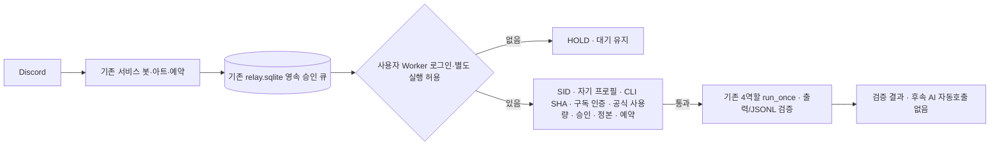

# 부팅 중계 + 사용자 AI Worker — 오프라인 연결 완료 / 실행 비활성

현재 **OFFLINE_CONNECTED_EXECUTION_DISABLED / MANUAL / 실제 AI0**입니다. 기존 운영 DB에 Worker 전용 표4개를 연결했고 기존12개 표의 내용 보존을 확인했습니다. 이 폴더는 부팅 서비스에서 import하지 않으며 실행/자동시작 CLI가 없습니다. `status.py`는 같은 운영 DB를 mode=ro로 읽습니다. ProgramData 별도 무결성 목록의 실행 허가와 자동 시작은 false입니다.

## 구조

`durable_queue.py`는 같은 SQLite 안의 `user_worker_jobs`, `user_worker_lock`, `user_worker_checkpoints`, `user_worker_handoffs`를 사용합니다. **운영 migration 완료**, 등록 업무0건입니다. 중계 쪽은 `enqueue`로 기존 정확한 SHA 승인이 있고 미소비·미만료인 계획만 저장합니다. 로그인 전에는 모델·인증·사용량을 호출하지 않습니다. 기존 Discord slash command 변경·봇 재시작은 하지 않았습니다.

승인 없이 일반 메시지를 실행 큐에 넣지 않습니다. 승인 만료·소비·계획 변경은 `WAITING_REAPPROVAL`로 남기며 자동 연장·새 승인 발급·기존 슬롯 삭제를 하지 않습니다. 현재 승인 TTL10분을 유지하므로 로그인까지 오래 걸린 계획은 다시 승인해야 합니다. 기존 역할 실행기의 고정 단발 슬롯도 그대로이므로, 소비된 과거 4역할 시험을 재사용할 수 없습니다. 지속 운영용 새 슬롯 발급 정책은 별도 검토가 필요합니다.

## 로그인 후 처리

- `UserWorker.once` 기본 `released=False`는 **어떤 인증/네트워크/CLI callback 이전에 HOLD**합니다. 이번에 `released=True` 실행 CLI나 자동 시작 등록을 만들지 않았습니다. 실제 A 모드도 변경하지 않습니다.
- 실제 adapter를 사용할 때 SID/프로필은 기존 Windows 토큰 조회에서, Session은 Windows API에서 얻습니다. Session0·서비스 계정·관리자 토큰·다른 CODEX_HOME·다른 배정 SID는 차단합니다. 자기 HOME/USERPROFILE/CODEX_HOME만 하위 CLI에 지정하고 다른 계정 비밀은 복사하지 않습니다.
- Worker가 로컬에서 선택한 절대 CLI 경로/SHA를 처음과 실행 직전에 확인합니다. ProgramData 별도 목록에 기존38개·진단4개·Worker5개·일반 사용자 CLI/동반exe4개를 고정했습니다. 실제 adapter는 실행 허가가 false이면 먼저 HOLD합니다. 큐가 실행 파일 경로·명령·모델 옵션을 지정하지 않습니다.
- `official_authenticate`, `official_usage`, `official_source_refs`는 기존 CLI 로그인 상태·App Server·GitHubReader의 adapter입니다. 이번에는 모두 모의 callback으로 검증했으며 실제 호출하지 않았습니다. usage UNKNOWN/소진/미허용/만료, 정본 변경, paused/role pause, 예약 마감, 다른 RUNNING 업무면 실행하지 않습니다.
- SQLite singleton claim으로 여러 사용자 Worker의 동일/다른 업무 동시 실행을 막습니다. preflight 중에도 두 번째 worker는 HOLD합니다. 프로세스 중단 후 남은 claim은 자동으로 빼앗지 않습니다. 담당자가 기존 프로세스 종료·결과/소비 여부를 확인하기 전 전체 Worker를 HOLD합니다. 자동 재시도·불명 lease 재발행0.
- 최종 실행은 기존 `collab.real_roles.run_once`를 그대로 호출합니다. PlanningAgent/CodexAgent/NewArtAgent/RenewalArtAgent의 승인·90초·단일 턴·읽기전용·금지 도구·최종 JSON/JSONL·토큰 기록을 재사용합니다. VERIFIED는 기존 검증을 통과한 경우에만 가능합니다. 이 worker의 `DONE`은 실제 응답 검증을 대체하지 않습니다.
- 성공한 기존 task의 TECH_PASS/계획SHA/역할을 확인한 뒤 기존 `auto_handoff`로 후속 업무만 만듭니다. NewArt/Renewal→Codex→Planning→대표 검토라는 기존 규칙을 재사용합니다. 후속 AI 승인이나 연쇄 호출은 만들지 않습니다.
- 실패/결과불명은 NOT_VERIFIED이고 재시도하지 않습니다. preflight HOLD와 결과를 전용 체크포인트에 기록하고 기존 control_outbox에 고정 보고를 넣습니다. 기존 봇의 전송 경로를 재사용하며 Worker는 Discord 토큰을 읽거나 직접 게시하지 않습니다. 운영 DB에는 테스트 보고를 넣지 않았습니다. 상시 polling·운영 backoff·자동 시작은 미등록입니다.
- `runtime_adapter.py`가 기존 run_once의 exec 호출만 감싸 자기 사용자 프로필에 DPAPI 원본 로그를 남깁니다. 버전/로그인 상태 원문은 기록하지 않습니다. timeout의 부분 출력도 보존하며 파서/허용 도구는 변경하지 않습니다. 실제 사용자 추론에서의 기록 실증은 아직 하지 않았습니다.

## 지금 가능한 것과 아직 안 되는 것

| 항목 | 상태 |
| --- | --- |
| 기존 PIN 없는 봇·아트·예약·SQLite | 기존 구성 유지, RUNNING 상태 확인 |
| 같은 DB에서 승인된 계획 영속 보관/중복·만료·소비 차단 | 운영 표 연결 완료, 업무0건·실행 비활성 |
| 사용자 로그인 전 AI HOLD | 기본 차단 구현, Worker 서비스 미등록 |
| 로그인 후 인증/usage/승인/정본 재검증 + 기존 4역할 실행기로 전달 | adapter·상태 머신 준비, 모의 검증만 완료 |
| 운영 사용자 Worker 자동 시작·상시 처리·실제 VERIFIED | 미배포·미실증·별도 실행 승인 필요 |
| 소비된 시험 슬롯 재사용·만료 승인 자동 연장 | 금지, 구현하지 않음 |
| 로그인 전 현 개인 구독으로 안정적 Session0 추론 | 미확인. 원인 UNKNOWN 유지 |
| 실패 보고와 역할 인계 | 기존 outbox/auto_handoff에 연결, 모의 전송·인계 검증, 실제 외부 게시0 |
| runtime pinning·private 로그 | 별도 목록·로그 adapter 연결 완료, 실제 추론 실증 미수행 |

## 무호출 상태 확인

기존 Tools/DiscordAICollab의 Python으로 다음 파일을 실행하면 운영 DB를 읽기 전용으로 확인합니다. 모델·인증·usage·네트워크·migration은 없습니다.

`../DiscordAIUserWorker/status.py`

오프라인 테스트: 같은 Python으로 `../DiscordAIUserWorker/test_queue.py -q`. 합성 SQLite/모의 함수만 사용합니다. 이 테스트의 PASS는 실제 AI VERIFIED가 아닙니다.

## 부팅 승인 충돌 — 내용 등록으로 정합성 복구 완료

`boot-service.ps1`의 `collab/*.py` 전체 검사 자체는 변경하지 않았습니다. 대표의 명시 승인 후 기존 ProgramData map에 검토 SHA4개만 추가했고, 기존Python38개 및 나머지 승인 필드와 ACL/소유자를 보존했습니다. 현재Python42개 검사 불일치0입니다. 기존 작업을 시험 재시작하지 않았으므로 실제 재부팅 성공 검증을 뜻하지는 않습니다.

이전 파일 이동 제안의 거부를 우회하지 않았습니다. 이번에는 별도로 승인된 정확한 SHA 등록 방식만 수행했습니다. 새 Worker 목록은 `C:\ProgramData\LimitlessRelay\user-worker-integrity.json`이며 실행 허가·자동 시작=false입니다. 제안 JSON은 당시 검토 정본으로 보존하고 실제 등록 결과는 `data/user-worker-registration.json`, DB 연결 결과는 `data/user-worker-connection.json`에 기록했습니다.

## 실제 읽기 전용1회 전에 남은 조건

현재 기존 실행기가 허용하는 단발 슬롯12개가 전부 CONSUMED입니다. 과거 슬롯을 지우거나 재활용하지 않습니다. 새 슬롯을 승인 가능한 형태로 지원하려면 기존 실행기의 범위 제한을 유지한 확장과 해당 코드 SHA 재검토가 먼저 필요합니다. 이번에 기존38개를 수정하지 않았습니다.

이후 새 단일 계획SHA·역할·읽기 범위·90초·1회·게시 범위를 대표가 승인하고, 일반 사용자 SID/완전CLI pin·원본 로그 저장·해당 사용자 identity를 확인해야 합니다. 실행 허가를 특정 시험에 한해 별도로 열고 Windows 로그인 후 공식 인증/5시간·주간usage/정본/예약/미소비 승인 gate를 다시 확인합니다. A모드나 자동 시작을 켤 필요는 없습니다. 이번에는 실제 시험을 하지 않습니다.

## Session0 재검증 기준선

기존 [최종 환경 조사](../../문서/00_프로젝트/ServiceBatch_Environment_FinalDiagnosis_20261024.md)를 유지합니다. 양쪽 표시버전0.164.0-alpha.11.1, 일반 사용자 exe SHA1103e9e0…/서비스c6144bc1…, 서비스 폴더 단독exe/일반 설치 동반파일3개, 일반 model gpt-6.1-sol/과거 서비스 명시모델없음, exec ignore-user-config/read-only/never·금지 도구 비활성, 일반 프록시없음·DNS/TCP443성공/서비스 당시 전체 proxy·추론 통신 미기록, keyring+Session0 지원 안정성 미확인, Operational 비활성화. 어떤 항목도 turn.failed 원인으로 확정하지 않습니다. 다음 시험은 새 별도 승인·단발90초·자기 계정 DPAPI 원본로그 보존 계획으로만 검토합니다.

## 향후 PIN 없는 공식 방식 검토

[공식 비대화형 실행](https://learn.chatgpt.com/docs/non-interactive-mode)은 저장 ChatGPT 인증을 재사용하는 CLI 자동화를 안내합니다. 이것만으로 현재 Session0/keyring 조합의 성공이 보장되지는 않습니다.

[Codex access tokens](https://learn.chatgpt.com/docs/enterprise/access-tokens)는 Business/Enterprise workspace의 비대화형 CLI/App Server용 공식 경로입니다. 현재 계정의 workspace/권한/사용 가능 여부는 확인하지 않았습니다. 일반 개인 구독에서 그대로 쓸 수 있다고 보고하지 않습니다. 이는 Platform API키와 다른 자격 증명이며 토큰 생성·로그인 전환·자동 활성화0입니다.

[Workspace service accounts](https://learn.chatgpt.com/docs/enterprise/service-accounts)는 조직의 headless Codex용 공식 구조지만 문서상 pay-as-you-go 계획에만 제공됩니다. Windows 로컬 LIMITLESSRelaySvc와는 다른 계정 개념입니다. 비용·계약 검토 없이 도입하지 않으며 이번에 유료 API/계정/과금 변경0입니다.
