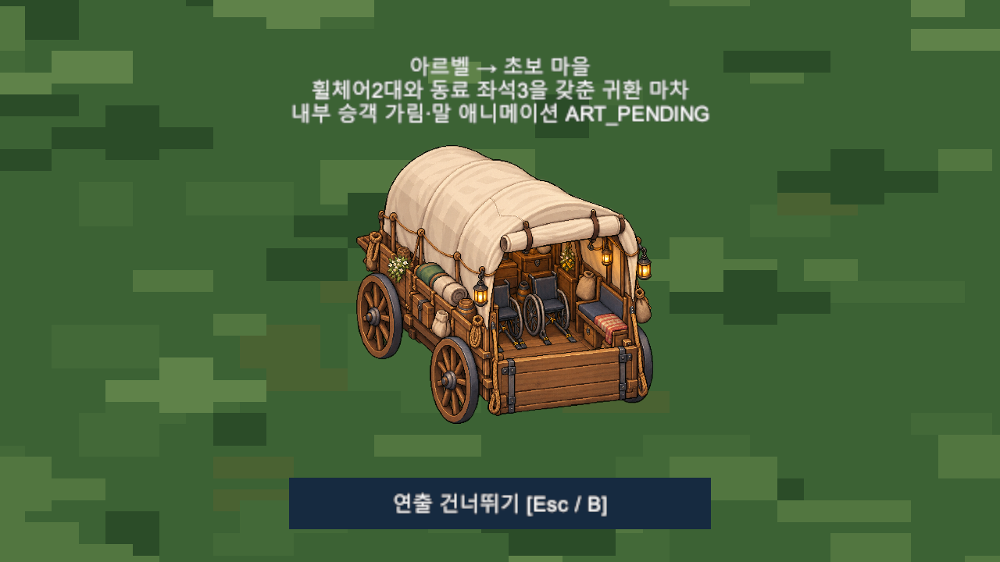

# Chapter2 Main12〜21 종합 회귀 QA — 2026-10-12

**전체 PARTIAL.** Main20/21 정상 전투 UI 명령 경로·마차·Continue를 우선 검증하고 Main12〜19 순차 Quest 서비스와 서브9종으로 회귀를 확대했다. 새 게임 기능 수정0. 기존 Unity Search 내부 예외는 별도 미해결로 유지한다. 전체 수동30〜45분 플레이·전 직업/레벨 밸런스를 PASS로 표시하지 않는다.

## 현재 구현·환경·입력의 구분

HEAD 기준240dbad의 Main12〜21·Chapter2 전리품7종·서브9종·BGM 정본·각 Runtime 보고서를 확인했다. Main22는 미구현. 최신 하렌 아트와 세린 전투 아트, 정상 TTS25개가 포함된 현재 LOCAL Assets를 기존 `Temp/Field01RenewalQA/Client`에서 검증했다. 원본 Editor PID31832 무접촉, Scene전환/강제Play/포커스/ComputerUse0. 모든 Batch는 Hidden, 별도 Save/Settings, MuteAll/스피커0. 사용자 실제 저장 슬롯을 선택하지 않았다.

**실제 UI 자동 전투:** 실제 Battle SceneController의 Attack Button.onClick와 대상 CombatantView.HitArea.onClick를 호출하고 기존 피해/AI/TurnQueue/승패/보상/귀환이 정상 실행되게 했다. HP·공격 수치·EndBattle 승리 결과를 주입하지 않았다. OS 키/마우스를 누른 사람 플레이와 구별한다. TimeScale8은 이 정상 큐 전투를 빠르게 관찰하기 위한 격리 설정이며 실제 사용자 속도/연출 타이밍 승인은 아니다.

**분기/서비스 시험:** 선행 퀘스트/레벨/파티 fixture, 위치 이동/interaction 호출, 도망/전멸·EndBattle 결과 주입, Save I/O/로드 실패 주입, 순차 Notify API는 해당 표시로 구별한다. 이 경로의 PASS를 일반 턴 전투 승리 또는 도보 완주로 확대하지 않는다.

## Main별 판정

| Main | 전체 | 새 자동 Runtime/정적 검사 | 실제 UI 정상 전투 |
|---|---|---|---|
| Main12 | PARTIAL | Quest 순차 목표/중복/완료 서비스 | NOT_VERIFIED (이번 전체 일반 플레이 없음) |
| Main13 | PARTIAL | Quest 순차 목표/중복/완료 서비스 | NOT_VERIFIED (이번 전체 일반 플레이 없음) |
| Main14 | PARTIAL | Quest 순차 목표/중복/완료 서비스 | NOT_VERIFIED (이번 전체 일반 플레이 없음) |
| Main15 | PARTIAL | Quest 순차 목표/중복/완료 서비스 | NOT_VERIFIED (이번 전체 일반 플레이 없음) |
| Main16 | PARTIAL | Quest 순차 목표/중복/완료 서비스 | NOT_VERIFIED (이번 전체 일반 플레이 없음) |
| Main17 | PARTIAL | Quest 순차 목표/중복/완료 서비스 | NOT_VERIFIED (이번 전체 일반 플레이 없음) |
| Main18 | PARTIAL | Quest 순차 목표/중복/완료 서비스 + 과열/냉각약 규칙·Catalog12/오류10 제외 | NOT_VERIFIED (이번 전체 일반 플레이 없음) |
| Main19 | PARTIAL | Quest 순차 목표/중복/완료 서비스 + Catalog13 GUID/원본 WAV hash | NOT_VERIFIED (이번 전체 일반 플레이 없음) |
| Main20 | PARTIAL | Quest 순차 목표/중복/완료 서비스 + 실제 조사/보상/패배재시도/Bootstrap Continue | PASS: Lv15 투사+세린+미엘, Attack→HitArea→정상 TurnQueue,19회 |
| Main21 | PARTIAL | Quest 순차 목표/중복/완료 서비스 + 퍼즐·마차·하렌·5Path·완료/Continue | PASS: A/B 각각7회 Attack, 자유3인 편성 |

[개별 범위 매트릭스](Chapter2_Main12_21_Integrated_QA_Matrix_20261012.csv). Main12〜19 모든 Scene/일반전/입력 동선 완주는 NOT_VERIFIED. 기존 [Main17 밸런스](Main17_Balance_QA.md)40회·[Main18](Main18_Final_QA.md)·[Main19](Main19_Final_QA.md)·[Main21](Main21_Implementation_QA_20261010.md) 증거는 기존 결과로 재사용하며 새 결과 날짜로 바꾸지 않는다.

## Main20 우선 검사

Lv15 투사(hearing)+세린(후열)+미엘(후열), Field11 현재 조우에서 Attack19회로 실제 승리. 종료 HP160/100/56, BossHP0. Phase2 전환1회, 실제 VictoryReturn로 Field11 복귀/목표7 확인. 이 하나의 구성으로 모든5Job/레벨 난이도를 승인하지 않는다.

별도 분기 시험에서9목표 실제 조사/대화, 선행Gate/Collider·예고/2Phase 모델·도발/전열·파수 장막 회귀, 과열3/최대HP8%·냉각약 유효/무효 소비, 전리품7종 드롭 경계·중복 정체성·스택99·판매가, 보스도망 차단·패배/재도전·전투Talent40/Quest80·완료EXP100/중복보상0, AtRift/AfterBoss/Completed Bootstrap Continue의 Quest·위치·Talent·편성/행·펫·Inventory·HP/MP·Lv/EXP/Path 정확 복원 확인.

## Main21 전투·귀환·하렌

두 조우A/B 실제3인 vs 기존 몬스터2인, 각각 Attack7회 정상 큐 승리. A는 폴/태온, B는 세린/미엘 선택 편성. 기존MonsterDefinition/HP/전후열 확인. 도망·전멸 분기는 조건 주입으로 Quest/보상 미진행·재도전 확인, 승리 후 Bootstrap Continue와 중복 보상 차단 확인.

실제3단서/부분Continue/오답 무손실/정답1회·레온 기존업무 선택·주민지원/인벤토리 소비0 통과. 마차 No/Yes·중복 수락·Skip2회·정확 Spawn·도착Continue·일반 마을 진입의 미완료·늦은 Player·도착요청중 Continue·Save I/O 실패/로드 실패의 출발/입력 복원·수락후Continue의 자동출발0·**정상12초 동일도착** 통과. 실제 하렌 첫 등장 대화·Roster불변, 완료보상EXP100/Talent60 한번, Main22 자동 진입0, Completed Continue·다른 슬롯2〜5 불변.

처음 실행은 통과한 전투/Skip/Continue 뒤 `Main21VillageAuditChecks`의 구형 Temp/Main21QA 경로 guard로 중단됐다. 원본 게임 코드는 보존하고 격리 보조 검사만 현행 복사본 경로로 수정했다. 초기 실패·소스·로그를 보존하고 CarriageArrived Save부터 잔여 검증 재개; 통과한 전투를 불필요하게 반복하지 않았다. 마을 환경302(활성300/비활성2)·15종·NPC/Marker·접근공간·남문과 Missing검사는 별도 assertion에 기록했다.

## Main12〜19·서브·음성 보호

현재21개 메인의 순차 이벤트/중복 경계를 서비스로 진행하여 Main12〜21 완료 확인. 서브9종은 실제 World_StarterVillage/Arbel NPC 선택/수락·보유재료·판매감소/부족/납품원자성·보상중복·QuestLog·실제 Bootstrap Continue/구형Version1·5슬롯 검증했다. 이 서비스 반복 fixture를 Chapter2 단일 캐릭터 통합 완주로 표시하지 않는다. 새 Chapter2 완료 Lv/Talent 실측 표본은 아직 없으며 Chapter3 수치 설계 근거로 임의 사용하지 않는다.

Main18 정상12·Main19 정상13은 재통합/재생성0. Catalog280개 ID고유, 정상25개 DialogueID/Speaker/GUID/WAV SHA256 모두 새 정적 검사 PASS. 오류10개는 Catalog에 없음/REGEN_REQUIRED 유지. 실제 Story/DSP 출력·문제10개 무음/다음 페이지·조건부 폴/미엘/태온·Mixer/Mute/빠른Next/자연종료/Scene전환·Continue·기존255개 resolve/play는 [오늘 이전 승인 작업](Main18_19_TTS_Selective_Integration_QA_20261012.md)의 Runtime 증거를 재사용한다. ASR은 사람 의미 청취 승인을 대신하지 않는다. 추가 청취5항목·문제10개 Schedar 샘플 재제작 인계 유지. Main20/21 TTS_PENDING은 의도된 미적용이며 이번 API 호출0.

## 원시 결과·실패 분류

| 결과 파일 | PASS assertion 수 | FAIL 줄 수 |
|---|---:|---:|
| `main20_ui_results.txt` | 11 | 2 |
| `main20_branch_results.txt` | 150 | 2 |
| `main21_first_results.txt` | 162 | 1 |
| `main21_resume_results.txt` | 58 | 1 |
| `main21_console_errors.txt` | 0 | 0 |
| `village_checks.txt` | 335 | 0 |
| `side_main_service_results.txt` | 588 | 2 |
| `main18_rules.txt` | 242 | 0 |

수는 반복된 Scene/fixture 표식을 포함하며 고유 케이스 수가 아니다. Main20 두 실행과 SideQuest의 최종 ConsoleErrors0 assertion은 **실제로 FAIL**했고 원문을 보존했다. Main21 역시 Console.Errors1을 기록했다. 원인은 로그의 `UnityEditor.Search.SearchDatabase/IndexationOnStartup ArgumentOutOfRangeException`; 해당 기존2이슈를 새 게임 회귀로 바꾸지 않는다. 기능 PASS와 Audit 프로세스 FAIL/PARTIAL을 함께 보고하며 ALL PASS로 숨기지 않는다. Main21 의도적 Save 경로파일 I/O 실패는 EXPECTED_ERROR.

원시 로그(삭제0): `Temp/Urgent20261012/main20_normal_attempt1.log`, `main20_branches_attempt1.log`, `main21_attempt1.log`, `main21_resume_attempt1.log`, `side_main_services_attempt1.log`. 재실행 소스/결과는 [Evidence](Evidence/Chapter2Integrated_20261012/assertion_summary.json), [첫 Main21 실패](Evidence/Chapter2Integrated_20261012/main21_first_results.txt), [재개 결과](Evidence/Chapter2Integrated_20261012/main21_resume_results.txt), [Search 원문](Evidence/Chapter2Integrated_20261012/main21_console_errors.txt), [Voice35개 정적 회귀](Evidence/Chapter2Integrated_20261012/voice_static_regression.json).

## 남은 위험과 다음 작업 TOP5

1. 기존 Unity Search 내부 예외 별도 조사. 현재 게임 기능 신규 blocker0; 원본 Editor 변경 없음.
2. Main12〜19 실제 전투 UI/도보 연속 플레이와 Main20/21 전 직업·Path/레벨 밸런스 확대. 현재5Path 정보 검사와 한 전투 구성을 전조합 승인으로 확대하지 않음.
3. 사용자30〜45분 체감 플레이·마차 가림/휠체어 위치·텍스트/음성 의미 청취. 자동 Runtime만으로 승인 대체 불가.
4. Main20/21 TTS는 별도 제작 승인 후 진행. Main18 오류10개만 Schedar1샘플→사용자 승인→나머지9; 이번 API0.
5. Chapter2 실제 완료 Save의 Lv/Talent/약/펫 구매 표본을 수집한 뒤 Chapter3 미정 경제/수치 확정.

원본 Assets/Packages/ProjectSettings **3661파일 SHA256 불변/삭제0**, 기존 사용자337상태 보호. [보호 검사](Evidence/Chapter2Integrated_20261012/protection.json). Scene·승인아트·WAV·meta/GUID·기존Save 규격·파티·전투 기능 변경0. 문서/증거만 선택적 Commit, Push0.

[Main20 UI 원시 로그](../../Temp/Urgent20261012/main20_normal_attempt1.log) · [Main20 분기](../../Temp/Urgent20261012/main20_branches_attempt1.log) · [Main21 최초](../../Temp/Urgent20261012/main21_attempt1.log) · [Main21 재개](../../Temp/Urgent20261012/main21_resume_attempt1.log) · [Main/서브 서비스](../../Temp/Urgent20261012/side_main_services_attempt1.log).
