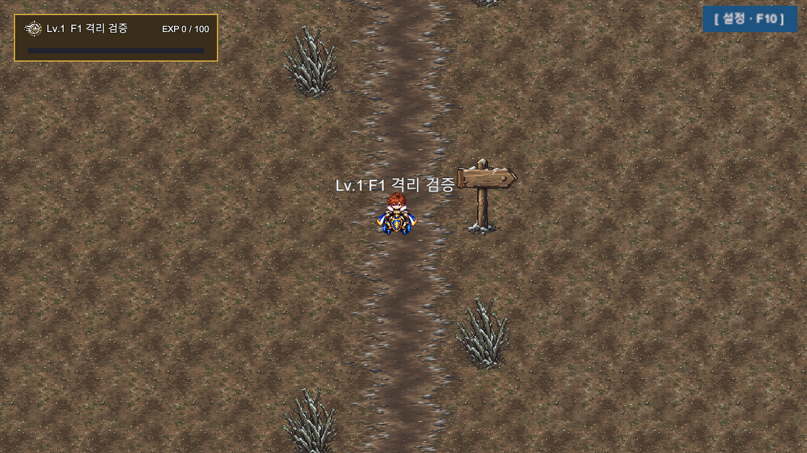

# Chapter3 F1 승인 환경 Unity 기술 검증 및 Main22 구현 준비 — 2026-10-21

**결과: 격리 Unity 64 PASS / 0 FAIL, 최종 컴파일 오류0 / 신규 Runtime 오류0, 정상 종료 확인. Main22 구현 준비 완료. 원본 적용 및 본편 Main22 구현은 미실행.**

## 실제 Unity 결과

| 범위 | 결과 |
|---|---|
| 승인6 PNG/Import | SHA 전부 승인값 일치,6개 Sprite/256RGBA/PPU128/Pivot 실 Import 값 확인 PASS |
| GameView | 1280×720(16:9),960×720(4:3),1680×720(21:9) 실제 GameView 렌더 타깃 캡처/요청 해상도 일치 PASS |
| Tile 접합/Sorting | 실 Tilemap의 흙→합성전환→서리 표시, 길·소품·Player 표시 및 missing Sprite/Script0 PASS |
| 통행/충돌 | 도보·휠체어 각각 남북/복귀·표지 접근·관목 우회·관목 차단·출구 아닌 외곽 차단 PASS |
| Camera | Player 추적 연결, 화면비별 네 모서리12검사 및 중심 viewport Bounds PASS, 캡처 바깥 마젠타 노출0 |
| Scene/Spawn | QA F1→마을 북문 fixture→F1 실제 Trigger 왕복/안전 Spawn/재전환 없음/없는 Scene 거부 PASS |
| Save | 격리 슬롯 저장·유효 읽기·Version1/Scene/좌표 일치·실 위치 복원·옛 좌표 없는 Spawn fallback PASS |

**캡처는 실제 Unity Play Mode/GameView 전체 카메라·GUI 렌더 경로입니다. 오프라인 합성이 아닙니다.** OS 창 스크린샷은 아니며 창 Show/Focus/활성화 없이 메모리 GameView/HostView의 RenderTexture를 읽었습니다. GPU 좌표 원점에 따른 저장 행 순서만 정규화했고 원본 PNG 픽셀은 바꾸지 않았습니다. 접합 확대 이미지는 **별도 Unity Camera.Render RT**로 명시합니다.

GameView 내부 렌더/크기 전달 경로는 [Unity 공식 참조 소스](https://github.com/Unity-Technologies/UnityCsReference/blob/master/Editor/Mono/PlayModeView/PlayModeView.cs)와 설치 Editor reflection으로 확인했습니다. 세 프레임 번호가 증가하는 실제 Play Mode에서 촬영했습니다. 단순 정적 Pillow 배치와 구분합니다.

[4:3 실제 GameView](Evidence/F1UnityPreflight20261021/GameView_960x720.png) · [21:9 실제 GameView](Evidence/F1UnityPreflight20261021/GameView_1680x720.png) · [Unity Camera RT 전환부 확대](Evidence/F1UnityPreflight20261021/UnityCamera_RT_TransitionJoin.png)

초기 캡처 도구에는 Batch GameView 부재/렌더 타깃 수명 문제와 D3D12·D3D11 native crash가 있었습니다. 제품 결함으로 숨기거나 초기 실행을 PASS로 쓰지 않았습니다. 마지막 실행에서는 타깃을 유효하게 연결하고 모든 Scene/Save 검증 이후에만 생성하여 **64/64 통과 및 정상 종료**했습니다. 원래 SearchDatabase 인덱스 예외는 기존 Editor 환경 오류로 분리했고 [최종 Console 원문](Evidence/F1UnityPreflight20261021/console_errors.txt)을 남겼습니다. 최종 F1 도구 컴파일 오류와 신규 제품 Runtime 오류는0입니다.

검증 내역 [checks.txt](Evidence/F1UnityPreflight20261021/checks.txt), [실측 Import/기존 북문 상태/프레임](Evidence/F1UnityPreflight20261021/observations.txt), [수치/캡처 SHA](Evidence/F1UnityPreflight20261021/Result.json).

## 승인 및 범위

- 바울 대표 승인: F1 환경6종 최종 미술 승인. ZIP `Limitless_Chapter3_NorthF1_Environment_6_TargetedFix_v3.zip`, SHA256 `488a65c051d1d017787771e0169124e47437b472911caa9949fdd59e55079054`.
- [Issue #35](https://github.com/HappyPaul812/Project-Limitless/issues/35#issuecomment-6307813105) 및 [최신 기획 승인 정본](https://github.com/HappyPaul812/Project-Limitless/blob/docs/planning/문서/00_프로젝트/20261021_Wolfv5_And_NorthF1v3_UserArtApproval_NextImplementationGate.md) `c0130e5030a04ddb0a904b1fb33097c918d223cb` 확인.
- 브랜치 `codex/chapter3-f1-unity-preflight-20261021`. 기준 commit `a6472c51054fdc6933cb065c21a9438d041b1595`.
- 기존 F1 Delta QA와 Main21 구현·Scene/Spawn/Save 구조 및 Issue35 갭 목록을 재사용했습니다. 서리들쥐 전투40PASS는 재검사하지 않았습니다. 별도의 완료된 Main22 기술 보고서는 현재 Issue35 댓글/로컬 문서에서 확인되지 않아, 기존 코드 계약을 기준으로 이번 F1 차이만 검증합니다.
- 격리 worktree의 `Assets/_Project/QA_F1/`에만 승인 PNG 사본·임시 씬·타일을 생성했습니다. 정식 Main22 퀘스트/Objective/Encounter/보상은 생성하지 않습니다.

## 승인 PNG / Import 계약

| PNG | SHA256 |
|---|---|
| NorthF1_EarthToFrost_Transition_Overlay_v3.png | `93126dd1cda0f3b97823ae4756344600ed7f6af619eb42013d1ec45a4933c4d1` |
| NorthF1_Ground_Earth_Base_v2.png | `ccf2c22e90bee292ecf2d0d030dad53e0032457272ebb94fccdf6491fabcf8b9` |
| NorthF1_Ground_ThinFrost_Base_v3.png | `12fe03d156944e1b72aec4e807770ee8016c61fe1de5804366819e716b97c30c` |
| NorthF1_Path_WornTrail_Overlay_v2.png | `e78b41d48707dfce6a79dd4e826f864c5c2608b45a0f457af414ee9768a20175` |
| NorthF1_Prop_FrostShrub_01_v2.png | `6c83c88881e7f89245ed580d50424b2671629ad9491da93f247aab99bfe4746e` |
| NorthF1_Prop_Waymarker_01_v3.png | `6e55b64dbc2e906a50cf8b7310849bb156a90bc40436f28a86832e59e232b589` |

- 승인 ZIP CRC와 PNG6 SHA를 직전 검수/기획 승인값에 재대조. PNG 재인코딩/리터치0.
- 기존 Chapter2 공식 환경의 PPU128 기준을 재사용. Sprite Single, PPU128, 256×256 RGBA, FullRect, Point, Uncompressed, NoMip, Clamp, NPOTNone.
- 지면/전환/길 Pivot `(0.5,0.5)` =128,128px. 관목은 하단 투명14px을 뺀 `(0.5,14/256)`, 표지판은12px을 뺀 `(0.5,12/256)`를 접지 후보로 사용했습니다.
- Grid cell `(2,2,1)`, Tilemap anchor `(0.5,0.5,0)`: PPU128의256px이2유닛을 차지합니다. 지면·전환 타일은 Collider 없음. 전환부는 허가된 1방향, 흙→흙+Overlay→얇은서리 조합입니다.
- Sorting Default 레이어의 순서: 지면 -20 / 전환 -19 / 길 -10 / 소품1 / 기존 Player5. 원본 캐릭터의 Sorting은 보존했습니다. 이는 시험 계약이며 향후 큰 소품의 Y깊이 정렬을 모두 해결했다는 뜻은 아닙니다.

## 길·Collider 시험 후보

- 기존 PlayerPlaceholder의 CircleCollider2D radius0.5, Transform scale1을 도보·휠체어 모두 사용합니다. Path는 외형 선택이며 Collider 축소로 통행 문제를 숨기지 않습니다.
- 승인 흙길에서 alpha≥128인 가로 픽셀 수 합계는 행별68–101px이고, 실제 가장 긴 **연속 구간은62–93px**입니다. 끊긴 픽셀을 합산해 폭을 부풀리지 않도록 연속 구간을 기준으로 사용합니다. PPU128/가로1배의 연속 폭은 최소0.484375유닛으로 지름1유닛보다 좁습니다.
- **최소 후보: PNG 무수정, 길 Transform scale `(3,1,1)`**. 진한 연속 가시 폭 최소1.453125유닛으로 Collider 대비 총0.453125유닛 여유. 최종 지도 배치의 곡선·코너 폭은 Main22 실제 제작 때 추가 계측해야 합니다.
- 소품은 길 중심 밖 x±1.9. 관목 발 Collider0.8×0.35, 표지판 발0.5×0.35, offsetY0.17. 가장 가까운 관목 사이 직선 통로폭3.0유닛. 잎/화살판 전체 이미지 박스를 장애물로 만들지 않습니다.
- QA 지도 Bounds32×24, 네면 경계 두께0.4, 남쪽 실제 Exit만 폭3 개방. 원본 마을의 지도 규격을 바꾸는 계약이 아닙니다.
- 물리 시험은 기존 PlayerController.FixedUpdate의 이동 처리에 감사 방향 값을 공급하고 Physics2D.Simulate로 실제 충돌을 계산합니다. OS 입력/사용자 포커스 조작은 없습니다. 사람 키보드·게임패드 손플레이와 구분합니다.

## Main21 → F1 Scene·Spawn·Save 계약 차이

| 구간 | 기존 상태 / 필요한 최소 변경 |
|---|---|
| Main21 완료 | 기존13목표/보상/TTS/펫 서비스 보존. `main_21_returning_warmth`의 `nextMainQuestId` 공란 유지 중. 이번에는 채우지 않음 |
| 북문 | `StarterVillageFieldConnection`은19×13 Bounds와 남문만 개방함. 현재 북쪽 실 SceneTransition 대상 없음. 후속 구현에서 북쪽 경계의 실제 Exit 구간만 분할 개방하고 Trigger/명시적 출발 상호작용 필요 |
| 전환 입력 | 기존 SceneTransitionTrigger는 겹침 즉시 자동 이동함. 기획의 ‘Main21 완료 후 자발적 명시 출발’에는 Quest 완료 게이트와 상호작용 확인이 추가로 필요. 이번에 제품 코드는 변경하지 않음 |
| 정식 ID | `World_NorthF1` 등은 제안이며 lock 아님. 이번 생성은 `QA_NorthF1`, `QA_VillageNorth`와 QA Spawn뿐. 정식 Scene/Quest/Dialogue/Encounter ID 확정은 후속 |
| Build 목록 | 새 정식 Scene을 BuildSettings에 등록해야 TryLoad/SaveValidate가 허용함. 격리 BuildSettings에만 QA2개 추가 |
| Spawn | 마을 Return과 북문 Trigger를 겹치지 않도록 배치. QA 후보 마을Trigger(0,6.1), ReturnSpawn(0,4.8); F1ReturnTrigger(0,-11.5), ArrivalSpawn(0,-9). 실제 본편 좌표 확정 아님 |
| Save | SceneTransitionService가 이전 좌표를 지우고 PendingSpawn을 전달, SceneSpawnPoint가 안전 배치 후에만 자동 저장. Version1/기존5슬롯/Legacy spawn fallback 유지 가능 |
| 기존 슬롯 | Main21 완료 저장에서 Main22 Available 복원은 빈 nextMainQuestId만 바꿔 끝나는 계약이 아님. 완료 후 옛 슬롯의 Quest 목록 재구성/중복 보상 방지/수동 출발을 후속 구현 시 별도 검증 |
| 첫5목표 | 진입/얇은서리/남하흔적2/서리들쥐1 지정전투/쉼터. 기존 ObjectiveType ReachLocation/Interact/DefeatEncounter/GenericSignal로 구현 가능하나 정확 targetID/보상/목표03 내부집계 방식 미잠금 |

**QA 마을 북문 씬은 연결 서비스의 시험용 fixture입니다. 실제 World_StarterVillage 북문을 뚫거나 Main22 본편 연결을 완료한 것이 아닙니다.** 실제 원본 마을은 격리 복사본에서 런타임 상태만 조회합니다.

## 후속 범위

F1 기술 후보 통과 뒤 별도 Main22 첫 플레이 구현 지시에서 정식 ID/북문 선택 게이트·Bounds/Scene등록/5목표·조우·Save·재방문을 연결합니다. 아직 Main23/24·새 몬스터·보스·한기·Quest 전체 구현을 시작하지 않습니다.

## 보호 및 Git

원본 Assets/Packages/ProjectSettings/UserData **4,351파일 SHA 전후 동일**, 원본 git status/HEAD 동일. 원본 Editor Bootstrap/Play OFF/포커스 없음/컴파일 없음/기존 dirty 상태 보존. 새 F1 PNG는 승인 바이트 그대로 격리 `QA_F1`에만 복사했습니다.

변경 파일은 격리 `Assets/_Project/QA_F1/`의 PNG6·Importer/meta·Tile3·QA Scene2, `F1UnityPreflight.cs` 감사 도구/meta, 본 보고/증거/상태/인계 문서입니다. 원본 Main21/Scene/Quest/Save/Player 코드를 변경하지 않았습니다. 원본에서 넘어온 기존 dirty 변경은 커밋하지 않습니다.

**원본 정식 적용 / main 직접 커밋 / Push / 병합 모두 미실행.** 최종 브랜치 commit은 완료 보고에 기록합니다. 다음 단계는 별도 Main22 첫 플레이 구현 승인 범위에서 정식 ID와 북문 선택 게이트를 잠그고 시험 계약을 실제 지도에 반영하는 것입니다.
