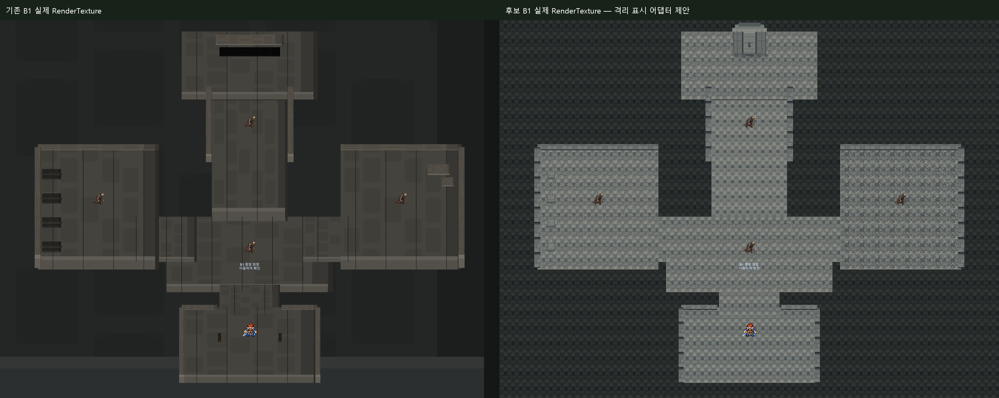
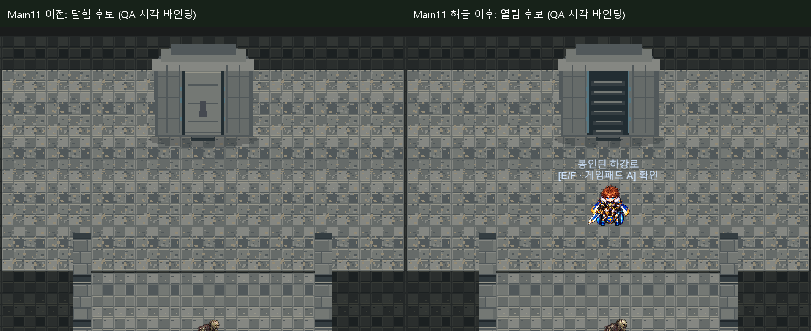
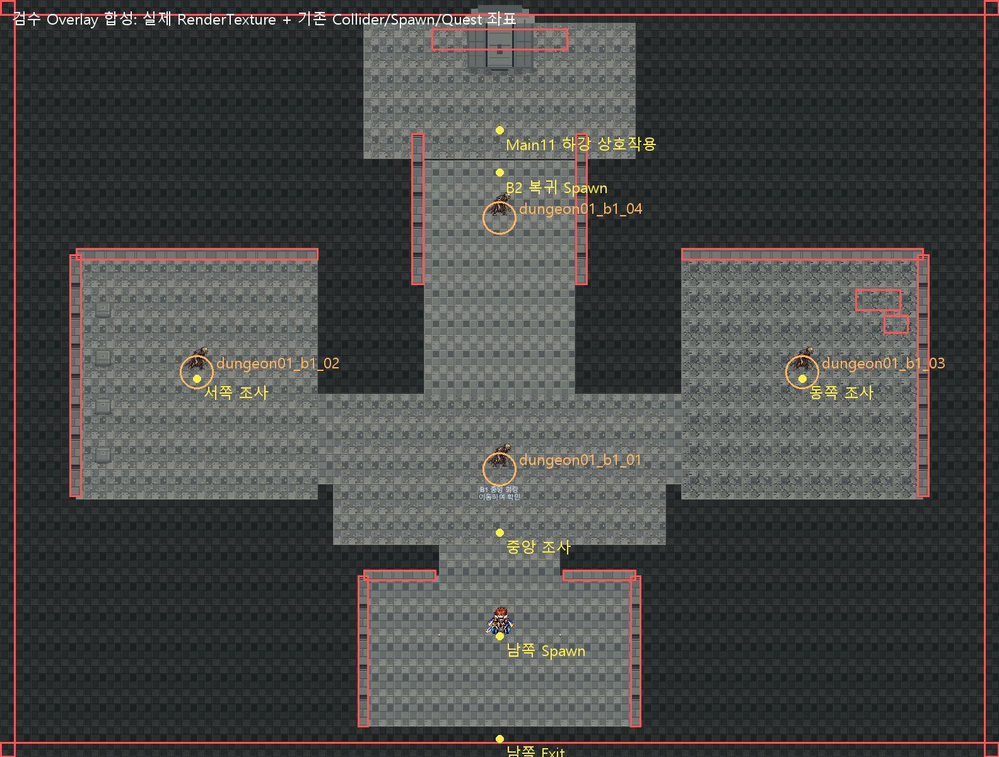

# Dungeon01 B1 리뉴얼 아트 v1 검수 — 2026-10-12

**USER_ART_REVIEW_PENDING / PNG·ZIP 기계 검사 PASS / 통합 기술·전체 Runtime QA PARTIAL / 원본 영구 적용0.** 실제 Unity에서 기존과 후보 비교를 제작했습니다. 신규25종은 격리 Import만 했으며 원본 Dungeon_01 Scene·자산·GUID는 변경하지 않았습니다.

## 핵심 판정

현재 Scene 환경은 **63 Renderer가 같은 석재1종**을 재사용합니다. 1:1 전역 교체는 안전하지 않습니다. 실제 단순 교체 화면에서도 바닥이 거대하게 늘어나고 벽·횃불·줄눈이 찌그러졌습니다. 이를 납품 PNG 손상이나 게임 기능 오류로 분류하지 않습니다. 역할별 표시와 반복 타일 통합 설계가 필요한 구조입니다.

검수 후보는 **격리 Runtime 표시 어댑터 제안**입니다. 원래63 Renderer의 Transform/Collider/Sprite/Sorting/Tint 데이터는 보존하고 표시만 숨긴 뒤 자식Renderer30개를 붙였습니다. 바닥/벽은 세계1유닛 반복, 소품은 기존면적 내부에 비율을 맞췄고, 겹치는줄눈29개/안치대뚜껑4개는 후보표시에서 제외했습니다. 봉인문만3×2.5 크기의별도시각 제안이며 기존Collider4.5×.7과일치하지 않습니다. 임시QA의문상태는Main11단계<4 닫힘/≥4 열림입니다. **이 상태별Sprite연결은현재게임에기존구현된기능이아니며QA제안입니다.**

정식 통합 시 반복처리/역할별비율/문상태표시/Collider시각일치 검증이 필요합니다. 원본PNG를 자동 편집하거나 기존게임에 임시 어댑터를 넣지 않았습니다. 미술 승인과 기술 통합 승인은 구별합니다.

## ZIP·Manifest·Importer

원본 `F:\Downloads\Limitless_Dungeon01_B1_Renewal_Art_v1.zip`: SHA256 `074f015c3de49457cd8288e1465bb29fc0f0549ed47d66a33fb2c0e9d224248a`. ZIP44항목, PNG38개 = 실사용25 + Preview11 + QA이미지2입니다. CRC오류0, PNG38개전체decode PASS, Manifest25개 파일명·해시·해상도·alpha bbox 일치, 예상PPU128/PivotCenter를 확인했습니다. 실사용25종의 실제Unity Single/PPU128/Center/Point/무압축/MipmapOff/NPOTNone Import와Sprite 존재를 확인했습니다. 격리 GUID 25개는 서로 고유하고 기존 원본 GUID와 충돌0이며, 원본에 등록0입니다.

기존Sprite `rpgTile152`은64×64/PPU64/중앙Pivot, GUID `e38fd353fd47c7644acb692973a9ee07`, fileID21300000으로1×1world입니다. Scene의StoneBase33×25와각방은이미Transform으로확대되어있습니다. 새128타일도1×1world이므로Sprite참조만바꾸면큰무늬1장이늘어납니다. Manifest의63개/공용GUID/fileID는실측과일치합니다.

Floor A/B/C의모든9쌍좌우경계와9쌍상하경계는RGBA byte가정확히같습니다. 실제Tiled화면에서연결을확인했습니다. 경계 일치는 반복 패턴이나묘실의밀도·눈피로에대한사람승인을대체하지않습니다.

[ZIP/PNG/Seam 감사](Evidence/Dungeon01B1Renewal_v1_20261012/zip_manifest_audit.json) · [격리 Importer/GUID](Evidence/Dungeon01B1Renewal_v1_20261012/isolated_imports.json) · [실제63개 Sprite 대응CSV](Evidence/Dungeon01B1Renewal_v1_20261012/sprite_mapping_63.csv) · [공급자 역할대응](Evidence/Dungeon01B1Renewal_v1_20261012/supplier_role_mapping.csv).

## 실제 화면과 공급자 합성 Preview

아래 비교는 실제Unity Camera.Render→RenderTexture입니다. 후보는메모리표시어댑터가적용된화면이며정식Scene저장결과가아닙니다. 화면밖HUD전체/OS직접입력검증과구별합니다. ZIP의Preview11개는공급자가명시한오프라인합성이며 원본/후보Unity실제화면으로취급하지않습니다.

[단순 교체의 실제 왜곡](Evidence/Dungeon01B1Renewal_v1_20261012/direct_swap_distortion_runtime.png) · [중앙 회랑 확대](Evidence/Dungeon01B1Renewal_v1_20261012/candidate_area_0_runtime.png) · [서쪽 안치실](Evidence/Dungeon01B1Renewal_v1_20261012/candidate_area_-10_runtime.png) · [동쪽 붕괴 묘실](Evidence/Dungeon01B1Renewal_v1_20261012/candidate_area_10_runtime.png).

기존봉인벽은(0,11.2), Main11하강상호작용은(0,8.2)로3유닛떨어져있습니다. 이번검수는좌표를변경하지않았습니다. 정식미술배정시기계장치/문/상호작용의관계와문시각3×2.5 대기존Collider4.5×.7을따로검토해야합니다. 현행코드는단계4이후상호작용으로B2를로드하며기존석재벽Sprite를열림PNG로바꾸지않습니다.

[B1 후보/기존 B2 실제 연속성 비교](Evidence/Dungeon01B1Renewal_v1_20261012/b1_b2_actual_continuity.png). B1의차가운회색·세밀한반복과B2의기존단순착색석재는질감밀도/색감차이가큽니다. B2자산은수정하지않았습니다. 공급자 [전체자산 Contact Sheet](Evidence/Dungeon01B1Renewal_v1_20261012/supplier_asset_contact_sheet.png)는합성검토자료입니다.

## Main11·전투·월드 Runtime

기존격리 `Temp/Field01RenewalQA/Client` 재사용, Unity6000.6.5f1 Batch/D3D, 별도 AuditSaveDirectory·Settings·음소거로실행했습니다. 원본Editor PID31832/화면/선택/PlayMode조작0입니다.

|검사|결과·범위|
|---|---|
|공간/환경|PASS: Bounds중심0/크기33×25, SceneRenderer63/원본Sprite1,기존환경복제0. 원본과후보의63행형상데이터차이0|
|Main11 B1|PASS: B1시작index0, 역순동쪽조사거절→중앙도착index1→서쪽실제대화index2/중복거절→동쪽index3→장치대화index4→열린하강로실제상호작용→B2도착index5|
|Save/Continue|PASS: 서쪽조사후/문해금후/실제왕복후의별도Save→BootstrapContinue3회, 목표index·실제위치정확복원|
|B1/B2왕복|PASS: 실제Main11하강상호작용, B2 Exit_To_B1 Trigger→B1 Spawn_From_B2(0,6.8)|
|일반전투4개|PASS: dungeon01_b1_01~04 실제Attack버튼/대상HitArea/TurnQueue/승리/귀환. 적HP·승패강제주입0|
|편성/리스폰|기존CreateDungeon01 분기와SpawnDefinitionbyte보존. 망자1 / 망자1+박쥐1 / 망자2 / 망자1+박쥐2 정책유지. 각4승리후35초전생성0·35초뒤각1개/최종4중복0 PASS|
|Field03왕복|PASS: 실제Rigidbody남쪽출구Trigger→Field03(.55,-2.65), 실제Main10입구상호작용→B1(0,-8.5)|
|휠체어|PASS: 지체의길외형/실제반경.5+margin.03, 조사·하강·Spawn6지점233waypoint와실제남쪽출구접근/전환. 동적몬스터Collider만검사중제외,새Scene에서복원. 원본Collider변경0|
|Quest Marker|실제중앙/봉인문문구표시확인. 회색바닥의밝은글자는질감과겹쳐최종가독성검토필요. 사람직접플레이·OS키/패드/전체HUD NOT_VERIFIED|
|Console|Compile오류0/Missing Sprite·Script0. 최종QA 신규게임오류0,기존Search.SearchDatabase/IndexationOnStartup예외재현으로PARTIAL|
|범위밖|B2보스전체/봉인실/석판/Main11완료·전직업/레벨/연속사냥밸런스는이번새검증 NOT_VERIFIED|

전투fixture는Lv18투사/지체의길·기존동료이며스폰별독립기본체력초기화입니다. 전투연출timeScale8/귀환1,리스폰은현행realtime35초를그대로측정했습니다. 네스폰생성관찰지연은약1.91~2.41ms입니다. Script/Trigger 자동호출과실제Rigidbody/실제전투UI경로를구별하며사용자의손플레이완료로확대하지않습니다.

## 실패 로그와 필요한 보완

1. 최초QA는Main11/B2하강/Continue2회를통과한후옛Builder의 `Exit_To_B1_Test`를찾아실패했습니다. 실제Scene은 `Exit_To_B1`/Spawn_From_B2였습니다. QA만수정,기존Story재실행0,실제B2도착Save에서귀환/남은검사를재개했습니다.
2. 재개QA는전투4개·35초·물리6지점을통과했고남쪽출구가자동작동한뒤사라진이전Rigidbody를계속읽어실패했습니다. 예상Scene교체를처리하지않은계측오류입니다. 게임수정0,앞선검사반복0,마지막출구/도착/재진입만다시확인했습니다. 새Scene이안정된뒤Field03정확Spawn과추가Continue가PASS입니다.
3. 원시실패/소스/로그를전부보존했습니다. Search는기존별도미해결2이슈로유지하며전체를PASS로부풀리지않습니다.

미술검토: 바닥패턴밀도·B2연속성, 작은석관/횃불의실제축소가독성, 얇은벽타일의절단비율, 봉인문과기존Collider·상호작용좌표의관계를확인해주세요. 석관뚜껑/줄눈분리처리와문상태바인딩은정식통합설계대상입니다. 공급자Preview의기둥·묘표·오버레이·장식추가배치는실제기존Scene과같지않으며이번에신규배치하지않았습니다.

[최초체크](Evidence/Dungeon01B1Renewal_v1_20261012/checks.txt) · [전투/접근 체크](Evidence/Dungeon01B1Renewal_v1_20261012/checks_resume.txt) · [마지막왕복 체크](Evidence/Dungeon01B1Renewal_v1_20261012/checks_final.txt) · [타이밍](Evidence/Dungeon01B1Renewal_v1_20261012/respawn_times.csv) · [QA 요약](Evidence/Dungeon01B1Renewal_v1_20261012/qa_summary.json).

## 좌표·보호·출처

Overlay는실제RenderTexture위에실측Collider/Spawn/Quest좌표를그린**설명합성**입니다. 빨강기존BoxCollider/주황Spawn반경/노랑주요위치이며게임화면의원래표시가아닙니다. [좌표CSV](Evidence/Dungeon01B1Renewal_v1_20261012/quest_spawn_coordinates.csv), [Collider/Spawn JSON](Evidence/Dungeon01B1Renewal_v1_20261012/colliders_spawns.json), [형상불변JSON](Evidence/Dungeon01B1Renewal_v1_20261012/runtime_geometry_preservation.json).

과거B1문서의“B2연결/상호작용없음”, B2문서의“Main11정의·목표없음”은초기구축기록입니다. 현재Main11스토리정본·실제코드·이번Runtime은B1조사/봉인해금/B2하강을구현한현행으로일치합니다. 과거문서를근거로기능을제거/재생성하지않았습니다.

시작로컬/원격HEAD `7f30f60634a6da9281893742d855b34a435ef281` 일치, 사용자미커밋337항목/822파일실측. 원본게임Assets/Packages/ProjectSettings/UserData **3738파일모두SHA256불변**, Dungeon_01Scene/meta/승인Field03의375참조와RockB기존1/기타승인아트/TTS/BGM/Quest/몬스터/Save/설정/GUID변경0입니다. 기존임시Gitworktree도보존합니다. [보호근거](Evidence/Dungeon01B1Renewal_v1_20261012/protection.json).

제작자는Manifest/README에서“외부PNG재색칠이아닌직접도형·절차적픽셀제작, 제3자복제자산없음”이라고명시했습니다. 이번검수는PNG/해시/자료를확인한범위이며독립저작권·상업적사용권증빙은별도로첨부되지않았습니다. 출처/권리판정은 **DECLARED_ORIGINAL / NOT_INDEPENDENTLY_VERIFIED**로유지합니다.

**USER_ART_REVIEW_PENDING**입니다. 원본영구적용0,관련문서/QA자료만선택적Commit,Push0. 검수 Commit은 `dce84d58cdf361dba145e8f1c22b66cabf639ff8`입니다.

## 실사용PNG25개

|파일|크기|Alpha bbox|
|---|---|---|
|`Ground/LL_C1_D01B1_Crack_Overlay_128_v1.png`|128×128|[10, 34, 84, 106]|
|`Ground/LL_C1_D01B1_Dust_Overlay_128_v1.png`|128×128|[10, 16, 124, 116]|
|`Ground/LL_C1_D01B1_Floor_Cracked_C_128_v1.png`|128×128|[0, 0, 128, 128]|
|`Ground/LL_C1_D01B1_Floor_Stone_A_128_v1.png`|128×128|[0, 0, 128, 128]|
|`Ground/LL_C1_D01B1_Floor_Worn_B_128_v1.png`|128×128|[0, 0, 128, 128]|
|`Ground/LL_C1_D01B1_Moss_Overlay_128_v1.png`|128×128|[4, 22, 120, 104]|
|`Walls/LL_C1_D01B1_Passage_Arch_128_v1.png`|128×128|[0, 0, 128, 128]|
|`Walls/LL_C1_D01B1_Passage_Junction_128_v1.png`|128×128|[0, 0, 128, 128]|
|`Walls/LL_C1_D01B1_Wall_Collapsed_128_v1.png`|128×128|[0, 0, 128, 128]|
|`Walls/LL_C1_D01B1_Wall_Corner_128_v1.png`|128×128|[0, 0, 128, 128]|
|`Walls/LL_C1_D01B1_Wall_Straight_128_v1.png`|128×128|[0, 0, 128, 128]|
|`Props/LL_C1_D01B1_Burial_Bier_128_v1.png`|128×128|[14, 38, 118, 114]|
|`Props/LL_C1_D01B1_GraveMarker_Damaged_128_v1.png`|128×128|[26, 20, 102, 120]|
|`Props/LL_C1_D01B1_Pillar_Broken_128_v1.png`|128×128|[20, 20, 114, 122]|
|`Props/LL_C1_D01B1_Pillar_Intact_128_v1.png`|128×128|[20, 12, 114, 122]|
|`Props/LL_C1_D01B1_Rubble_Cluster_128_v1.png`|128×128|[16, 48, 128, 128]|
|`Props/LL_C1_D01B1_Rubble_Small_128_v1.png`|128×128|[22, 62, 128, 126]|
|`Props/LL_C1_D01B1_Sarcophagus_Damaged_128_v1.png`|128×128|[12, 18, 116, 122]|
|`Props/LL_C1_D01B1_Sarcophagus_Intact_128_v1.png`|128×128|[12, 18, 116, 122]|
|`Props/LL_C1_D01B1_Torch_Sconce_128_v1.png`|128×128|[40, 10, 94, 110]|
|`Props/LL_C1_D01B1_Torch_Unlit_128_v1.png`|128×128|[42, 50, 92, 110]|
|`Gate/LL_C1_D01B1_B2_Transition_Stone_128_v1.png`|128×128|[0, 0, 128, 128]|
|`Gate/LL_C1_D01B1_Descent_Gate_Closed_192x160_v1.png`|192×160|[18, 8, 176, 156]|
|`Gate/LL_C1_D01B1_Descent_Gate_Open_192x160_v1.png`|192×160|[18, 8, 176, 156]|
|`Gate/LL_C1_D01B1_Stone_Descent_Stairs_192x160_v1.png`|192×160|[20, 8, 174, 144]|

## 공급자Preview/QA 이미지13개 — 오프라인 자료

- `Preview/LL_C1_D01B1_Asset_ContactSheet_v1.png` (1271×1230)
- `Preview/LL_C1_D01B1_B1_B2_StyleContinuity_v1.png` (1108×679)
- `Preview/LL_C1_D01B1_CentralGallery_Closeup_v1.png` (848×664)
- `Preview/LL_C1_D01B1_EastCollapsedChamber_Closeup_v1.png` (680×720)
- `Preview/LL_C1_D01B1_FullMap_Composite_v1.png` (1848×1400)
- `Preview/LL_C1_D01B1_FullMap_OpenedGate_Composite_v1.png` (1848×1400)
- `Preview/LL_C1_D01B1_NorthGate_ClosedOpen_v1.png` (1210×584)
- `Preview/LL_C1_D01B1_NorthGate_Closeup_v1.png` (792×664)
- `Preview/LL_C1_D01B1_OldNew_Comparison_v1.png` (2190×980)
- `Preview/LL_C1_D01B1_Spawn_Quest_Collider_Overlay_v1.png` (1968×1560)
- `Preview/LL_C1_D01B1_WestOssuary_Closeup_v1.png` (680×720)
- `QA/LL_C1_D01B1_6x6_TileRepeat_v1.png` (1024×1000)
- `QA/LL_C1_D01B1_Palette_Readability_v1.png` (1120×380)

## 2026-10-12 최종 미술 승인 및 정식 적용

USER_ART_APPROVED. 공식 PNG 25종 등록, 63개 기존 구조를 보존한 Tiled20·원크기 소품8·중복표시 숨김33·기존 문2 방식 적용. 전체 QA PARTIAL, 신규 문 TECH_HOLD. 상세 근거는 Dungeon01_B1_Renewal_Official_Integration_QA_20261012.md 참조.
