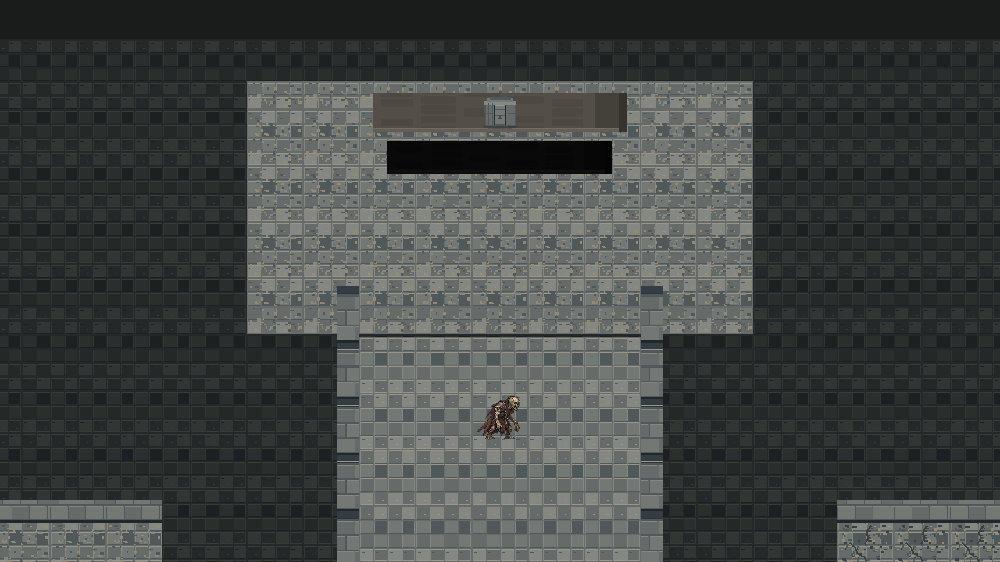
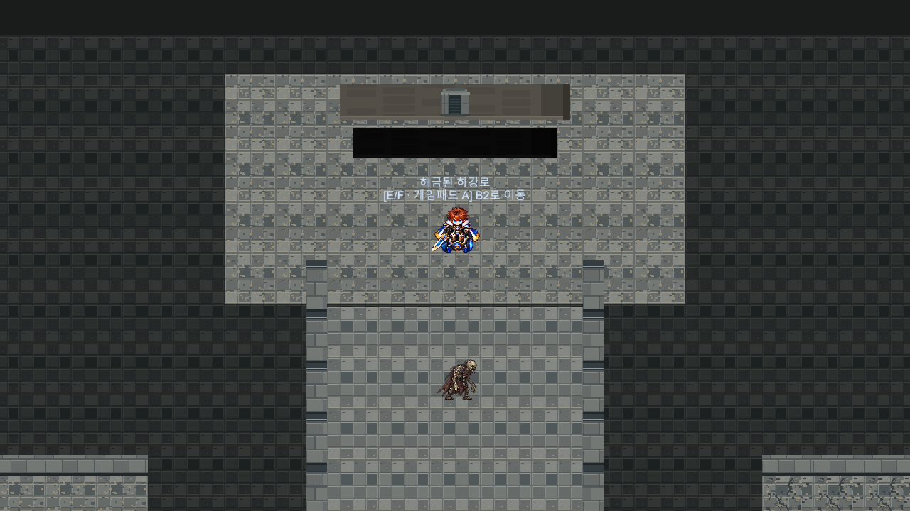

# Dungeon B1 봉인문 시각 보완 QA — 2026-10-12

시작 조건: B2 통합·QA·Commit 완료 후 사용자 Push를 원격 main 47a65e2618af8bba56e2b0ed2062a7ad2b910fb7로 확인했습니다.

## 채택 표현 — TECH_HOLD_RESOLVED_STATE_PLAQUE

승인된 닫힘/열림 PNG192×160·PPU128을 수정하지 않고 균등0.5배로 표시합니다. 세계 크기0.75×0.625의 작은 상태 표식이며 기존 봉인벽 중심(0,11.2), Collider4.5×0.7의 XY 영역 안에 완전히 들어갑니다. 새 통로를 그리지 않고 기존 벽과 하단 표현을 그대로 유지합니다. 실제 하강로(0,8.2)의 기존 Marker는 해금 후 “[E/F · 게임패드 A] B2로 이동”을 안내합니다. 그림 속 계단을 걸어 통과하는 새 길이나 퍼즐을 만들지 않았습니다. 전체 문을 큰 크기로 설치하는 방식은 채택하지 않았으며 작은 표식의 사용자 체감 가독성은 별도 확인이 필요합니다.

DungeonEnvironmentDefinition.Placement에 선택 alternateSprite 필드만 추가했습니다. B1 프로필의 기존 SealedDescent 행에 승인된 닫힘/열림 Sprite를 연결합니다. Main11 Flow가 별도 Collider 없는 표식1개를 만들며 기존 해금 조건(CurrentStep>=4 또는 Main11완료)으로 Sprite를 선택합니다. B1 환경 표시28/기존 문2는 그대로이며 표식1개만 추가됩니다. Scene 원본은 변경하지 않았습니다. Save 버전·퀘스트·Dialogue·B1/B2 이동 조건은 변경하지 않았고 상태는 현재 QuestService에서 복원합니다.

## 실제 격리 Runtime

Unity6000.6.5f1 격리 Batch에서 Main11 B1 순차조사·역순/중복차단, 해금 전후 Continue, 실제 B2 진입/귀환, Field03 왕복/재입장, 휠체어 경로, 표식 크기·좌표·기존 Collider 내부·중복0·Sprite 상태/이동 안내가 통과했습니다. B2의 공유 코드 경계 회귀는 미처치 물리장벽/봉인실 상호작용 거절·단서7 숨김, 실제 완료 Save 복원·재입장 단서유지/석판숨김을 확인했습니다. 기존 전투·35초 리스폰 QA는 재사용했고 반복하거나 변경하지 않았습니다.

첫 실패는 2D Collider의 깊이0과 Sprite bounds 깊이0.1을 3D Contains로 비교한 QA 오류였습니다. 게임을 변경하지 않고 XY 검사로 수정했으며 실패 자료를 Attempt1에 보존했습니다. 실제1280×720 닫힘/열림 RT를 검토했고 신규 컴파일/Runtime/Missing 오류0입니다. 기존 Search 예외로 전체 PARTIAL입니다. 사용자 손 플레이·장시간/다양한 화면 크기 가독성은 NOT_VERIFIED입니다.

## 보호

사용자337항목/822파일과 기존 Save·설정·PNG·meta·모든 Scene 바이트를 보호했습니다. 허용 변경은 환경 정의CS의 선택 Sprite 필드, Main11 시각CS, B1 프로필 asset3개뿐입니다. B2 Scene/PNG/프로필, Field03 Scene/RockNorth 및375개 승인 참조, TTS/BGM/몬스터/리스폰은 변경하지 않았습니다. 원본 Editor/사용자 화면 무접촉입니다.

Evidence/Dungeon01B1GateFollowup_20261012의 checks.txt, plaque_bounds.txt, B2Regression, 보호JSON 및 raw로그를 참조하세요. Git Push 미실행입니다.

B1 체크388건/B2 경계 회귀139건 PASS.

정식 보완 Commit: `6c78cdb833e873639b0a027d5cfdc7efb5a83b3f`.
