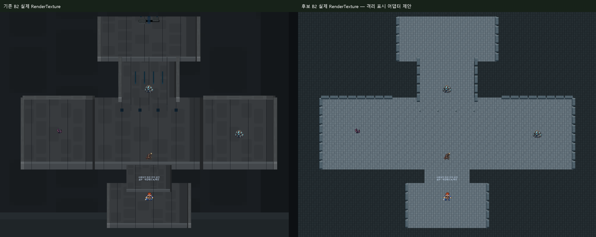
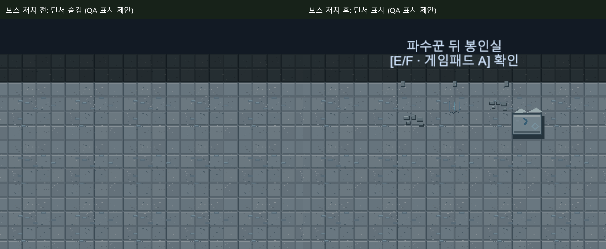
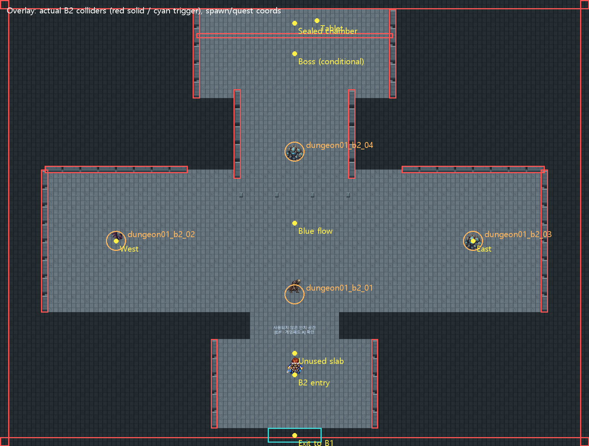

# Dungeon01 B2 리뉴얼 아트 v1 실제 검수 — 2026-10-12

**USER_ART_REVIEW_PENDING / ZIP·PNG 기계 검사 PASS / 전체 QA PARTIAL / 원본 영구 적용0.** 신규31종을 격리 Unity에만 Import하고 실제 비교와 B2 진행·보스·석판 회수·정상 귀환을 검증했습니다. 승인 전 원본 게임 아트/Scene에 적용하지 않았습니다.

## ZIP와 구조

ZIP51항목, PNG44개 = 실사용31 + 공급자Preview12 + QA이미지1입니다. CRC0/PNG전체decode/Manifest31개 파일명·SHA256·크기·alpha bbox 일치 PASS. ZIP SHA256 `c55e7546dc2a1201cd0f5d1aaea23034cee626e2de23dccf098007330e56eaec`. 실제Importer31개 Single/PPU128/Center/Point/무압축/MipmapOff/NPOTNone, 신규격리GUID31개 고유·기존원본충돌0입니다. Floor A~D 모든16쌍의좌우/상하RGBA 경계가정확히같고 실제반복화면을확인했습니다.

Scene의직접환경 Renderer는 **54개/같은석재Sprite1종**입니다. 기존rpgTile152 64×64/PPU64/Center/GUID e38fd353fd47c7644acb692973a9ee07/fileID21300000입니다. 역할은바닥8/줄눈28/벽Collider10/BlueFlow4/UnknownMark4입니다. 공급자54행의GUID/fileID/좌표/Scale을 실제Runtime과대조했습니다. 기존환경Theme복제0이며 Main11이별도로만드는보스뒤단서Sprite7개는Runtime오브젝트입니다.

대형Transform에타일1장을늘려붙이지않았습니다. 원래54개의Transform/Scale/Collider/Sprite/Sorting/Tint는불변이며, 격리메모리에서원래표시를숨기고환경자식26개를붙였습니다. 바닥/벽18개는세계1유닛반복, 다른8개는기존면적내비율맞춤,줄눈28개는후보표시에서제외했습니다. 후보의실제시각색상은새PNG 본색이며 기존Renderer tint 데이터는그대로보존합니다. 이것은정식통합결과가아닌**QA표시어댑터 제안**입니다.

[기계검사 JSON](Evidence/Dungeon01B2Renewal_v1_20261012/zip_manifest_audit.json) · [31Importer/GUID](Evidence/Dungeon01B2Renewal_v1_20261012/isolated_imports.json) · [실제54대응 CSV](Evidence/Dungeon01B2Renewal_v1_20261012/sprite_mapping_54.csv) · [Runtime단서 대응](Evidence/Dungeon01B2Renewal_v1_20261012/runtime_story_mapping.csv) · [형상불변](Evidence/Dungeon01B2Renewal_v1_20261012/runtime_geometry_preservation.json).

## 실제 미술 Preview

모든아래Runtime 그림은 Unity6000.6.5f1 Camera.Render→RenderTexture입니다. HUD전체/사용자직접키보드조작과구별합니다. 공급자Preview12개는오프라인합성이며실제Unity화면으로취급하지않습니다.

[서쪽 확대](Evidence/Dungeon01B2Renewal_v1_20261012/candidate_area_-10_-1_runtime.png) · [동쪽 확대](Evidence/Dungeon01B2Renewal_v1_20261012/candidate_area_10_-1_runtime.png) · [중앙 석실](Evidence/Dungeon01B2Renewal_v1_20261012/candidate_area_0_0_runtime.png) · [보스 전실](Evidence/Dungeon01B2Renewal_v1_20261012/candidate_area_0_9.5_runtime.png) · [석판 회수 구역](Evidence/Dungeon01B2Renewal_v1_20261012/tablet_area_runtime.png).

[B1후보/B2후보 전체 연속성](Evidence/Dungeon01B2Renewal_v1_20261012/b1_b2_candidate_continuity.png) · [B1하강로/B2입구 실제 연결부](Evidence/Dungeon01B2Renewal_v1_20261012/b1_b2_connection_runtime.png). B1이미지는기존통과검수의실제RT를재사용했습니다. B2는더차갑고푸른석재, B1은먼지/마모가더많습니다. 타일밀도·방구별·작은홈의가독성은사용자미술검토대상입니다.

## 보스 전후 단서 노출 — 기존게임과 후보를 구분

현행 `MainQuest11DungeonFlow.BuildSealedChamber`는 DeepCrack/BlueFromBelow/BrokenStone2/RepeatedUnknownMark3, **총7개의보스뒤단서Renderer를처치전부터생성·표시**합니다. 실제처치전 enabled=7/7과확대RT를기록했습니다. 물리장벽과순차퀘스트상호작용은정상차단되지만 **시각적단서선노출위험**이있습니다. 이는신규PNG문제나이번영구변경이아닌기존표시구조입니다. 원본게임을수정하거나이위험을PASS로숨기지않았습니다.

후보QA에서는원래7개를숨기고같은좌표의새단서자식7개를 BossDefeated에서만보이게했습니다. 석판그림1개는(1.25,11.35)에추가한QA표시제안이며처치후·회수전만표시합니다. Inventory생성/Quest변경을이그림이수행하지않습니다. 보스승리전7개숨김/장벽차단, 승리후새단서표시/장벽해제, 석판회수후그림숨김을구별합니다. **새숨김바인딩과석판그림은원본게임에미적용입니다.**

[기존게임의처치전노출확대](Evidence/Dungeon01B2Renewal_v1_20261012/original_sealed_before_runtime.png). 확대QA카메라는상단배경까지담았습니다. 일반CameraFollow의16:9 viewport는네방향모두Bounds내부PASS이며이확대의맵밖배경을일반카메라결함으로분류하지않습니다.

Gate Closed/Open/AncientFrame와BeforeBoss VisualBarrier PNG는기존54개Renderer에직접대응하지않는보조배치/상태바인딩자산입니다. 이번에는새봉인문을임의배치하지않고기존BossChamberBarrier(center0,10.5/size11×.28)를보존했습니다. 정식통합때문표시·Collider·상태/스포일러노출을최소범위로설계해야합니다.

## Runtime 결과

원본Editor PID31832/화면/포커스를건드리지않고 기존격리 `Temp/Field01RenewalQA/Client`를재사용했습니다. 별도Saves/Settings·음소거, 원본에SceneSave0입니다. B1조사구간은이전검수PASS를재사용하고이전목표0~3완료checkpoint만QA서비스fixture로설정했습니다. **이번에B1전체손플레이를다시했다고주장하지않습니다.** B2도착이후는실제상호작용/전투UI/처리경로로검사했습니다.

|검사|결과·실제범위|
|---|---|
|B1/B2연결|PASS: B2 Exit_To_B1→B1 Spawn(0,6.8), 실제Main11하강상호작용→B2(0,-8.5)|
|일반4조우|PASS: dungeon01_b2_01~04 실제Attack/대상HitArea/TurnQueue/승리/귀환. 기존망자·잔영·박쥐·수호체/편성/Spawn자산불변|
|리스폰|PASS: 원래35초전생성0/35초뒤각1개, 최종4·중복0. 관찰지연약2.02~3.04ms. 설정변경0|
|B2순차조사|PASS: 안치공간→서쪽→동쪽→중앙푸른흐름의실제TryInteract/대사완료, Main11index9보스목표|
|보스진입/승리|PASS: 실제FieldMonster BeginEncounter→Battle→정상24공격승리/복귀. HP/승패강제주입0|
|보스동작|PASS: 실제UI도망거절, Phase2/수호체2추가(적최대3)/장막/충격준비 관찰. 임시상태관측파일에기록. 기존페이즈·침묵·소환·피해코드변경0|
|처치전접근|PASS: 실제Rigidbody가BossChamberBarrier에막힘, 봉인실순차상호작용거절. 시각적원본단서노출은별도위험으로PARTIAL|
|처치후접근|PASS: 승리index10/Barrier꺼짐, 실제봉인실조사index11, 석판대사·Inventory1/index12, 아직조사선택|
|석판/귀환|PASS: 석판한번회수·중복0, 실제돌아간다선택→Field03안전지대→Main11완료/석판1유지|
|Save/Continue|PASS: Primary별도Save의보스전index9/석판회수index12를BootstrapContinue2회복원. 완료된실제Save를별도ViewSlot2로byte복사하여Main11완료/석판1복원도확인. 사용자Save무접촉|
|휠체어|PASS: 실제반경.5+.03, B2주요8지점244waypoint의실제Rigidbody이동. 동적일반몬스터Collider만검사중제외후복원, 기존환경/장벽Collider불변|
|Bounds/Camera|PASS: 중심0/크기33×25 보존, 16:9실제CameraFollow북/남/서/동4viewport내부. 확대RT는별도촬영카메라설정|
|Marker/Console|실제안치공간·봉인실Marker 표시/새배경대조. Missing Sprite/Script0, 수정후Compile0/신규게임오류0. 기존Search.SearchDatabase/IndexationOnStartup예외재현으로전체PARTIAL|

전투는Lv25투사·지체의길/기존동료fixture, 조우별독립체력초기화·전투연출timeScale8/귀환1입니다. 보스24공격은정상UI/AI/TurnQueue결과이며서비스시뮬레이션승리주입이아닙니다. 침묵재사용대기·DoT장막예외·전직업/레벨/연속사냥밸런스의세부경계는이번새검증NOT_VERIFIED입니다. 과거 [2차회귀CSV](LIMITLESS_SecondRegression_Cases.csv)의Boss서비스검사와이번실제전투를혼동하지않습니다.

QA초기새스크립트의범위치환/Count호출에서컴파일진단3개가발생했습니다. 격리QA코드2오류만수정한뒤Runtime/보충뷰는Compile0으로통과했고초기실패로그를보존했습니다. 게임C#수정0, 통과한B1/전투/퀘스트를불필요하게재실행하지않았습니다.

Overlay초기집계가B1 Scene이름을참조하는QA오류도확인했습니다. 게임검사반복없이B2 Collider만별도수집해벽/경계/출구/보스장벽의실제좌표와처치전enabled/후disabled를확인하고JSON·Overlay를수정했습니다. 최초잘못된집계는별도scope_error JSON으로보존했습니다. [콜라이더보충체크](Evidence/Dungeon01B2Renewal_v1_20261012/collider_checks.txt) · [처치후Collider](Evidence/Dungeon01B2Renewal_v1_20261012/colliders_after_boss.json).

[Primary체크](Evidence/Dungeon01B2Renewal_v1_20261012/checks.txt) · [장벽/Camera추가체크](Evidence/Dungeon01B2Renewal_v1_20261012/views_checks.txt) · [보스관측](Evidence/Dungeon01B2Renewal_v1_20261012/boss_observed.txt) · [4스폰타이밍](Evidence/Dungeon01B2Renewal_v1_20261012/respawn_times.csv) · [QA JSON](Evidence/Dungeon01B2Renewal_v1_20261012/qa_summary.json).

## 기술·미술 보완과 보호

미술보완검토: 기존극도로얇은BlueFlow/UnknownMark를소품비율로맞추면너무작아지는구간, 벽타일의얇은Collider면적에맞춘잘림, 새바닥반복밀도와밝은Marker대조, B1/B2의차가움/마모차이입니다. 이는기존scale와신규texture배정의통합문제를PNG손상과분리한결과입니다. 보조문/기둥/봉인판의추가배치는별도승인·동선검토대상이며이번영구배치0입니다.

Overlay는실제RT위에실측좌표를그린설명합성입니다. 일반Spawn4개와기존Collider를표시하며보스좌표는노랑Boss표시로구분합니다. [5SpawnDefinitions](Evidence/Dungeon01B2Renewal_v1_20261012/spawn_definitions_5.json)는일반4와조건부비리스폰보스1을구별합니다. [좌표CSV](Evidence/Dungeon01B2Renewal_v1_20261012/quest_spawn_coordinates.csv).

공급자 [Contact Sheet](Evidence/Dungeon01B2Renewal_v1_20261012/supplier_contact_sheet.png)/[6×6 반복자료](Evidence/Dungeon01B2Renewal_v1_20261012/supplier_tile_repeat.png)는오프라인자료입니다. 실제중앙확대도반복/접합검토에사용했습니다. Manifest의“직접생성원본·ThirdParty텍스처복제없음”은제작자선언으로기록하며독립저작권·상업적권리증빙은 **NOT_INDEPENDENTLY_VERIFIED**입니다.

오래된B2/보스문서의Main11·봉인실미구현문구는과거범위기록이며현재스토리정본/실제코드/이번보스→석판→귀환완료결과와구별합니다. 과거표기를근거로현재기능을되돌리지않았습니다.

시작로컬/원격main395dd5d일치. 사용자337status항목/822파일, 원본게임3738파일전체SHA256불변을확인했습니다. 원본B1/B2Scene·승인Field03/아트/몬스터/전투/Quest/Save/설정/TTS/BGM/meta/GUID변경0입니다. [보호JSON](Evidence/Dungeon01B2Renewal_v1_20261012/protection.json). **USER_ART_REVIEW_PENDING, 원본영구적용0, 문서·QA만선택적Commit, Git Push0.** 검수Commit은후속상태기록에남깁니다.

## 실사용PNG31개

|파일|해상도|Alpha bbox|
|---|---|---|
|`Ground/LL_C1_D01B2_Floor_Stone_A_128_v1.png`|128×128|[0, 0, 128, 128]|
|`Ground/LL_C1_D01B2_Floor_Stone_B_128_v1.png`|128×128|[0, 0, 128, 128]|
|`Ground/LL_C1_D01B2_Floor_Stone_C_128_v1.png`|128×128|[0, 0, 128, 128]|
|`Ground/LL_C1_D01B2_Floor_Stone_D_128_v1.png`|128×128|[0, 0, 128, 128]|
|`Ground/LL_C1_D01B2_Floor_Threshold_128_v1.png`|128×128|[0, 0, 128, 128]|
|`Ground/LL_C1_D01B2_Floor_PassageBorder_128_v1.png`|128×128|[0, 0, 128, 128]|
|`Ground/LL_C1_D01B2_Groove_Unlit_Overlay_128_v1.png`|128×128|[39, 2, 91, 126]|
|`Ground/LL_C1_D01B2_Groove_Blue_Overlay_128_v1.png`|128×128|[38, 7, 91, 122]|
|`Walls/LL_C1_D01B2_Wall_Straight_128_v1.png`|128×128|[5, 8, 123, 126]|
|`Walls/LL_C1_D01B2_Wall_Corner_128_v1.png`|128×128|[5, 8, 123, 126]|
|`Walls/LL_C1_D01B2_Wall_SealPanel_128_v1.png`|128×128|[5, 8, 123, 126]|
|`Walls/LL_C1_D01B2_Wall_Fractured_128_v1.png`|128×128|[5, 8, 123, 126]|
|`Walls/LL_C1_D01B2_Wall_Junction_128_v1.png`|128×128|[5, 8, 123, 126]|
|`Props/LL_C1_D01B2_Pillar_Refined_128_v1.png`|128×128|[27, 26, 107, 125]|
|`Props/LL_C1_D01B2_Pillar_Chipped_128_v1.png`|128×128|[29, 14, 107, 126]|
|`Props/LL_C1_D01B2_Sealed_Tomb_128_v1.png`|128×128|[23, 31, 110, 114]|
|`Props/LL_C1_D01B2_Dormant_BurialSlab_128_v1.png`|128×128|[14, 49, 118, 114]|
|`Props/LL_C1_D01B2_Unknown_Carving_128_v1.png`|128×128|[21, 30, 112, 118]|
|`Props/LL_C1_D01B2_Repeating_Stone_Marks_128_v1.png`|128×128|[31, 23, 103, 120]|
|`Props/LL_C1_D01B2_Broken_Fragment_Cluster_128_v1.png`|128×128|[26, 65, 108, 115]|
|`Props/LL_C1_D01B2_Fractured_Platform_128_v1.png`|128×128|[25, 55, 110, 112]|
|`Props/LL_C1_D01B2_Plinth_128_v1.png`|128×128|[30, 28, 105, 117]|
|`Props/LL_C1_D01B2_Flow_Pedestal_128_v1.png`|128×128|[38, 33, 96, 119]|
|`Props/LL_C1_D01B2_Subtle_Blue_Light_128_v1.png`|128×128|[35, 47, 100, 125]|
|`Gate/LL_C1_D01B2_SealDoor_Closed_192x160_v1.png`|192×160|[8, 20, 185, 156]|
|`Gate/LL_C1_D01B2_SealDoor_Open_192x160_v1.png`|192×160|[8, 20, 185, 156]|
|`Gate/LL_C1_D01B2_SealDoor_AncientFrame_192x160_v1.png`|192×160|[8, 20, 185, 156]|
|`Story/LL_C1_D01B2_AfterBoss_DeepCrack_128_v1.png`|128×128|[12, 61, 109, 90]|
|`Story/LL_C1_D01B2_AfterBoss_BlueFromBelow_128_v1.png`|128×128|[32, 47, 97, 106]|
|`Story/LL_C1_D01B2_AfterBoss_BrokenTablet_128_v1.png`|128×128|[32, 37, 104, 106]|
|`Story/LL_C1_D01B2_BeforeBoss_VisualBarrier_128_v1.png`|128×128|[27, 33, 109, 118]|
