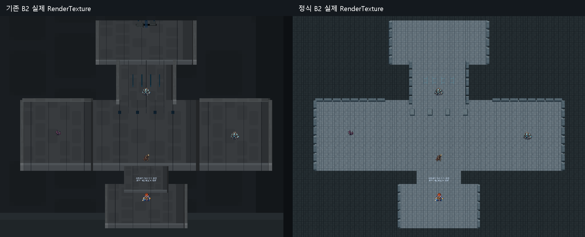
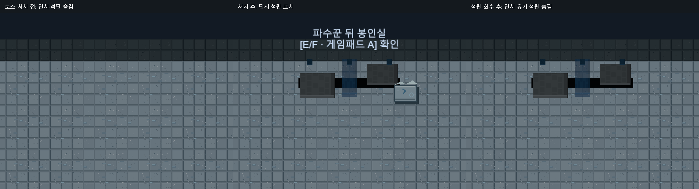

# Dungeon_01 B2 정식 아트 통합·봉인실 표시 QA — 2026-10-12

**USER_ART_APPROVED / 정식 PNG31 등록 / 전체 QA PARTIAL**. B1에서 검증한 DungeonEnvironmentDefinition·DungeonEnvironmentRenderer를 코드 변경 없이 재사용했습니다.

## 정식 적용 구조

기존54 앵커의 좌표·Scale·Sorting·Flip·Sprite·Collider를 보존합니다. 바닥8+벽10 = Tiled18, 푸른 홈4+문양4 = 원래 PPU128 소품8, 기존 줄눈28 = 중복 표시 숨김입니다. 표시 자식26개만 생성하고 재활성화 때 재사용합니다. Scene에 프로필 컴포넌트1개(14줄)만 추가했으며 전체 재생성·동선 재설계는 하지 않았습니다. 공식 PNG31개는 원본 바이트 그대로 Resources/Art/Environment/Dungeon01B2/V1에 등록했고 보조 Gate/장식은 새 배치하지 않았습니다. 신규 GUID 충돌0입니다.

B1의 PNG25/앵커63/표시28/문2, Scene·프로필·렌더링 코드의 기존 바이트는 그대로입니다. B1 문은 TECH_HOLD를 유지합니다.

## 봉인실 스포일러 수정

MainQuest11DungeonFlow가 생성하는 기존 단서7개의 Sprite와 좌표·색·비율을 유지하고 표시 여부만 BossDefeated에 연결했습니다. 생성 직후 첫 렌더 전부터 숨겨 로드 순간의 노출도 막습니다. 기존 BossChamberBarrier와 순차 조사 조건은 변경하지 않았습니다.

새 석판 그림은 (1.25,11.35)에 PPU128/Sorting6으로 생성하고 보스 처치 후 목표10~11·Inventory 석판0일 때만 표시합니다. 회수·목표12 및 완료 후 숨깁니다. 그림은 Inventory나 Quest를 변경하지 않습니다. 기존 대사·보스ID·보상·Save 스키마도 유지합니다.

## 실제 Runtime 검증

격리 Unity6000.6.5f1에서 B1 통과 체크포인트를 재사용해 B2 입장부터 검증했습니다. B1↔B2 실제 상호작용 왕복, 일반4개 실제 공격 버튼/대상 선택/승리/복귀 및 현행35초 리스폰, B2 순차 조사, 침묵의 파수꾼 실제 전투·Phase2 소환·장막·도망 거절, 봉인실 조사·석판1개·정상귀환·Main11 완료가 통과했습니다. QA는 서비스 시뮬레이션과 UI 콜백/물리 검사이며 OS 키보드 직접 플레이가 아닙니다. 밸런스나 모든 직업 검증은 포함하지 않습니다.

보스 전 단서7 숨김/장벽 유지/석판 숨김, 처치 후 단서7 표시/장벽 해제/석판 표시, 회수 후 석판 숨김/단서 유지/Inventory1을 검증했습니다. 보스 전·처치 후·회수 후 Save/Continue와 재진입, 완료 후 Field03 Continue 및 B2 재입장에도 상태가 복원됐습니다. 기존 환경 좌표와 Collider 데이터는 Scene의 원래 블록을 그대로 보존했습니다. 타일의 표시 영역·Scale·Sorting·Flip, 재활성화/재진입 중복0, 휠체어 실제 반경 경로, Missing Sprite/Script0을 확인했습니다.

실제 Camera.Render→RenderTexture 전체/서쪽/동쪽/중앙/보스 전후/석판/B1 연결부를 Evidence에 보존했습니다. 기존 미술 비교는 이전 검수의 실제 RT를 재사용합니다. 사람의 장시간 가독성, 모든 자막·HUD 상태, OS 직접 입력, 장시간 성능 및 독립 상업권 증빙은 NOT_VERIFIED입니다. 기존 Unity Search 내부 예외는 별도 유지하여 전체 PARTIAL입니다.

## 보호·근거·Git

원본 Editor와 화면 무접촉, 별도 QA Save/설정만 사용했습니다. 사용자337항목(822 실제파일), 기존 GUID/meta·TTS·BGM·몬스터·밸런스·B1을 보호했습니다. 기존 게임3801파일 중 허용된 B2 Scene·Main11 표시 코드2개만 변경하며 나머지3799파일 해시가 같습니다. 원본 ZIP SHA256 c55e7546dc2a1201cd0f5d1aaea23034cee626e2de23dccf098007330e56eaec 일치 및 CRC PASS.

Evidence/Dungeon01B2Official_20261012의 checks.txt, respawn_times.csv, boss_observed.txt, assets.json, protection.json, 실제PNG 및 로그를 참조하세요. 문양 이름 대응 오류는 격리 프로필에서 수정한 뒤 정식 QA를 수행했고 원본 게임에 잘못 적용하지 않았습니다. Git Push는 수행하지 않습니다.

실제 통과 체크 1188건.

추가 상태 검증 139건 PASS: 보스 전 실제 Rigidbody 장벽 차단·봉인실 상호작용 거절, 실제 완료 Save 별도슬롯 복원·재입장 단서7 유지/석판 숨김. 신규31 Importer 계약도 PASS입니다.

