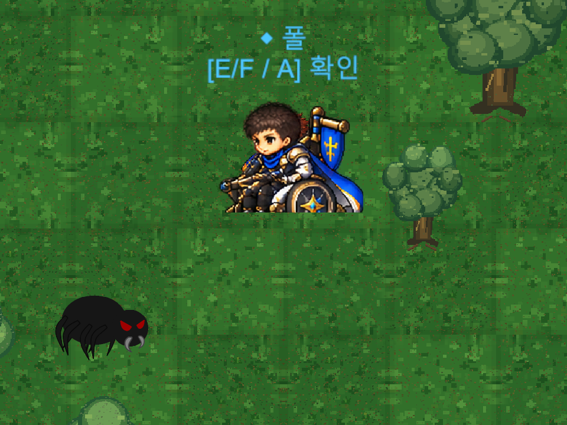
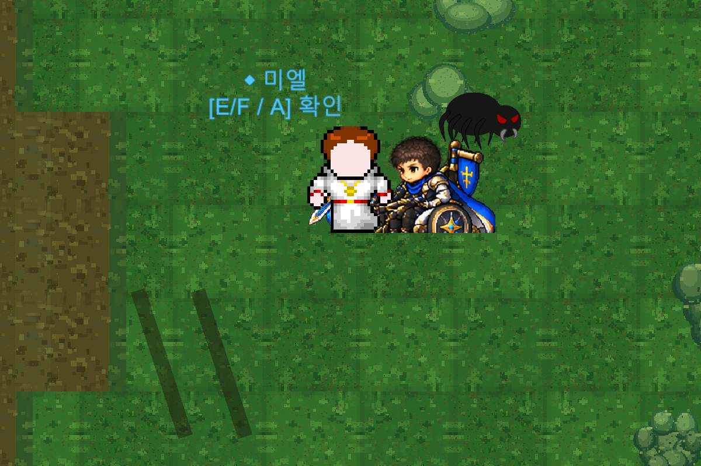
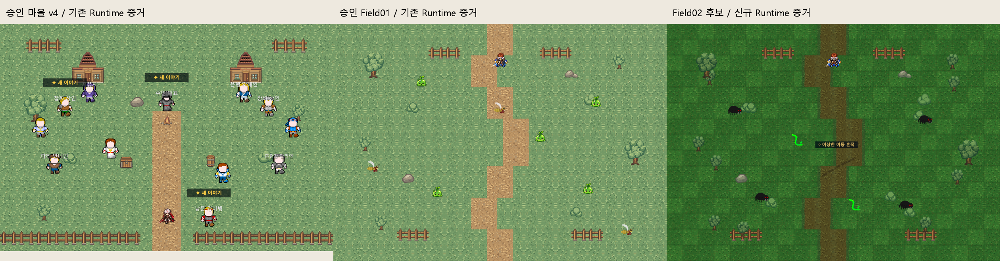

# Field_02 리뉴얼 아트 v1 검수 — 2026-10-12

**USER_ART_APPROVED (2026-10-12).** 신규12종 정식 통합 결과는 [최신 정식 통합 QA](Field02_Renewal_Official_Integration_QA_20261012.md)를 따른다. **아래 내용은 승인 전 검수 이력(기술 PARTIAL / 당시 원본 적용0)**이다. 납품 완료와 사용자 최종 미술 승인은 구별한다. 원본 ZIP과 승인된 마을 v4·Field01, Scene·Theme·Generator·Prefab·Save·WAV·기존 GUID는 변경하지 않았다.

## 원본 및 실제 검사

원본 `F:\Downloads\Limitless_Field02_Renewal_Art_v1.zip`, SHA256 `06d191e64fe9d146d458573588c00911666c4677e504c4b888a8d0d8d63ccc8d`. ZIP 30항목, PNG25개(실사용 후보17 / Preview6 / QA2), CRC 오류0, PNG 전체 디코딩 성공. Manifest17개 파일·크기·SHA256 모두 일치. RGBA17개; 바닥5개는 불투명, 나머지 alpha 범위·bbox는 [기계 검사](Evidence/Field02Renewal_v1_20261012/zip_audit.json)에 기록했다. 나무255×256·128×156, 나머지128×128. 외부 자산 원본 변경0; 독창성/권리 귀속은 납품자의 'original' 선언만 있으며 별도 권리 증빙은 NOT_VERIFIED.

Unity6000.6.5f1, 기존 `Temp/Field01RenewalQA/Client` 재사용, 숨김 Batch, 별도 Save/Settings, 스피커0. 원본 Editor PID31832 유지. 신규17개는 **격리 프로젝트에만** Single/PPU128/Center/Point/무압축/Mipmap Off/NPOT None로 Import했다. 원본 프로젝트 Assets에 후보를 복사하지 않았다.

실제 Scene 환경363개 + `Field02_Forest` 테마의 TreeWest 복제6·BushWest 복제4 = 후보 참조373개. [개별 대응표](Evidence/Field02Renewal_v1_20261012/sprite_mapping_373.csv), [원래 Runtime](Evidence/Field02Renewal_v1_20261012/runtime_before.json), [후보 Runtime](Evidence/Field02Renewal_v1_20261012/runtime_candidate.json). 373개의 위치·Scale·FlipX·Sorting·Tint·Collider 값 모두 교체 전후 동일. 후보 교체는 Play 메모리에만 적용, Scene 저장/재생성0.

| 기존 Sprite | Scene+Runtime 수 | 대응 후보 | Rect 변화(px) |
|---|---:|---|---|
| `bush_01` | 6 | `Props/LL_C1_F02_Bush_A_128_v1.png` | 128×128 → 128×128 |
| `bush_02` | 1 | `Props/LL_C1_F02_Bush_B_128_v1.png` | 128×128 → 128×128 |
| `fence_tiles_2_2` | 8 | `Props/LL_C1_F02_Fence_MossWood_128_v1.png` | 128×128 → 128×128 |
| `rock_01` | 1 | `Props/LL_C1_F02_Rock_Moss_A_128_v1.png` | 128×128 → 128×128 |
| `rock_02_0` | 1 | `Props/LL_C1_F02_Rock_Moss_B_128_v1.png` | 85×54 → 128×128 |
| `tiles_grass_4_0` | 105 | `Ground/LL_C1_F02_ForestFloor_A_128_v1.png` | 128×128 → 128×128 |
| `tiles_grass_4_4` | 15 | `Ground/LL_C1_F02_Path_Left_128_v1.png` | 128×128 → 128×128 |
| `tiles_grass_5_0` | 106 | `Ground/LL_C1_F02_ForestFloor_B_128_v1.png` | 128×128 → 128×128 |
| `tiles_grass_5_4` | 15 | `Ground/LL_C1_F02_Path_Right_128_v1.png` | 128×128 → 128×128 |
| `tiles_grass_6_0` | 104 | `Ground/LL_C1_F02_ForestFloor_C_128_v1.png` | 128×128 → 128×128 |
| `tree_big` | 2 | `Props/LL_C1_F02_Tree_Big_255x256_v1.png` | 255×256 → 255×256 |
| `tree_medium` | 9 | `Props/LL_C1_F02_Tree_Medium_128x156_v1.png` | 128×156 → 128×156 |

## 미술 및 배치 검토

위 세 화면은 실제 Unity RenderTexture이며 첫 화면의 원래 배치에서 Sprite만 바꿨다. 오른쪽은 바닥만 흰색으로 비교한 **제안 화면**이다. `FieldThemeInstaller`가 기존 바닥에 `(0.62,0.76,0.60)`을 곱하므로 이미 그늘색인 새 아트가 더 어두워진다. 원본 Theme를 바꾸지 않았다. 사용자가 기존 Tint 유지/후보색 기준 중 선택해야 한다.

납품 Contact Sheet와 TileRepeat는 오프라인 합성이며 Unity 캡처가 아니다. [Contact Sheet](Evidence/Field02Renewal_v1_20261012/package_contact_sheet.png), [납품 타일 반복](Evidence/Field02Renewal_v1_20261012/package_tile_repeat.png). 현장 화면에서 길 중앙 접합·울타리·나무/바위 크기를 확인했다. 기존 바닥의 랜덤 FlipX를 유지하므로 반복감/경계 시임은 최종 미술 승인 대상이며 수치 검사만으로 '완벽한 시임'이라 판정하지 않는다. 큰 나무·중간 나무의 실제 Rect/PPU는 대응표대로 유지된다. 바위B의 원본 Slice와 신규128px 사이의 크기 변화도 대응표·Runtime 확대를 기준으로 최종 승인해야 한다.

17개 중 직접 치환 가능한 것은12종이다. Mud Patch·Root·Branch·Story helper2개는 기존 환경 Sprite의 1:1 대상이 없다. 기존 Main06 흔적과 Main07 절차적 바퀴자국을 덮어쓰지 않았다. 다섯 보조 자산 신규 배치는 별도 승인 후 검토하며 Scene 배치 변경으로 숨겨 적용하지 않는다.

## 게임 구조 보호 및 검증 한계

Overlay의 노란 좌표 표시는 설명 합성이다. 실제 Field bounds21×15, 북 Spawn(0,4.6)/Transition(0,6.8), 남 Spawn(0,-5.2)/Transition(0,-7.15); 방향별 Field01↔02↔03 Stable SpawnID 대응은 LOCAL connection4개로 확인했다. 북 입구 안전지대 center(0,5.65),radius2.2. 서로 다른 Spawn/Trigger 위치 유지. WorldBounds·경계·콜라이더 기존 구조 보존.

Main06 조사(0.2,-1.6), Main07 바퀴 자국(2.7,-1.2), 여행자(4.4,0.2), 폴(6.5,-2.35)는 LOCAL 코드와 Manifest 일치. 네 지점 환경 Collider probe 통과. Main06 실제 Marker가 후보 바닥에서도 읽히는 RenderTexture 확보. Main07은 활성 목표별로 폴이 최초 지점→여행자 옆(+0.8,0), 미엘/폴 복귀 표식으로 바뀌는 기존 코드 확인. 후속 격리 검사에서 바퀴 자국→여행자→폴→실제3대3 UI전투→미엘/폴 복귀→완료 대화까지 PASS. 전투는 정상 Attack/HitArea6회로 승리(HP/결과 주입0). E/F와 동일 Interact 처리·진입 callback을 자동 호출했으며 OS 키 입력/연속 도보 휠체어 전체 경로는 NOT_VERIFIED. 기존 Field01 복구 QA의 Main06 실제 조사·왕복 PASS는 재사용하며 본 검수에서 재실행하지 않았다.

숲거미4·맹독뱀2 실제 초기 스폰6 확인. SpawnDefinition6개·ID·Monster GUID·activityRadius·respawnSeconds30·전투/드롭 설정을 변경하지 않았다. Field02 일반 몬스터 전부 승리 후30초 재스폰은 NOT_VERIFIED. Main07 StoryBattle 정상 승리·Field02 복귀는 PASS. 양방향 실제 Trigger callback로 Field02→01→02→03→02 왕복 및 Spawn 좌표 PASS. 출입구까지의 전체 도보 접근은 NOT_VERIFIED. 신규 미술 영구 통합 이후 관련 Runtime 회귀가 필요하다.

Compile 오류0, 환경 후보 참조 Missing Sprite0, Scene Missing Script0. [Batch assertion](Evidence/Field02Renewal_v1_20261012/checks.txt), [Console](Evidence/Field02Renewal_v1_20261012/console_errors.txt). 기존 Unity Search 내부 예외가 남아 기술 전체는 PARTIAL이며 게임 기능 신규 오류0. QA 완료를 미술 승인으로 간주하지 않는다.

## 승인 이후 복붙용 통합 지시

> Field02 v1 미술 승인 범위를 먼저 확인하고 이 보고서의373개 대응표로 신규12종 Sprite-only 통합을 진행한다. Scene363개 및 Theme 복제10개, 원래 위치·Scale·Flip·Sorting·Collider·퀘스트/몬스터/Save를 보존한다. Tint 선택은 승인 내용대로 적용한다. 나머지 보조5개는 별도 배치 승인이 없으면 추가하지 않는다. 기존 meta/GUID를 변경하거나 Scene을 재생성하지 않는다. 원본 Editor 무접촉, 기존 격리 프로젝트에서 Main06/07·폴·Marker·휠체어 접근·몬스터6·30초 리스폰·Field01/03 왕복·Save/Continue를 검사하고 PARTIAL/FAIL을 숨기지 않는다. 선택적 Commit만, Push 금지.

## 보충 실제 Runtime 및 검사 오류 감사

[최초 Main07 결과](Evidence/Field02Renewal_v1_20261012/supplement_checks.txt) · [Continue/왕복 재개](Evidence/Field02Renewal_v1_20261012/supplement_checks_resume.txt) · [재개 관찰 Quest JSON](Evidence/Field02Renewal_v1_20261012/supplement_continue_observed.json).

공식 폴/여행자/미엘 캐릭터 자산은 변경하지 않았다. 폴은 기존 공식 Battle Idle를 필드에 사용하는 표현이다. 하단 경계와 지면·휠체어 시각 배치는 최종 미술/체감 검토 대상이다. 기존 Marker/E/F/A 안내가 후보 환경에서도 표시됨을 확인했으며 사람의 가독성 승인을 대신하지 않는다.

최초 Continue의 'Quest JSON 전체 byte 동일' assertion은 FAIL이었다. 완료 직후 Save에는 Main07 완료/활성퀘스트 없음이지만 `MainQuest08FieldFlow.Install`은 Field02 재진입 때 Main08을 자동 시작한다. 게임 버그가 아니라 QA 기대값 오류다. 원본 실패/로그를 보존하고 저장 위치·완료 ID 목록 정확 복원과 Main08 새 시작index0을 나누어 검사하자 모두 PASS. 게임/Save 코드 변경0, 통과한 Main07 전투 재실행0.

일반 Save 디렉터리가 쓰일 위험을 자동 승인 검토가 지적해 최초 보충 실행을 거절했다. 기존 EnteredPlayMode의 별도 AuditSaveDirectory 설정에 더해 RunBatch와 최초 쓰기 전 실제 슬롯 경로를 Temp 하위로 fail-closed 확인하는 조건을 명시했다. 보호 근거 확인 후 승인된 실행만 진행, 사용자 Save 접근0. 보충 Runtime의 최종 판정은 PARTIAL_KNOWN_SEARCH.

위 비교는 기존 승인 마을/Field01 Runtime 증거와 새 후보 Runtime 캡처를 나란히 배치한 설명 이미지다. 부드러운 윤곽·녹색/갈색 팔레트 연결은 확인되지만 Field02 테마 색조가 더 짙고 바닥 반복무늬 밀도가 높다. [실제 길 접합 확대](Evidence/Field02Renewal_v1_20261012/path_join_zoom_runtime.png)와 [납품 연속성 mockup](Evidence/Field02Renewal_v1_20261012/package_continuity_mockup.png)을 함께 검토한다. 납품 mockup은 실제Scene이 아니다.

RockNorth(B)의 원본85×54/PPU100/Center가 신규128×128/PPU128/Center로 바뀐다. 전체 Rect 세계 크기는0.85×0.54→1×1, 신규 alpha bbox(9,44,119,109)의 하단은 중심에서 -45/128=-0.3516이다. 기존 Collider center y4.18/size0.4×0.22는 유지했다. 단순 참조 변경만으로 접지·시각 크기가 동일하다고 주장하지 않으며 최종 승인/후속 통합에서 실제 확대 검사 필요.

[원시 최초 로그](../../Temp/Urgent20261012/field02_attempt1.log) · [Main07 보충](../../Temp/Urgent20261012/field02_supplement_attempt1.log) · [왕복 재개](../../Temp/Urgent20261012/field02_supplement_resume.log) · [인계3문서 출처/해시](Evidence/Field02Renewal_v1_20261012/handoff_provenance.json).
