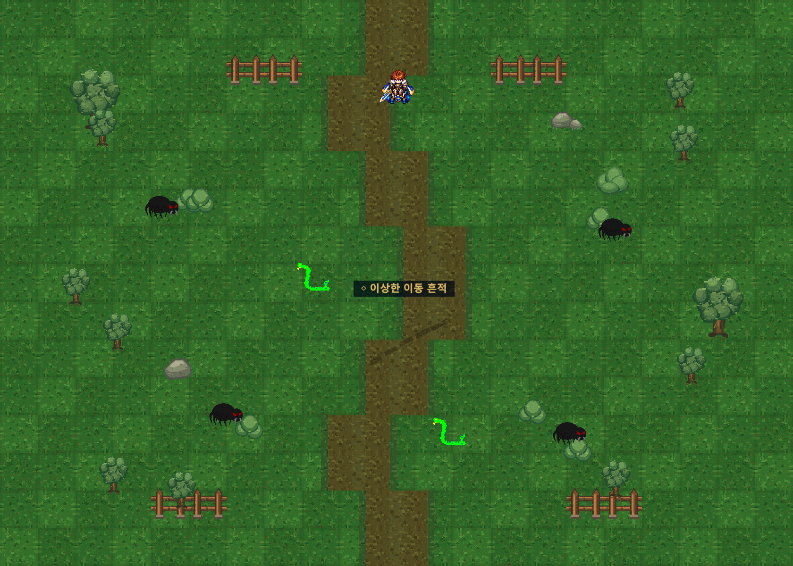
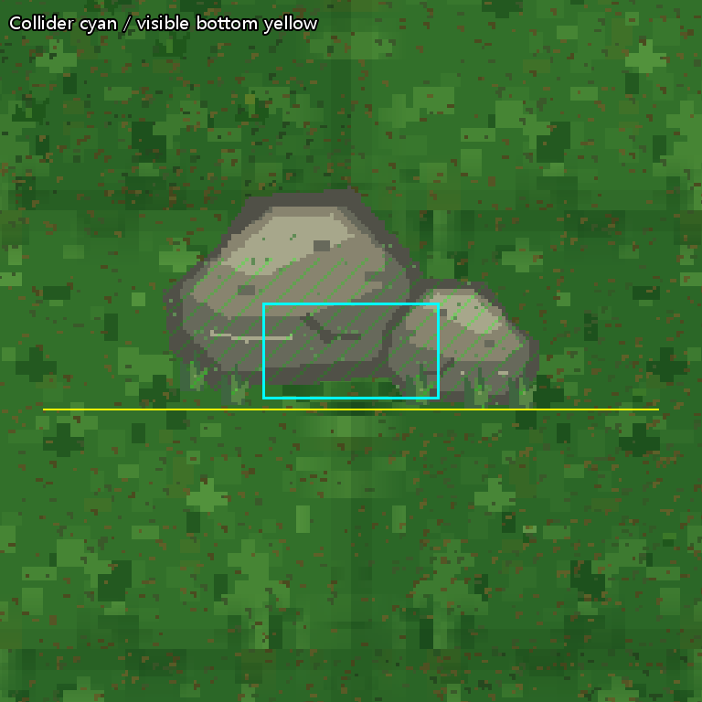

# Field02 리뉴얼 v1 정식 통합 QA — 2026-10-12

**USER_ART_APPROVED / IMPLEMENTED / 전체 QA_PARTIAL.** 사용자 최종 승인에 따라 신규12종과 Scene363개를 정식 연결했다. Theme 복제10개까지 실제 환경373개가 신규 Sprite를 참조한다. 기존 GroundTint(0.62,0.76,0.60), 배치·Scale·Flip·Sorting·Collider·보조5종 미배치 조건을 유지했다.

## Git 동기화와 원본 보호

Push된 origin/main `55ac89fad9b48e176006886b56e24a9496e4a9ae`를 fetch로 확인했다. 추가14개 운영 문서와 사용자 미커밋 파일의 교차0을 확인하고 원본 main을8817bf9→55ac89f fast-forward했다. 기존337항목/822파일 byte 보호 확인. 이전 `Temp/GitIntegration20261012/main-merge` worktree는 그대로 보존했다. Push0, reset/clean/무조건 pull0.

현재 작업 시작의 Assets/Packages/ProjectSettings/UserData 3684파일 중 **Field_02.unity1개만 허용 변경**, 나머지3683개 SHA256 불변. Scene의 신규 Sprite를 메모리상 역대응하자 원본 byte와 정확히 동일: 실제 변경363행만. Scene 재생성/Unity Scene 전체 재저장0. 기존 Scene meta/GUID·ThirdParty·승인 Field01/마을·TTS25/오류10·Save·설정·대사/BGM·퀘스트/몬스터/리스폰·연결 Asset 불변.

## 자산과 참조

원본 ZIP은 현재 `F:/Downloads/Limitless_Sprites/Limitless_Field02_Renewal_Art_v1.zip`에서 재발견했다. 최초 검수 SHA256 `06d191e64fe9d146d458573588c00911666c4677e504c4b888a8d0d8d63ccc8d`와 동일/CRC 오류0을 확인했다. 신규 경로 `Assets/_Project/Art/Environment/Field02/V1/`: Ground5/Props7, 원본 ZIP PNG byte 그대로. Single/PPU128/Center/Point/무압축/Mipmap Off/NPOT None. PNG12+meta12+folder meta4=28개 신규파일, GUID16개 고유/기존 충돌0. [파일별 SHA/GUID/Importer](Evidence/Field02Official_20261012/asset_hash_guid_importer.json), [363개 역할별 치환/파일목록](Evidence/Field02Official_20261012/integration.json). 기존373개 검수 대응표의 GUID/fileID 쌍을 기준으로 교체했다.

`FieldThemeInstaller`는 Scene의 TreeWest/BushWest를 복제하므로 바뀐 공식 Sprite를 자연스럽게6+4개 사용한다. Theme 데이터/로직 변경0. `Field01SceneGenerator`는 Field_01.unity와 Field01/V1만 대상으로 한다. 별도 Field02 환경 재생성 경로는 발견되지 않았다. `Field03Main08ContentBuilder`는 Field03가 없을 때만 Field02를 복사하며 기존 Field03는 불변이다. 이번에 생성기 실행/불필요한 새 생성기/Runtime override를 추가하지 않았다.

Mud Patch/Root/Branch/Story helper2개는 Import/신규 배치0. Main06 흔적과 Main07 기존 절차적 바퀴 자국을 유지했다. 신규 아트 때문에 기존 TTS·퀘스트 ID·화자·몬스터 ID/Definition/Spawn30초 값을 바꾸지 않았다.

## 실제 격리 Runtime

Unity6000.6.5f1, 기존 `Temp/Field01RenewalQA/Client` 재사용. 공식 Scene 파일과 PNG/meta를 동일하게 적용한 Hidden Batch. 별도 `Field02Official_20261012/Saves`와 Settings, 최초 저장 전 실제 슬롯 경로를 fail-closed 검증. 원본 Editor/Play/Scene/포커스/OS 입력 무접촉, 스피커 출력0. QA 소스는 원본 Assets로 복사하지 않았다.

| 검사 | 판정·근거 |
|---|---|
|12종/환경373|PASS: Scene363/unique12, 런타임 복제10 실제 공식경로 |
|GUID/Importer/누락|PASS: 신규GUID 충돌0, 필드/전투/Bootstrap/Field01/03/마을 Missing Sprite/Script0, Compile 오류0 |
|Sorting/Collider|PASS: Scene byte 역대응 및 RockNorth 좌표(4.5,4.4),box size(0.4,0.22),offset(0,-0.22) 보존 |
|Main06|PASS: 실제 조사 입력 처리·대화 닫힘·완료, Main07 재진입 시작 |
|Main07|PASS: 바퀴자국→부상자→폴 최초만남→3대3 정상 UI전투→미엘/폴 복귀→완료 |
|전투|PASS: 실제 Attack/대상HitArea→기존 AI/TurnQueue/피해/승패/귀환. 승리HP/EndBattle 주입0. Lv12 투사·mobility fixture, OS 실제 키보드 조작과 구별 |
|몬스터|PASS: 숲거미4/맹독뱀2,6Spawn각 정상 전투 승리·정확30초 이후 개별1개 복원·최종6개/중복0 |
|왕복|PASS: Field02→01→02→03→02 실제 Transition callback/Spawn 좌표. 출구/Spawn Asset 불변 |
|Continue|PASS: 실제 Bootstrap Continue/위치·Main07 완료 ID 복원, Field02 재진입의 Main08 정상 자동시작index0 |
|휠체어|PASS: mobility 외형 존재·환경 반경0.4 경로탐색·실제 Rigidbody/환경Collider waypoint 이동. 동적 몬스터 Collider는 시험 동안만 제외 후 복원. OS 조작/전체 사용자 체감은 NOT_VERIFIED |
|마을/Field01|PASS: Field01 승인환경363개/공식경로; 마을 활성300/비활성2·15종·NPC/Marker·접근공간·남문 기존335assertion; 원본 art/Scene/meta hash 보존 |
|Console|PARTIAL: 기존 Unity Search 내부 예외. 게임 신규 오류0, 기존2이슈 유지 |

전체화면/주요장소는 실제 RenderTexture다. Marker/E/F/A·폴·미엘 이름표가 후보/공식 바닥에서 표시됨을 확인했다. 색조는 승인 화면대로 유지하며 강제 밝기 변경0. 깊은 그늘/반복무늬 위 글자의 최종 사람 가독성·장시간 눈 피로·휠체어 조작감은 사용자 실제 플레이 항목이다.

Rock B 원본 Rect85×54/PPU100, alpha bbox(1,1,84,53)의 실제 그림0.83×0.52 world → 신규 Rect128×128/PPU128,alpha bbox(9,44,119,109)의 그림0.859375×0.5078125 world. 실제 그림 폭은 약3.54% 증가/높이는 약2.34% 감소한다. 신규 alpha 하단 worldY4.04844, 기존Collider 하단4.07. 0.02156 차이를 확대 화면에서 확인했으며 좌표·Scale·Collider를 임의 보정하지 않았다. 접지 그림자와 바닥이 겹치고 떠 있는 투명 틈은 확인되지 않았다. Overlay의 선은 설명 합성이며 Collider를 수정한 화면이 아니다.

## 30초 경계 및 QA 오류 구분

게임 타이머는 `BattleSceneFlow.ReturnToField(true)` 시점 `Time.realtimeSinceStartup+30`이며 TimeScale와 독립적이다. 정상 전투는 격리 TimeScale8로 빠르게 진행하고 복귀 후1에서 관찰했다. 31/35초로 값을 바꾸지 않았다. 각 타이머 만료 전 생성0, 만료 후 가능 여부/실제1개생성/중복0 확인. [6스폰 시간 기록](Evidence/Field02Official_20261012/respawn_times.csv): 타이머 경계 이후 실제 오브젝트 관찰 지연 0.002365〜0.002876초(프레임 순서). 관찰의 후속 deadline+2는 실패 판정 상한이며 실제 리스폰 설정을 늘린 값이 아니다.

최초 두 번째 스폰 검사는 전투 승리/타이머 가능30초까지 통과한 뒤 집계가 실패했다. QA가 Field03 출입구 복귀지점에서 먼 몬스터의 BeginEncounter를 호출해 복귀 안전 이동으로 Field03에 넘어간 로그를 확인했다. 제품 타이머 버그가 아니라 잘못된 QA 접촉 fixture다. 게임 코드 수정0; QA만 안전한 내부 위치와 측정Scene 확인을 추가해 미통과5스폰부터 재개했다. 이미 통과한 첫 스폰/Main06/07/왕복/Continue는 다시 실행하지 않았다. 원본 FAIL/소스/로그 모두 보존. 두 번째 스폰의 정상 전투는30초 재검증에 필요한 범위로 다시 수행했다. 이어진 연속 기본공격 fixture에서는 세 번째 스폰 승리 assertion이 FAIL이었다. 휴식 없이 이전 HP/MP를 이어 사용한 조건은 확인했으나 실패 시 전투 HP 덤프가 없어 세부 원인은 미확정이다. 나머지4개는 리스폰 독립 검사를 위해 전투 전에 격리 PartyResourceService.Reset로 기본 최대HP fixture를 준비했다. Battle 중 HP/스탯/결과를 주입하지 않았다. 이 성공을 회복 없는 연속 사냥 밸런스 승인으로 확대하지 않으며 해당 최초 실패도 별도 보존한다.

## 증거·남은 검증

[첫 실행 assertion/실패](Evidence/Field02Official_20261012/checks.txt) · [재개](Evidence/Field02Official_20261012/checks_resume.txt) · [중간 연속전투 실패](Evidence/Field02Official_20261012/runtime_intermediate_checks.txt) · [Search 원문](Evidence/Field02Official_20261012/console_errors_resume.txt) · [휠체어 경로](Evidence/Field02Official_20261012/wheelchair_routes.txt) · [마을 검사](Evidence/Field02Official_20261012/village_checks.txt) · [보호](Evidence/Field02Official_20261012/protection.json).

[Import 원시 로그](../../Temp/Field02Integration20261012/import.log) · [Runtime 최초](../../Temp/Field02Integration20261012/runtime_attempt1.log) · [첫 재개](../../Temp/Field02Integration20261012/runtime_resume.log) · [최종 재개](../../Temp/Field02Integration20261012/runtime_resume2.log). 사람 키보드/패드의 연속 플레이·전 레벨/직업 전투밸런스·미술/가독성 체감은 NOT_VERIFIED. 자동검사를 사람 플레이 승인으로 확대하지 않는다. 기존 Search 예외 별도 미해결이므로 전체 PASS가 아니다.

선택적 Commit 대상은 신규28파일·Field02 Scene1·검수승인상태·본 보고서/증거·CURRENT_STATUS이다. 기존 사용자337항목을 포함하지 않는다. Push는 사용자가 직접 수행한다.
