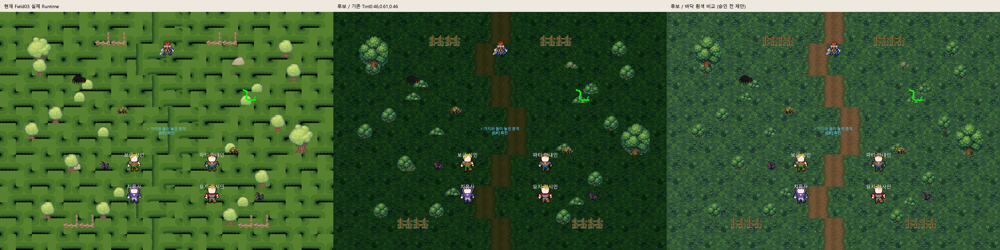
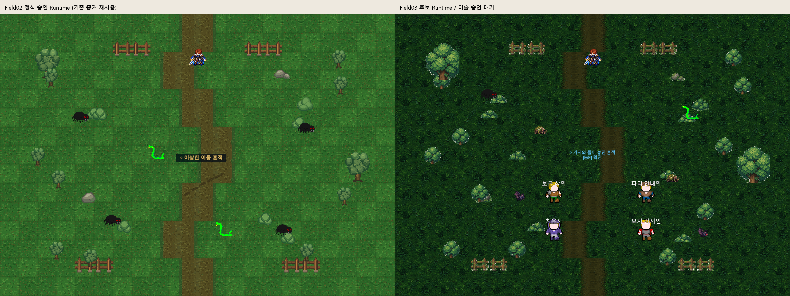
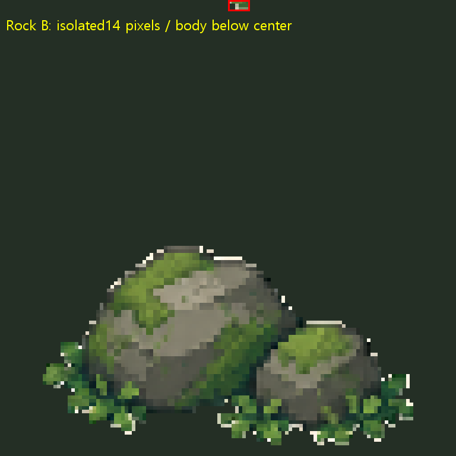
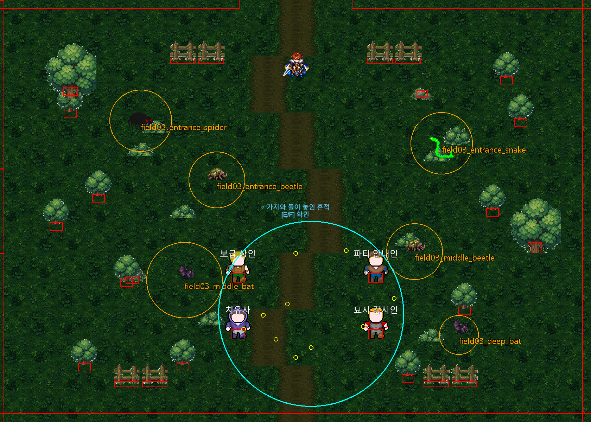

# Field03 「침묵의 숲길」리뉴얼 v1 검수 — 2026-10-12

**USER_ART_REVIEW_PENDING / 전체 QA_PARTIAL / 원본 게임 영구 적용0.** PNG 기계 검사는 PASS지만 Rock B의 분리 픽셀/접지, 나무 외곽 밝은 픽셀, 기존 Tint의 암부와 반복무늬는 미술 보완 검토가 필요하다. 임시 Sprite는 격리 Unity의 메모리에서만 적용했고 Scene을 저장하지 않았다.

## 시작 상태·검수 기준

AGENTS·팀 운영 COMMON_RULES/CODEX·PROJECT_CONTEXT/CODEX_WORKFLOW·CURRENT_STATUS·스토리 정본 Main08~10/실제 코드·Field03 Scene/Theme/Spawns/Connections/Safety를 확인했다. 로컬/GitHub main 모두 `e31d8e3ad844bbdf4f617156a2e876a45c107565`(원격ls-remote). 미커밋337항목 보호. Field02 정식 통합/Push 결과를 재작업하지 않았으며 연속성 비교는 기존 승인 Runtime 증거를 재사용했다.

원본 `F:/Downloads/Limitless_Field03_Renewal_Art_v1.zip`, SHA256 `333ffb32a8255cabadf021b33a1aa243c7d2c4e9d7304eb424a6055f01209d81`,34항목/PNG29개. 실사용20(직접12/보조8),Preview7,QA2. CRC 오류0·PNG29전체 디코딩·Manifest20파일/크기/SHA 일치. Manifest의 기존GUID/fileID/363개 수량도 LOCAL과 전부 일치. [전체 기계 감사](Evidence/Field03Renewal_v1_20261012/zip_scene_audit.json).

## 실제 환경 대응

Scene363 = Grass315 / Road30 / Tree5 / Bush3 / Rock2 / Fence8. Theme TreeWest 복제8+BushWest 복제5 = 전체376. [개별376 대응 CSV](Evidence/Field03Renewal_v1_20261012/sprite_mapping_376.csv), [원본 Runtime](Evidence/Field03Renewal_v1_20261012/runtime_before.json), [후보 Runtime](Evidence/Field03Renewal_v1_20261012/runtime_candidate.json). 모든376개의 위치·Scale·Flip·Sorting·Tint·Collider 교체 전후 동일. 신규 PNG20종은 격리 경로 `Assets/_Project/QA_Field03Candidate/`만 임시 Import: Single/PPU128/Center/Point/무압축/Mipmap Off/NPOT None. 원본 기존 Sprite/meta/GUID 변경0.

| 기존 Sprite | Scene+Runtime 참조 수 |
|---|---:|
| `bush_01` | 7 |
| `bush_02` | 1 |
| `fence_tiles_2_2` | 8 |
| `rock_01` | 1 |
| `rock_02_0` | 1 |
| `tiles_grass_4_0` | 105 |
| `tiles_grass_4_4` | 15 |
| `tiles_grass_5_0` | 106 |
| `tiles_grass_5_4` | 15 |
| `tiles_grass_6_0` | 104 |
| `tree_big` | 2 |
| `tree_medium` | 11 |

GroundTint `(0.46,0.61,0.46,1)`와 cameraColor는 유지했다. Floor A/B/C 각9쌍의 좌우·상하 경계와 PathLeft/Right 중앙 경계 pixel byte 일치. 랜덤 Flip을 유지한 실제 배치에서 반복무늬 밀도는 눈에 띈다. 경계 pixel 일치가 미술적 반복감 해소를 뜻하지 않는다.

보조8종은 미배치: DeepSilence Patch / Root / Branch / CarvedStone / OrderedStoneStack / CatacombEntrance Frame / DisturbedTrace / PaulWheelRuts. 기존 조사 Quad·바퀴자국·단계별 지하묘지 표현을 덮어쓰거나 항상 켜진 입구를 추가하지 않았다. 보조 문양/푸른빛은 미스터리 정본과 별도 검토해야 한다. Manifest가 출처 시트 사용 및 독창성/라이선스 독립 감사 미완료를 명시하므로 권리 검증 PASS로 처리하지 않는다.

## 미술 검토용 실제 Preview

세 화면은 실제 Unity RenderTexture다. 오른쪽은 바닥만 흰색으로 임시 비교한 제안 화면이며 원본 Theme 변경0. 기존 Tint에서는 길과 바닥이 상당히 어두워진다. 중앙 왼쪽 동일 grass 표본의 RGB 평균은 원본[82.23484375, 119.175625, 46.5778125]→후보[24.9521875, 53.8590625, 24.10890625]이며 밝기 비교 참고값이지 자동 합격 기준이 아니다. Quest Marker의 파란 글자/NPC 흰 이름은 표시되지만 사람의 가독성 승인을 대신하지 않는다.

Field03는 더 짙은 암부·촘촘한 잎 무늬와 세부 묘사가 늘어 Field02와 명암/질감 차이가 크다. '침묵의 숲길' 분위기와 길 구분·눈 피로를 함께 검토해야 한다. [실제 전체맵](Evidence/Field03Renewal_v1_20261012/candidate_runtime.png), [납품 Contact Sheet](Evidence/Field03Renewal_v1_20261012/package_contact_sheet.png). 납품7개 Preview는 AI concept 합성이고 실제 좌표 배치/Collider 검증 화면이 아니다. [납품 concept](Evidence/Field03Renewal_v1_20261012/package_ai_concept.png)과 본 실제 Preview를 구별한다.

Rock B 상단(64,0)-(70,3)에 **14개 분리 alpha 픽셀**, 본체 bbox(12,69)-(116,125)3537픽셀이 있다. 원본85×54/PPU100 alpha 그림0.83×0.52world 대비 본체0.8125×0.4375world로 더 낮고 중앙 Pivot 아래쪽에 치우친다. 원래 위치(4.5,4.4)/Collider size(0.4,0.22),offset(0,-0.22)는 보존했지만 후보 본체 하단worldY3.92344는 Collider 하단4.07보다0.14656 아래다. **단순 Rect128×128/Center 치환을 접지 동일로 승인할 수 없다.** 분리 픽셀 제거와 본체 캔버스/접지 기준을 미술 담당이 정리하여 재납품하는 것을 권장한다. Codex 원본 PNG 수정0.

[나무 외곽 밝은 픽셀 확대](Evidence/Field03Renewal_v1_20261012/tree_edge_bright_pixels_zoom.png): 실제 암부에서 밝은 외곽 점이 두드러진다. 의도한 잎/장식인지 추출 잔여 테두리인지 제작 담당 확인과 보완 검토가 필요하다. 출처·의도를 추측해 확정하지 않는다.

## 스토리·몬스터·월드 Runtime

Unity6000.6.5f1, 기존 `Temp/Field01RenewalQA/Client` 재사용, Hidden Batch/Direct3D RenderTexture·스피커0. 별도 Field03Inspection/Viewport의 Saves·Settings, 최초 쓰기 전 슬롯 경로 검증. 원본 Editor PID31832 유지·포커스/Play/Scene조작0. 교체는 Play 메모리에만 적용, 원본/격리 Field03 Scene파일 저장0.

| 검사 | 실제 범위/판정 |
|---|---|
|Main08|PASS(Field03): Field02 첫4목표는 fixture 사건으로 준비(재플레이0), 실제 Field03 입장/조사(0,-1.5)/깊은고요(0,-5.2) Trigger·대화·완료·Continue |
|Main09|PASS: 푸른빛(2.4,-4.1)→바퀴자국(3.5,-3.1)→폴(1.8,-1.4)의 재회/정보→석재(-0.3,-3.3)→함께가기6목표, 실제 거리 TryInteract·대화·폴 해금·Continue |
|Main10|PASS: 기존 석재 재사용→가공돌(-1.15,-3.7)→숲길(-1.85,-4.2)→하강(-0.7,-4.55)→입구(0.55,-4.85)7목표. 입구 step0~3숨김/4이후 표시·완료·Continue |
|Dungeon_01|PASS: 완료 입구 실제 TryInteract로 진입/B1몬스터4확인, Exit_To_Field03 Trigger→(.55,-2.65) 실제 귀환 |
|Field02↔03|PASS: 실제 Transition callback/Spawn(0,-5.2)/(0,4.7). Field02 재통합/별도 회귀0 |
|몬스터6|PASS: 숲거미1/맹독뱀1/이끼갑충2/그늘박쥐2, 기존 Spawn·활동반경·안전지대 유지,6개 정상 UI전투 승리·재스폰·최종6개/중복0 |
|리스폰|**현행35초 PASS / 요청30초 불일치**: 모든6SpawnDefinition이35초. 30초 미생성/35초 만료후각1개 확인. 게임 설정 변경0 |
|휠체어|PASS: mobility 공식외형, 실제 Player Circle반경0.5+margin0.03/NPC·환경 Collider를 포함한11지점 물리 접근. 목표중심이 막히면0.9이내 접근점(실제 상호작용범위1.6) 선택. 몬스터 동적Collider는 시험 동안만 제외/복원 |
|Bounds/Camera|PASS:21×15; 북/남/좌/우 실제 Follow Camera16:9 viewport4개가 Bounds 안에 유지. 전체맵/조사 확대는 별도 검토용 카메라 조절 캡처 |
|누락/Console|Sprite/Script 누락0·Compile오류0, 신규 게임 Console 오류0. 기존 Search 예외 재발로 전체 PARTIAL |

UI전투는 Lv15 투사/mobility와 실제 동료 구성 fixture에서 Attack Button/대상HitArea→정상 AI/TurnQueue/승패/보상/귀환을 실행했다. 각 전투 전 독립 기본HP fixture를 준비했으며 전투 중 HP/스탯/EndBattle 승리 주입0. OS 키보드/패드 조작·전직업/레벨 난이도·연속 사냥 밸런스는 NOT_VERIFIED다. Story 입력도 동일 TryInteract/Trigger 처리 경로를 자동 호출한 범위이며 사용자 손 플레이와 구별한다.

## 보호 좌표와 충돌 Overlay

빨강=환경/NPC Collider, 주황=실제 안전조정 후 몬스터 활동원, 청록=지하묘지 안전지대 center(.55,-3.65)/radius3.3, 노랑=위10개 Quest 지점. 설명 Overlay이며 게임 배치 수정이 아니다. [좌표표](Evidence/Field03Renewal_v1_20261012/quest_coordinates.csv), [실제 Collider/Spawn](Evidence/Field03Renewal_v1_20261012/world_colliders_spawns.json). 모든10개 스토리 지점은 안전지대 내부이며 활동원은 zone+활동반경 기준으로 밀리는 기존 로직을 유지한다. 기존 안전지대NPC4명이 Main08부터 보이는 현행 동작도 변경하지 않았다.

조사 확대: [Main08](Evidence/Field03Renewal_v1_20261012/main08_investigation_runtime.png) / [Main09 푸른빛](Evidence/Field03Renewal_v1_20261012/main09_step0_runtime.png) / [폴](Evidence/Field03Renewal_v1_20261012/main09_step2_runtime.png) / [Main10 하강](Evidence/Field03Renewal_v1_20261012/main10_step3_runtime.png) / [발견된 입구](Evidence/Field03Renewal_v1_20261012/main10_step4_runtime.png).

## 실패 이력 및 재검증

1. QA의30초 고정 기대값은 현행35초 Asset과 불일치하여 FAIL. 이전 결과를 삭제하지 않고 기존35초 설정으로 검사만 수정했다. 사용자 요청의30초를 맞추기 위해 게임 값을 변경하지 않았다.
2. 첫 물리 경로는 NPC를 경로탐색에서 제외하고 Player반경0.4를 사용해(실제0.5) 푸른빛 주변 묘지감시인 Collider에 막혔다. 게임 버그/신규아트 Collider 변경이 아니라 QA 탐색 모델 오류다. 실제0.5+margin/NPC를 포함하고 상호작용 거리 내 접근점을 찾자11지점 물리 검사가 통과했다. 타겟좌표/NPC/Collider 수정0, 이미 통과한Story/전투/35초 검사는 반복0.
3. 각 Batch의 UnityEditor.Search.SearchDatabase/IndexationOnStartup 예외는 기존 별도 미해결2이슈로 유지한다. 기능/Viewport 재검증 PASS를 전체QA PASS로 바꾸지 않는다.

[최초 결과/30초 기대값 실패](Evidence/Field03Renewal_v1_20261012/checks.txt) · [35초/물리경로 실패](Evidence/Field03Renewal_v1_20261012/checks_resume.txt) · [보정 경로/실제 Camera](Evidence/Field03Renewal_v1_20261012/viewport_checks.txt) · [6스폰 시간](Evidence/Field03Renewal_v1_20261012/respawn_times.csv) · [Viewport JSON](Evidence/Field03Renewal_v1_20261012/viewport_camera_viewports.json).

[원시 최초 로그](../../Temp/Field03Inspection20261012/runtime_attempt1.log) · [35초 재개](../../Temp/Field03Inspection20261012/runtime_resume.log) · [접근/Camera](../../Temp/Field03Inspection20261012/viewport_accessibility.log). 모두 보존. Save/Continue3회는 완료ID와 좌표 정확복원 및 정상 후속 Main 자동시작을 구별하여 검사했다.

## 승인 대기·보존

사용자 미술 승인은 아직 없다. **USER_ART_REVIEW_PENDING**을 유지한다. 우선 검토3건: Rock B 분리픽셀/접지 보완, 나무 밝은 외곽 및 Field02 연속성/암부, 보조8종의 별도 배치/서사·권리 확인. 자동 Runtime 검증은 사람의 미술/가독성 승인을 대체하지 않는다. 승인 후에도 Sprite-only 최소 통합과 Rock B 별도 검증이 필요하다.

원본게임3712파일 SHA256 불변·삭제0, 기존 사용자337항목/822파일 보존. Scene/meta/GUID/승인Field02·TTS/BGM/캐릭터/Save/설정 변경0. [보호 증거](Evidence/Field03Renewal_v1_20261012/protection.json). 문서/검수증거만 선택적 Commit. Git Push0.

## PNG 전체 목록

아래29개 중 Ground/Props/Story20개가 실사용 후보이고 Preview7/QA2는 검토자료다.

| 파일 | 해상도 | 모드 |
|---|---|---|
| `Ground/LL_C1_F03_DeepSilence_Patch_128_v1.png` | 128×128 | RGBA |
| `Ground/LL_C1_F03_ForestFloor_A_128_v1.png` | 128×128 | RGBA |
| `Ground/LL_C1_F03_ForestFloor_B_128_v1.png` | 128×128 | RGBA |
| `Ground/LL_C1_F03_ForestFloor_C_128_v1.png` | 128×128 | RGBA |
| `Ground/LL_C1_F03_Path_Left_128_v1.png` | 128×128 | RGBA |
| `Ground/LL_C1_F03_Path_Right_128_v1.png` | 128×128 | RGBA |
| `Preview/LL_C1_F03_Asset_ContactSheet_v1.png` | 1100×1120 | RGBA |
| `Preview/LL_C1_F03_CoordinateOverlay_v1.png` | 1448×1086 | RGBA |
| `Preview/LL_C1_F03_Field02_Field03_Continuity_v1.png` | 1672×941 | RGB |
| `Preview/LL_C1_F03_Layout_21x15_CompositePreview_v1.png` | 1448×1086 | RGB |
| `Preview/LL_C1_F03_Main08_Closeup_v1.png` | 1448×1086 | RGB |
| `Preview/LL_C1_F03_Main09_Closeup_v1.png` | 1448×1086 | RGB |
| `Preview/LL_C1_F03_Main10_CatacombEntrance_Closeup_v1.png` | 1448×1086 | RGB |
| `Props/LL_C1_F03_Branch_A_128_v1.png` | 128×128 | RGBA |
| `Props/LL_C1_F03_Bush_A_128_v1.png` | 128×128 | RGBA |
| `Props/LL_C1_F03_Bush_B_128_v1.png` | 128×128 | RGBA |
| `Props/LL_C1_F03_CarvedStone_A_128_v1.png` | 128×128 | RGBA |
| `Props/LL_C1_F03_Fence_MossWood_128_v1.png` | 128×128 | RGBA |
| `Props/LL_C1_F03_OrderedStoneStack_A_128_v1.png` | 128×128 | RGBA |
| `Props/LL_C1_F03_Rock_Moss_A_128_v1.png` | 128×128 | RGBA |
| `Props/LL_C1_F03_Rock_Moss_B_128_v1.png` | 128×128 | RGBA |
| `Props/LL_C1_F03_Root_A_128_v1.png` | 128×128 | RGBA |
| `Props/LL_C1_F03_SilentCatacomb_Entrance_Frame_192x192_v1.png` | 192×192 | RGBA |
| `Props/LL_C1_F03_Tree_Big_255x256_v1.png` | 255×256 | RGBA |
| `Props/LL_C1_F03_Tree_Medium_128x156_v1.png` | 128×156 | RGBA |
| `QA/LL_C1_F03_GroundTint_Comparison_v1.png` | 1920×534 | RGB |
| `QA/LL_C1_F03_TileRepeat_6x6_v1.png` | 768×896 | RGBA |
| `Story/LL_C1_F03_DisturbedTrace_128_v1.png` | 128×128 | RGBA |
| `Story/LL_C1_F03_WheelRuts_Paul_128_v1.png` | 128×128 | RGBA |
