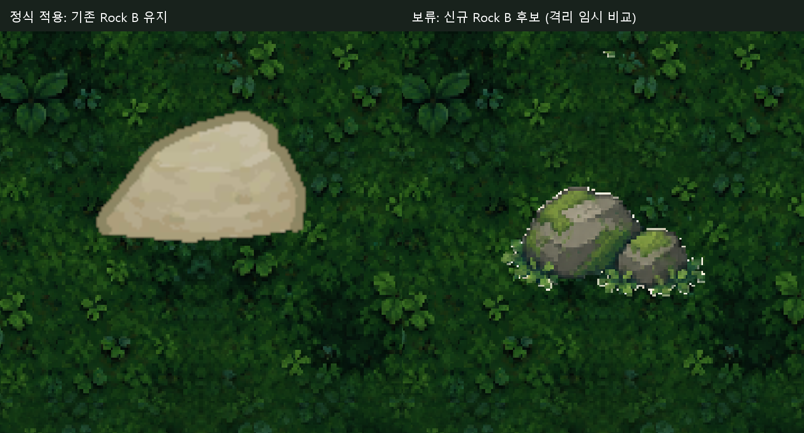
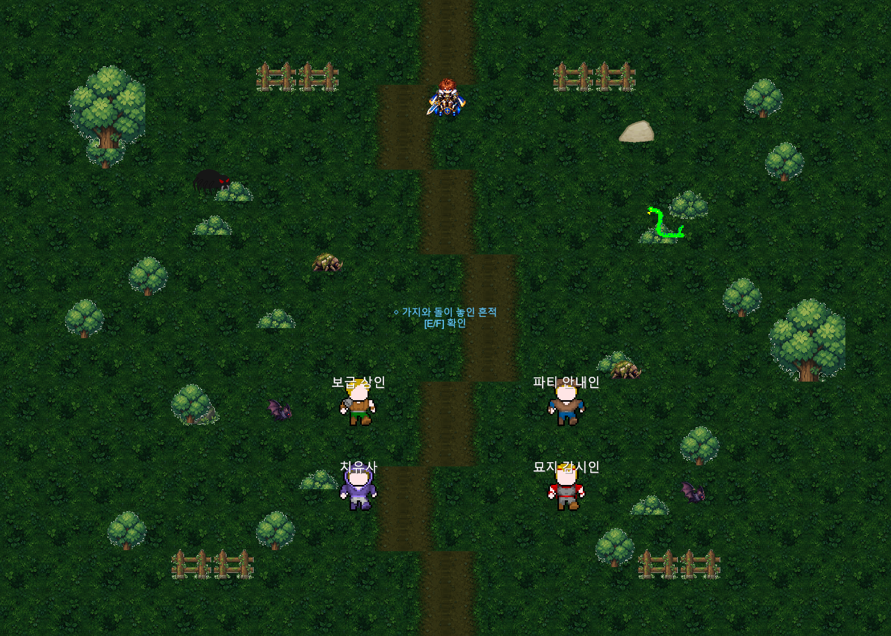

# Field03 리뉴얼 v1 정식 통합 QA — 2026-10-12

**USER_ART_APPROVED / 정식 적용11종 / 환경375 of 376 / 전체 QA_PARTIAL.** 사용자 최종 미술 승인을 반영했습니다. Scene362개와 Theme복제13개를 신규아트로 연결하고, 기술 문제가 확인된 **Rock B1종·Scene1참조는 기존 Sprite로 유지**했습니다. 신규 자산 누락이나 일괄 적용 실패가 아닌 명시적 기술 보류입니다.

## 적용 수량과 보존

|구분|원래 대상|신규 적용|기존 유지|
|---|---:|---:|---:|
|직접 교체 Sprite 종류|12|11|Rock B1|
|Scene 환경 참조|363|362|RockNorth1|
|Field03_SilentForest 복제|13|13|0|
|합계 환경 참조|376|375|1|

신규 경로는 `Assets/_Project/Art/Environment/Field03/V1/`입니다. Ground5종·Props6종의 PNG는 ZIP 원본 byte 그대로이며, PNG11+PNG meta11+folder meta4=신규26파일입니다. Unity6000.6.5f1 격리 Import가 생성한 GUID15개는 서로 고유하고 기존 GUID와 충돌0입니다. Single/PPU128/중앙 Pivot/Point/무압축/Mipmap Off/NPOT None을 확인했습니다. 신규 Rock B 및 보조8종은 원본 프로젝트에 Import하거나 배치하지 않았습니다.

검수 정본 `sprite_mapping_376.csv`의 old GUID/fileID를 사용했습니다. 원본Scene에서 Sprite 참조362행만 치환했고, 메모리상 역대응한 byte가 변경 전Scene과 정확히 같습니다. 좌표·Scale·Flip·Sorting·Collider·다른Scene 데이터와 기존meta는 불변입니다. 실제Runtime376행에서도 position/scale/sorting/flip/colliders/tint 차이0입니다. GroundTint `(0.46,0.61,0.46)`과 CameraColor `(0.025,0.045,0.04,1)`을 유지했습니다.

`FieldThemeInstaller`는 TreeWest8개/BushWest5개를 복제하므로 신규Sprite가 그대로 반영됩니다. Theme 로직·데이터 수정0입니다. `Field03Main08ContentBuilder.CreateSceneAndBuildEntry`는 Field03가 없을 때만 Field02를 복사하며 기존Scene을 재생성하지 않습니다. 생성기 실행0·게임C#변경0입니다.

[376개 최종 대응표](Evidence/Field03Official_20261012/sprite_mapping_376_official.csv) · [PNG SHA256/GUID/Importer](Evidence/Field03Official_20261012/asset_hash_guid_importer.json) · [변경 파일/수량](Evidence/Field03Official_20261012/integration.json) · [Runtime 형상 비교](Evidence/Field03Official_20261012/runtime_geometry_preservation.json).

## Rock B 기술 보류

이전 실제RenderTexture 및 이번 정식Scene의 확대 비교를 확인했습니다. 후보PNG의 상단 분리 alpha14픽셀과 낮은 본체 접지는 여전히 남아 있습니다. 새본체 bbox(12,69)~(116,125), 하단worldY3.92344는 기존Collider 하단4.07보다0.14656 낮습니다. 기존85×54 Slice/PPU100 Sprite `rock_02_0`의 GUID `5b951bd26f9af3849a2fe92928a0c645` 및 fileID `-1321756614084088994`를 RockNorth(4.5,4.4)에 그대로 유지합니다. Collider size(.4,.22)/offset(0,-.22)도 불변입니다.

후보PNG를 수정하거나 Collider를 이미지에 맞춰 이동하지 않았습니다. 이번 비교 촬영에서만 격리Runtime의 RockNorth Sprite를 잠시 후보로 바꿨다가 즉시 복원했으며 Scene 저장0입니다. 원본ZIP/v1PNG를 보존하는 별도버전 수정을 아트 담당에게 요청할 자료를 준비했습니다. [수정 요청서](Evidence/Field03Official_20261012/RockB_Art_Correction_Request.md).

## Runtime QA 결과와 범위

원본Editor PID31832와 화면을 조작하지 않고 기존 격리 프로젝트 `Temp/Field01RenewalQA/Client`를 재사용했습니다. BatchMode/D3D RenderTexture, 별도 AuditSaveDirectory·Settings, 음소거로 검증했습니다. 모델 용량 오류로 응답이 중단된 사이에도 재개QA가 완료되어 있었으므로 복구 후 Unity 실행/이미 통과한 검사를 다시 수행하지 않았습니다.

|검사|판정·실제 범위|
|---|---|
|Import/참조|PASS: 신규11종·Scene362+복제13=375, Rock B 기존1 포함 총376, Missing Sprite/Script0|
|Main08 전체|PASS: Field02 흔적3/폴 바퀴자국 실제 Interact·대사 완료 → Field03 진입 → 조사/깊은고요 완료|
|Main09|PASS:6단계 실제 TryInteract/대사 진행, 폴 영구해금|
|Main10|PASS:7단계 실제 TryInteract, 입구0~3숨김/4이후표시, 완료 후 진입 가능|
|Main11 진입 조건|PASS:Field03의 Main10 완료 뒤 Available/활성Main없음 → 실제 Dungeon01 진입 때 Main11 시작. Main11 전체 던전 퀘스트/보스 완료는 이번 범위 NOT_VERIFIED|
|Save/Continue|PASS:Main08/09/10 완료 뒤 별도Save→Bootstrap 슬롯Continue, 완료ID와 실제좌표 정확복원3회. 재개QA도 Main10 완료Save를 그대로 사용|
|정상 전투6회|PASS:거미1/뱀1/이끼갑충2/그늘박쥐2. 실제 Attack 버튼/대상HitArea/TurnQueue/승리/복귀, 각각7~8회공격. 승패·적HP 강제주입0|
|35초 리스폰|PASS:각6Spawn 승리귀환 타이머,30초에는미생성/35초에각1개 복원, 최종6개·중복0. 관찰프레임 지연2.03~2.91ms. 게임 설정변경0|
|왕복|PASS:Field03→Dungeon01→Field03, Field03→Field02→Field03의 실제 Trigger/진입상호작용 및 목적Spawn|
|휠체어 접근성|PASS:실제반경0.5+margin0.03/NPCCollider 포함11지점·Rigidbody112waypoint. 동적몬스터Collider만 검사 중 잠시 제외후복원. 목표좌표 변경0|
|Field01/02 회귀|PASS:각 승인된 환경363개 경로와 Missing0. 기존파일hash불변|
|마을 회귀|PASS:V4 환경302(활성300),15종,12NPC 이름/Marker/인접접근, Bounds/남문, Sprite PPU/Scale, RenderTexture|
|Camera|기존검수의16:9 네방향 viewport/Bounds PASS 증거 재사용. 이번Scene 형상/Camera 데이터 불변, 전체/주요지점 RenderTexture 새촬영|
|Console|PARTIAL:컴파일 오류0, 재개QA의게임신규오류0. 기존 Unity Search.SearchDatabase/IndexationOnStartup 예외1회 재현; 기존미해결2이슈 유지|

Story/Transition 검사는 실제 처리 메서드·Trigger callback을 자동 호출한 범위입니다. 전투는 Lv15 투사·지체의길 fixture이며 스폰별 기본체력 초기화로 독립 검증했습니다. 전투 연출은 timeScale8, 복귀 뒤 timeScale1이고 리스폰은 기존 realtime35초를 측정했습니다. OS 키보드/패드 직접조작, 모든직업/레벨·연속사냥 밸런스를 검증했다는 뜻은 아닙니다.

[기존/정식 전체 Runtime 비교](Evidence/Field03Official_20261012/before_after_official_runtime.png)

Main08 조사문구와 NPC 이름, Main10 입구 안내는 실제화면에 표시됩니다. **폴 재회 확대에서는 가까운 파티안내인의 이름/대화 안내가 겹치는 기존 구간**이 확인됩니다. 동일 겹침은 승인 전검수 이미지에도 있고 이번 Sprite-only변경으로 UI위치를 바꾸지 않았습니다. 가독성 전체PASS로 확대하지 않고 사람의 실제플레이 확인항목으로 남깁니다. 어두운 Tint/빽빽한 반복무늬/밝은 나무외곽도 승인분위기대로 유지했습니다.

[폴 재회 확대](Evidence/Field03Official_20261012/main09_step2_runtime.png) · [입구 확대](Evidence/Field03Official_20261012/main10_step4_runtime.png) · [휠체어 도착](Evidence/Field03Official_20261012/wheelchair_south_runtime.png).

## QA 오류 복구 및 증거

첫 실행은 Main08~10과Continue3회를 통과한 뒤 QA가 `ActiveMainQuest`를 확인하면서 NullReferenceException을 냈습니다. **Main11이 Field03에서 자동 시작한다는 QA 가정이 잘못됐습니다.** `MainQuest11DungeonFlow.Awake`는 Dungeon01 B1 진입에서만 Available Main11을 시작합니다. 게임코드0변경, QA만 고쳤고 이미 통과한Story는 반복하지 않았습니다. Main10완료Save에서 재개하여 Available확인→입구진입→Main11활성 확인 후 남은검사를 모두 수행했습니다.

최초168 PASS 뒤 QA오류1, 재개316 PASS/FAIL0을 각각 보존합니다. 최초오류를 삭제하거나 처음부터전체를 재실행하지 않았습니다. 전체판정은 Search예외 및 RockB보류 때문에 **PARTIAL**입니다.

[최초검사](Evidence/Field03Official_20261012/checks.txt) · [재개검사](Evidence/Field03Official_20261012/checks_resume.txt) · [6스폰 타이밍](Evidence/Field03Official_20261012/respawn_times.csv) · [마을검사](Evidence/Field03Official_20261012/village_checks.txt) · [요약JSON](Evidence/Field03Official_20261012/qa_summary.json).

[Import원시로그](Evidence/Field03Official_20261012/import.log.txt) · [최초원시로그](Evidence/Field03Official_20261012/runtime_attempt1.log.txt) · [재개원시로그](Evidence/Field03Official_20261012/runtime_resume.log.txt) · [최초QA소스](Evidence/Field03Official_20261012/runtime_first.cs.txt) · [수정재개소스](Evidence/Field03Official_20261012/runtime_resume.cs.txt).

## Git·사용자 원본 보호와 남은 작업

시작 로컬HEAD와 읽기전용 GitHub main은 모두 `9c7457b381bbb67239a1bcd7d8c8425a3a12dea7`였습니다. 기존 Git통합 worktree는 `Temp/GitIntegration20261012/main-merge`에55ac89f 상태로 보존했습니다. 시작337개 사용자status항목/822개 실제파일을 해시로 보호했습니다. CURRENT_STATUS의기존사용자8줄은 작업트리에 남기고Commit에서 제외합니다. 시작게임3712파일 중 허용Scene1개만 바뀌고 나머지3711개는SHA256불변입니다. Scene/meta/GUID·Save·설정·승인Field01/02/마을/캐릭터/TTS25·오류10무음·BGM·ThirdParty 원본을 보호했습니다. [보호JSON](Evidence/Field03Official_20261012/protection.json).

남은 항목: Rock B 수정본 납품/격리재검수/1참조 연결, 기존Search예외, 실제키보드·패드/장시간가독성·겹친안내 확인입니다. Main11 전체던전QA는 이번적용범위 밖으로 NOT_VERIFIED입니다. 외부소스시트 출처·상업적권리 독립감사는 **NOT_VERIFIED**를 유지합니다. 보조8종 신규배치0, Quest/Dialogue/Spawn/35초 설정변경0입니다.

관련파일만 선택적Commit하며 **Git Push는 실행하지 않습니다.** Commit SHA는 후속상태기록에 남깁니다.
