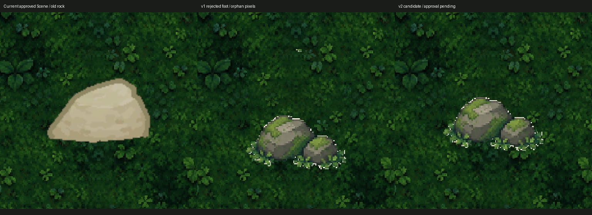

# Field03 Rock B v2 실물·격리 Unity 검수 — 2026-10-13

**기계검사 PASS / 격리 접지·실제 RenderTexture PASS / USER_ART_REVIEW_PENDING / 원본 게임 적용0.** v1의 두 기술 문제는 납품본에서 수정됐습니다. 독립 권리 증빙·사람 최종 미술 승인과 기존 Unity Search 문제는 별도 미검증/보류입니다.

## 실물·원본 대조

| 항목 | 관측 |
|---|---|
| ZIP | `F:\Downloads\Limitless_Field03_RockB_Fix_v2.zip` |
| ZIP SHA256 | `44d8f99bafe5eefc753c18c1ee179da491e935fdf415c60605e60b040e4f53dc` |
| 무결성 | 파일8 / PNG3(실사용1+제작 Preview/QA2), CRC 전체 PASS, PNG 전부 decode PASS, 안전한 상대경로 추출 |
| 실사용 | `Props/LL_C1_F03_Rock_Moss_B_128_v2.png`, 128×128 RGBA |
| PNG SHA256 | `4783f18a407cfaac4489731571b60a7364433f94fc4e849fd74bfd3358b6b770` / Manifest 일치 |
| 승인 v1 ZIP | `F:\Downloads\Limitless_Sprites\Limitless_Field03_Renewal_Art_v1.zip`, SHA `333ffb32a8255cabadf021b33a1aa243c7d2c4e9d7304eb424a6055f01209d81` |
| v1 PNG SHA | `b34a8f54b2ab61020ba7051723cb76d3d8cbfc8f432fee7cf6999de46671b41b`, 납품 source_v1_sha 일치 |

현재 저장소의 [보완 요청](Evidence/Field03Official_20261012/RockB_Art_Correction_Request.md)·공식 Field03 QA·자료 부재 후속 QA를 먼저 읽었습니다. 자료 부재 기록은 과거 이력이며 이번에는 실물 존재를 확인했습니다. 승인 v1 ZIP/PNG는 변경하지 않았습니다.

## 픽셀·접지

- v1 alpha>0: 3,551픽셀,8방향 연결 컴포넌트2개=본체3,537+불필요14. v2:3,537픽셀, 컴포넌트1개. 상단 고립14픽셀 제거 확인.
- 본체 전체를 y=-19px 이동한 예상 배열과 v2 **전체 RGBA 배열 정확 일치**. 색·형상 재제작/본체 손실/외부 픽셀 추가0을 데이터로 확인했습니다. 기존 승인 아트의 시각적 일관성을 유지하는 수정입니다. 사용자 미술 승인 자체를 대신하지 않습니다.
- bbox는 PIL exclusive 좌표입니다: v1(12,0,116,125), v2(12,50,116,106). 납품 Manifest의 inclusive 표기와 구분합니다.
- Scene `Field_03` / RockNorth(4.5,4.4,0), Scale(1,1,1), BoxCollider2D size(.4,.22), offset(0,-.22) **격리 실제 값 일치**. 실제 collider 바닥Y=4.070001(부동소수점).
- 신규 Single Sprite / PPU128 / Center Pivot(64,64) / Point / 무압축 / AlphaIsTransparency / FullRect로 격리 Import했습니다. alpha 하단 pixel-edge 월드Y=4.071875, Collider 하단4.07과 차이 **0.001875world(약0.24px)**. v1 본체 하단3.9234375보다19/128world 올라가 문제를 해소했습니다. PNG 원본을 추가 보정하지 않았습니다.
- 실제 RenderTexture에서 기존 Sprite, 문제 v1, 수정 v2를 같은 Camera/원래 배치로 캡처했습니다. 원래 Collider의 (4.5,4.18) 점 solid도 확인했습니다. Sprite 전체 rect bounds는 alpha 접지와 다르며 접지 계산은 alpha 본체 기준입니다.

[v2 실제 Unity 확대](Evidence/ArtInspection_20261013/rock_v2_unity.png) · [픽셀 감사](Evidence/ArtInspection_20261013/rock_pixel_audit.json) · [Importer 실제16개 기록](Evidence/ArtInspection_20261013/attempt1_imports.tsv).

## GUID·권리·보호

격리에서 생성한 Rock1+Field04 후보15의 GUID16개는 서로 중복0, 원본 Assets의 기존 GUID와 충돌0입니다. **격리 QA GUID를 원본에 복사하거나 정식 GUID로 확정하지 않습니다.** 정식 Import는 승인 후 Unity가 새 meta/GUID를 만들게 해야 합니다.

납품은 승인 v1 픽셀의 위치 수정이며 source SHA·실제 픽셀 동등성을 확인했습니다. 원본 v1의 독립적 상업권/제작자 계약 증빙은 NOT_VERIFIED입니다. 납품 선언을 독립 권리 감사 PASS로 승격하지 않습니다.

원본 Field03 공식 **375/376**과 RockNorth 기존 Sprite 유지. 모든 원본 Scene·PNG·meta·Collider·Save·TTS/BGM·사용자 수정은 byte 보호했고 격리 복사본의 메모리 참조만 바꿨습니다. 새 PNG의 원본 게임 등록/Scene 저장0입니다. 원본 Editor는 Bootstrap/Edit Mode/비포커스 그대로입니다.

## 승인 후 최소 적용 계획

1. 사용자가 위 실제 비교의 v2 미술을 최종 승인합니다. 현재 자동 승인하지 않았습니다.
2. 프로젝트 전용 새 버전 경로(제안: `_Project/Art/Environment/Field03/V2/Props/`)에 **납품 PNG byte 그대로** 등록, 새 meta/GUID, PPU128/Center/Point/Alpha 계약 확인.
3. Field03의 RockNorth **Sprite 참조1개만** 선별 교체. 좌표·Scale·Sorting·Collider·다른375 Sprite 참조·Theme·Generator/C#는 변경하지 않습니다. 동일 old GUID를 공유하는 Field04/다른 Scene은 교체 대상이 아닙니다.
4. 격리에서 해당 foot/주변 휠체어 이동·Missing/Compile/Console·Field02/던전 왕복·SaveContinue를 확인하고 관련 Main08~11 영향이 없는지 기존 증거와 대조합니다. 영향이 없다면 정상375 전체를 다시 제작/교체하지 않습니다.
5. 적용 기록과 선별 커밋을 별도 작성합니다. 실패 시 해당 참조1개만 이전 값으로 되돌릴 수 있는 변경표를 유지합니다. Push는 사용자에게 맡깁니다.

## 검증 경계

Rock 검사는 첫 Batch에서 PASS62 항목의 일부로 완료했습니다. 이어 Field04 QA 비교 함수가 잘못된 JsonUtility 사용으로 중단했지만 Rock 결과를 삭제/재실행하지 않았습니다. 컴파일 오류0, GPU RenderTexture 실제 출력 확인. Unity Search 기존 예외로 **공통 전체 QA PARTIAL**입니다.

NOT_VERIFIED: 사용자 실제 미술 승인, 원본 Editor 정식 Import, v2 적용 후 전체 Main08~11/전직업·장시간 손 플레이, 독립 권리 증빙. 이번은 승인 전 검수이며 게임 정식 적용 완료가 아닙니다. 커밋·보호집합은 [총괄 기록](ArtInspection_20261013_Summary.md)을 따릅니다.
