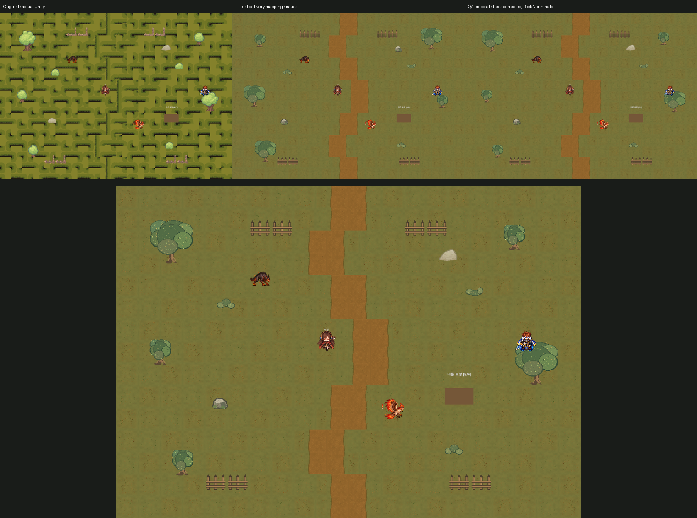

# Field04 환경 v1 실물·격리 Unity 검수 — 2026-10-13

**검수 완료 / 전체 PARTIAL / ART_MAPPING_FIX_REQUIRED / USER_ART_REVIEW_PENDING / 정식 적용0.** ZIP·PNG·타일·Importer·기능 회귀는 확인했으나, 납품표의 나무 Big/Medium 대응과 RockNorth 접지에 보완이 필요합니다. 기존 서쪽 Spawn 겹침·북쪽 경계 틈도 새 아트와 구분해 기록했습니다.

## 입력·무결성

- ZIP `F:\Downloads\Limitless_Field04_Renewal_Art_v1.zip`, SHA256 `60f4c51d5dba1ad3bae862db033d36ccaae2cf8dac5b34b65762667874441be3`.
- 파일27, PNG21=환경12+Optional_Story3+Preview4+QA2. ZIP CRC/경로 containment/PNG 전부 decode PASS. 원본 ZIP은 전후 SHA 유지.
- Manifest12개의 SHA/size/경로와 실제 PNG **12/12 일치**. Optional3은 README에 별도 제안이며 Manifest의 assets에 포함되지 않음; 별도 QA/Validation.json hash와3/3 일치. Optional3을 본 적용12종으로 세거나 자동 배치하지 않았습니다.
- [기존 저장 Scene374행](Field04_Serialized_Object_Mapping_20261013.csv) 및 [Runtime18행](Field04_Runtime_Protection_Mapping_20261013.csv)·실제 로컬 meta·직접 로드한 Sprite GUID+signed fileID를 대조했습니다. 명칭보다 GUID+fileID/원크기를 우선해 충돌을 보고합니다.
- 격리 실제 Import: 환경12+Optional3+Rockv2=16종, Single/PPU128/Center/Point/무압축/AlphaIsTransparency/FullRect. 새 GUID16 중복0·원본 GUID와 충돌0. Optional3은 Import 검사만 했고 Scene 배치0입니다. 새 GUID/PNG/meta는 원본 게임에 등록하지 않았습니다.
- 실사용 Props 연결 컴포넌트 검사 및 PNG별 alpha bbox/파일 SHA는 [PNG 감사](Evidence/ArtInspection_20261013/png_audit.json), 실제 Importer는 [TSV](Evidence/ArtInspection_20261013/attempt1_imports.tsv)를 따릅니다.

## Scene 대응률과 중요한 충돌

실제 저장 환경363=Grass315+Road30+Props18. GUID+fileID 기준 납품 대응 **363/363,12/12 역할, count 일치**입니다. 그러나 참조를 찾았다는 사실과 적절한 크기/접지는 별개입니다.

| 납품표 | 실제 로컬 Sprite | 문제·판정 |
|---|---|---|
| tiles_grass_3_0 /1606921373@ecafa… /104개 | tiles_grass_6_0 /1×1 | 명칭 불일치. ID/개수/크기는 일치; 문서 이름 보완 대상 |
| tree_big /21300000@5b888… /3개 →255×256 | **tree_medium** /128×156, PPU128 | 기존1×1.21875에 새1.9921875×2를 배정. 3개 나무가 커짐; 그대로 적용 보류 |
| tree_medium /21300000@d062… /2개 →128×156 | **tree_big** /255×256, PPU128 | 기존1.9921875×2에 새1×1.21875를 배정. 2개 나무가 작아짐; 그대로 적용 보류 |
| rock_02_0 /-1321756614084088994@5b951… | slice85×54, **PPU100**, native.85×.54 | 새128×128/PPU128은 native1×1. alpha foot/실루엣도 달라 단순 교체 보류 |

[12역할 개별 대조 CSV](Evidence/ArtInspection_20261013/field_mapping_audit.csv)와 [실제 Sprite/Renderer bounds](Evidence/ArtInspection_20261013/resume1_original_sprite_bounds.tsv)에 전체값을 기록했습니다. 상기 차이는 Manifest를 자동 수정해 숨기지 않았습니다.

QA에만 두 후보를 만들었습니다:

1. **Literal**: 납품의 GUID→PNG 표 그대로 메모리 참조만 교체363개. 나무 크기 역전과 RockNorth 차이를 보여 주는 검수 화면입니다.
2. **Proposal**: 실제 tree_medium3개에 Medium PNG, tree_big2개에 Big PNG를 대응하고 **RockNorth1개는 기존 Sprite 유지**. 신규362/363, Optional0. 부모/좌표/Scale/Sorting/Tint/Collider의 비교값 모두 그대로였습니다. 사용자 미술 승인·납품표 수정 없이 이것을 정식 적용하지 않습니다.

## 실제 RenderTexture·시각 검토

[원본](Evidence/ArtInspection_20261013/field_existing_unity.png) · [납품표 그대로](Evidence/ArtInspection_20261013/field_literal_manifest_unity.png) · [나무 대응 수정·RockNorth 유지 제안](Evidence/ArtInspection_20261013/field_proposal_unity.png) · [세린/조사 지점](Evidence/ArtInspection_20261013/field_serin_sites_unity.png) · [개별 Contact Sheet](Evidence/ArtInspection_20261013/field_individual_contact_sheet.png).

이 파일들은 격리 Unity6000.6.5f1/GPU의 Camera.Render→RenderTexture 출력입니다. 납품 ZIP의 합성 Preview를 실제 Unity 화면이라고 부르지 않았습니다. 비교표의 축소 배치는 QA Contact Sheet이며 큰 원시 캡처도 함께 제공합니다.

- 신규 환경은 녹색 나무·퇴색한 풀·황갈색 길을 유지하며 환경 자체를 화염/사막으로 만들지 않았습니다. 화면의 화염색 몬스터는 **기존 공식 몬스터**이며 이번 리뉴얼 대상이 아닙니다.
- 기존 Field04_DryForest의 groundTint(.69,.61,.42)가 새 Grass/Road에도 곱해진 **실제 색**을 보여 주었습니다. Source PNG보다 황갈색/어두운 올리브색이 강합니다. 서쪽으로 더 건조해지는 방향성은 현재 고정 타일 분포에서 뚜렷하지 않아 **사용자 미술 검토 사항**이며 임의 Tint/배치를 변경하지 않았습니다.
- 5개 ground타일의 자기/교차변형/좌우 길 접합/길 외곽과 Grass 비교 **27/27 edge RGBA 정확 일치**. 전역 실제 길은 기존 계단 형태의 꺾임을 유지하므로 픽셀 이음 PASS가 곡선/길 가독성 최종 승인을 의미하지 않습니다.
- **Tiled 방식은 사용하지 않았습니다.** 기존 Field04가1×1 개별 SpriteRenderer로 타일315+길30을 갖고 Scale1이므로 Simple 교체가 적합합니다. B1/B2의 큰 앵커와 구조가 달라 역할별 반복 child를 추가할 이유가 없었습니다. 근본 크기가 다른 소품은 Tiled로 덮어 해결하지 않습니다.
- 공식 세린/Player/몬스터 Sprite·Animator·이름표·Marker 그대로. Runtime GroundClue의 기존 갈색 Quad도 그대로 보입니다. Optional 물길/토양/잎 데칼을 승인이 없이 올리지 않았습니다.

## 지형·소품 접지

[소품별 alpha foot/Collider CSV](Evidence/ArtInspection_20261013/field_prop_foot_audit.csv)에18개 앵커를 기록했습니다. parent/world Scale1·기존 Collider 보존을 전제로 PNG의 alpha 하단을 월드 단위로 계산했고 실제 Unity bounds도 내보냈습니다.

| 대표 | 신규 alpha foot의 기존 대비 변화 | Collider 하단 대비 | 경계 |
|---|---:|---:|---|
| Tree big(올바른 대응 제안) | 0 | -0.06875 | 기존 발 높이 유지 |
| Tree medium(올바른 대응 제안) | -0.015625 | +0.111875 | 기존과2px 차이; Collider 바닥과 그림 발이 같다고 단정하지 않음 |
| RockWest | -0.1484375 | -0.015625 | 그림 발이 Collider에 가까워짐; 미술 검토 |
| RockNorth Literal | **-0.14625** | **-0.07625** | 현재 feet보다 낮음/원크기 변화; 기술 보류 |
| Fence | -0.125 | +0.028125 | 원래 틈/물리 형상 유지, 표현 발 위치 검토 |

Field03 Rock B v2와 **Field04 Rock B v1은 서로 다른 PNG/해시/지역 자산**입니다. Field03 승인/수정 결과를 Field04에 자동 적용하지 않았습니다. RockNorth 보완은 납품 담당이 기존 alpha 발 관계·.85×.54 원래 slice·새 그림 실루엣을 대조한 별도 버전으로 제출해야 합니다. 원본 Scene/Collider/Scale/PPU를 임의 바꾸어 맞추지 않습니다.

## 실제 기능·접근성 QA

| 검사 | 결과/범위 |
|---|---|
| Main12 | 기존 완료1~11 및 Main12 앞4목표의 **격리 fixture**에서 시작. Field04 동쪽 Spawn→west_entry 실제 도착→Main12 완료/Main13 시작 PASS. Main12 앞4목표 전체를 이번에 다시 플레이한 것은 아님 |
| Main13 | 토양/물길 실제 TryInteract·Dialogue 완료→세린 실제 Story handler→임시 동행→Story Battle 실제 공격6회 UI승리→Arbel 실제 도착→레온 대화→완료 PASS. 기존 순서/ID/화자/공식 Animator 보호 |
| Continue | 실제 Save→Bootstrap Slot01 Action 버튼→위치/Quest JSON 동일 복원2지점(토양 전/Story 승리 후) PASS. 별도 AuditSaveDirectory/Settings 사용 |
| 이동 연결 | Field03↔Field04↔Arbel↔Field05 실제 transition handler/목적 Scene/Spawn PASS. **Field04→Field05 직접 출구는 없고 Arbel 경유가 정상**. OS 입력 왕복을 의미하지 않음 |
| 몬스터 | 실제 Field04 일반2개/활동 정의/35초. 열풍매7공격·그을음들개8공격 **실제 Attack 버튼/타겟 Hit 경로 승리** PASS. 30초 부재/35초1개 재생성/최종 중복0 PASS |
| 휠체어 | 기존 path.mobility·실제 CircleCollider radius.5 사용. 주요5지점 및 동서 출구 접근4지점, 총 **179 실제 Rigidbody waypoint** PASS. 검사 중 일반 몬스터 Collider만 일시 비활성해 환경/NPC 폭을 측정, 종료 후 복원 |
| 서쪽 Spawn 중심 | (-8,0)의 최초 경로 assert FAIL. 실제 기존 TreeWest Box와 Player native 겹침=True, distance=-0.01631531. **원본 Collider 그대로라 신규 아트 원인이 아님**. 근처(-8,.25)와 출구 접근 경로는 PASS; 정확한 Spawn 중심의 무겹침 PASS로 바꾸지 않음 |
| 북쪽 외곽 | legacy북문/Spawn Runtime 제거 확인. (0,7.4) solidCollider 없음. 실제 Exit가 아닌 중앙 틈에 대한 원본 우려 유지. 사용자 입력으로 Bounds 밖 이탈 가능한지는 NOT_VERIFIED |
| Camera | WorldBounds21×15,16:9/4:3/21:9 네 방향 **viewport 전체 Bounds 안**12검사 PASS. 실제 사람 가독성/초광폭 전범위는 별도 |
| 컴파일·Console | 세 번 Batch compile error0. 최종 재개 신규 Runtime오류0, 기존 UnityEditor.Search.SearchDatabase 예외 유지. 원본 Editor Compile/Play를 강제로 실행하지 않음 |

전투는 level30·fighter·mobility 격리 fixture, TimeScale8로 UI전투를 가속했으며 정상 값으로 복원했습니다. 밸런스/전직업·실제 OS 키/패드·장시간 연속 플레이 PASS를 주장하지 않습니다. TTS/BGM을 새로 만들거나 사용자에게 재생하지 않고 MasterMute/AudioListener0을 적용했습니다.

## 실패 보존과 재개

attempt1:62 PASS 뒤 **QA JsonUtility가 engine Collider를 지원하지 않아 중단**. 비교를 size/offset/enabled/trigger/edgeRadius 값으로 고쳤습니다. 게임 코드 변경0. Rock/Importer/이미 얻은 결과는 보존.

resume1:107 PASS 뒤 정확한 서쪽 Spawn(-8,0) 경로 assert 실패. 실패를 삭제하지 않고 기본 Circle radius/TreeWest의 native overlap을 resume2에서 진단했습니다. 이미 통과한5 Story 경로/Preview를 반복하지 않고 근처 통로와 남은 검사로 재개.

resume2:177 PASS/FAIL0, 상태 PARTIAL_KNOWN_SEARCH_USER_ART_REVIEW_PENDING. 전체 원시 PASS346, exact label 중복 제외279. **최초 실패를 포함한 세 실행을 하나의 전체 PASS로 표기하지 않습니다.** [실행별 집계/실패/검사](Evidence/ArtInspection_20261013/runtime_summary.json), 원시 checks/console/QA 소스는 같은 Evidence에 보존했습니다. 원시 Unity 전체 로그는 Temp/ArtInspection20261013에 두고 계정/장치 정보가 섞인 로그를 Git에 그대로 넣지 않았습니다.

Git 문서용 checks/console/QA 텍스트는 LF와 후행공백/EOF 빈 줄만 정리했습니다. 실패 내용·순서·개수는 그대로이며 원시 파일 byte는 격리 Results 및 Temp에 유지합니다. PNG/원본 ZIP/납품 아트는 수정하지 않았습니다.

## 권리·승인 후 변경 범위

제작 담당의 원본 procedural pixel-art/외부 픽셀 미사용 선언을 읽었습니다. PNG/Manifest/해시와 실물은 확인했지만 저작권·제작 과정의 독립 증빙은 NOT_VERIFIED입니다. [납품 선언](Evidence/ArtInspection_20261013/delivery_field_Rights_And_Provenance.md)과 독립 권리 감사는 구분합니다.

1. 납품표 Grass 명칭 및 나무2그룹(5참조) 수정과 RockNorth 별도 보완 또는 기존 유지안을 사용자/리뉴얼 담당이 검토합니다. 현재 기술·미술 승인 보류입니다.
2. Proposal362개를 승인한다면 새 프로젝트 전용 PNG/새 GUID를 등록하고 **Field04 Scene의 해당 Sprite 참조만** 역할별 선별 교체합니다. RockNorth1/Optional3/공식 NPC·몬스터/기존 meta/Transform/Scale/Sorting/Collider/Theme/Quest/Save 보호. 전체363 적용 완료라고 표기하지 않습니다.
3. RockNorth가 보완·승인되면 남은1참조를 별도 처리합니다. 모든 현재 PNG를 자동 수정하거나 Phase/Sprite ID를 만들지 않습니다.
4. 정식 적용 뒤 동일 위 범위의 격리 회귀/Preview·사용자 미술·가독성 확인 및 원본 보호를 다시 기록합니다. 원본의 서쪽 Spawn/북쪽 Collider 문제 수정은 아트 적용과 분리한 별도 기술 범위입니다.

승인 전 원본 신규 PNG/Scene/C#/GUID/Save 영구 변경0. 최종 Commit·보호 결과·Push 명령은 [총괄](ArtInspection_20261013_Summary.md) 및 [Git 통합](Git_Main_Integration_PrePush_20261013.md)을 따릅니다.
