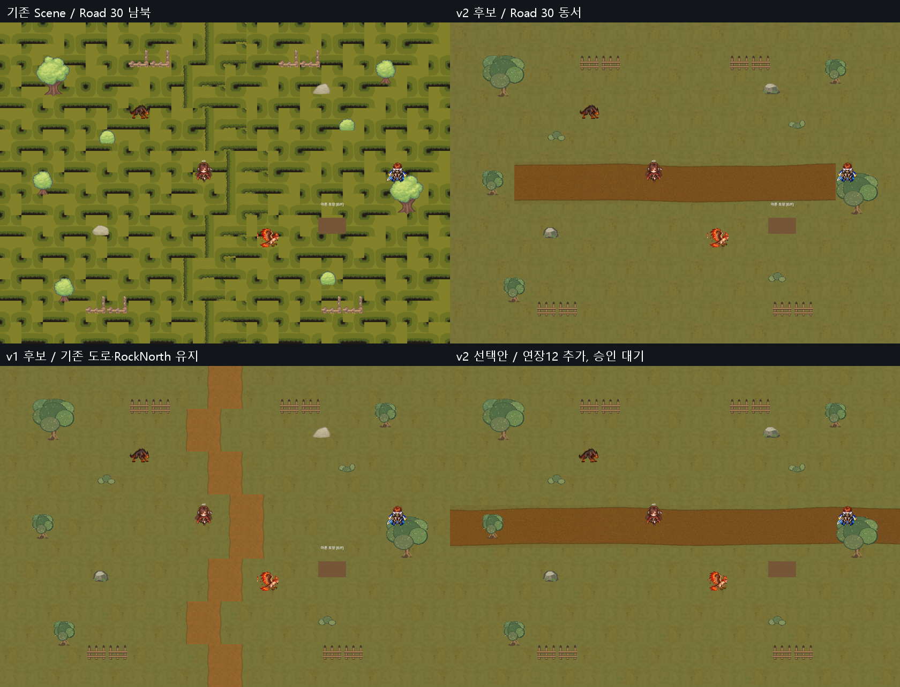

# Field04 v2 검수·동서 도로 실제 재배치 후보 — 2026-10-13

**후보 제작 완료 / 기능 회귀 PASS / 종합 PARTIAL / USER_ART_REVIEW_PENDING / 원본 정식 적용0.** 기존 Road30개를 격리 Unity에서 실제 동서 좌표로 이동했습니다. Sprite 그림만 교체하거나 Scene 전체를 회전하지 않았습니다. 선택안으로 납품된 연장12개를 추가한 별도 후보도 제작했으며, 두 안 모두 미술 승인 전입니다.

## 정본·격리

- 기준 `origin/main` = `0e0476649b667129cb7aa6004f4b677335ed8be2`, `origin/docs/planning` = `c0f1d7c5f91af502380200445eaa3bbb6aa143a4`. A 브랜치 `codex/field04-v2-road-20261013`, worktree `Temp/ABC20261013/A`.
- AGENTS/PROJECT_CONTEXT/CODEX_WORKFLOW/CURRENT_STATUS/팀 공통규칙·Codex 인계, [기존 대응표](Field04_ReadOnly_Renewal_Mapping_20261013.md), [v1 검수](Field04_Art_v1_Inspection_20261013.md)를 읽고 작업했습니다.
- 원격 정본 ProjectVersion은6000.5.7f1, 사용자 원본의 미커밋 설정과 실제 격리 실행은6000.6.5f1입니다. 정본6000.5.7f1 Editor 검증은 **NOT_VERIFIED**이며 버전파일을 바꾸지 않았습니다.
- 실제 GPU Batch는 `Temp/Field01RenewalQA/Client` 복사본에서 숨김·비대화형 실행했습니다. 원본 Editor/OS 포커스 조작0. 복사본 전용 Save·Settings·음소거를 Play 진입 전후 지정했습니다. 원본 Scene·PNG·meta·TTS·BGM 수정0, TTS 실행·API 호출0.

## v2 자산 검수

입력 ZIP `F:\Downloads\Limitless_Field04_Renewal_Art_v2.zip`, SHA256 `178ad6b235c65848cce48f4e2cfe86ff77c36857a12663237f7d7afa561f969d`.

| 검사 | 결과 | 근거·한계 |
|---|---|---|
| ZIP CRC·경로 containment·PNG decode | PASS | ZIP68항목, PNG60개. ZIP 원본 보존 |
| Manifest 경로·SHA·size | PASS | 환경10+도로30+연장12+Optional Story3 =55개 모두 일치. Preview5를 게임자산으로 세지 않음 |
| Renderer 대응 | PASS | 기존363=Grass315+Road30+Props18. 새 자산으로363/363 대응 |
| 나무5개 크기 대응 | PASS | actual Medium3→128×156, Big2→255×256. 기존 PPU128/Center/Scale1 보존 |
| RockNorth 크기·접지 | PASS(기술) | 원본 visible .83×.52 → v2 .828125×.5234375. alpha foot4.14→4.134375, 차이-.005625. Collider bottom4.07·offset(0,-.22)·size(.4,.22) 그대로. 최종 실루엣은 미술 승인 대기 |
| Importer/GUID | PASS | 환경10+도로30+연장12+Story3=55개 Single/PPU128/Center/Point/FullRect/무압축/AlphaIsTransparency. 새55GUID 충돌0. 원본 GUID 재사용·덮어쓰기0 |
| 도로 경계·투명도 | PASS(위치 전용) | 15열×2행 연결, alpha 전부255, 실제 화면에 투명 틈0. 경계 평균 RGB변화9.463 vs 일반 인접9.603. 자연 텍스처이므로43개 edge는 RGBA 중복0/43이며 '완전 동일 edge'라고 주장하지 않음 |
| 바닥 반복 | PASS/범위 제한 | v1과 byte 동일 Grass3·Props6·Story3 총12PNG 보존. 기존 Grass 이음 검증 유지. 새 도로는 위치별 전용이므로 자기반복/Tiled용 타일이 아님 |
| 서쪽 건조 분위기 | PARTIAL | 녹색 나무·퇴색한 풀 유지, 환경 화염화0. 길 자체의 서쪽 건조 표현은 후보 화면으로 검토. 기존 groundTint(.69,.61,.42)와Grass315분포를 그대로 두어 맵 전체의 동서 건조 변화는 강하지 않음 |
| 출처·권리 | PARTIAL | Manifest의 신규 절차적 픽셀아트·외부 픽셀 미사용 선언 확인. 제작 원본/저작권 독립 증명은 NOT_VERIFIED |

[전체 PNG·원본8Texture/meta SHA·alpha·seam·GUID 감사](Evidence/Field04_v2_20261013/asset_audit.json), [실제 Importer](Evidence/Field04_v2_20261013/importers.tsv), [Manifest](Evidence/Field04_v2_20261013/Manifest.json).

## 실제 변경 범위

- 기존 RoadLeft/Right **30개만** Sprite 참조와 시각 Transform 위치 변경: 기존 남북 꺾인 배열 → x=-7..7, y=+.5/-.5, 15열2행. 개별 GameObject/fileID와 old/new 좌표는 [30개 납품 좌표표](Evidence/Field04_v2_20261013/RoadPlacement_30.csv), 실제 실행값은 [TSV](Evidence/Field04_v2_20261013/road_actual.tsv).
- Scale1, rotation identity, SortingLayer0/order-8, 기존 Tint 그대로. Road는 Collider0이며 기능 컴포넌트 이동0. Grass315의 좌표 이동0. 나머지333 환경의 좌표·Scale·Sorting·Tint·Collider snapshot 동일 PASS. 전체 Collider·QuestSite 좌표 snapshot 동일 PASS.
- 기존 Field04는1×1 Simple SpriteRenderer 구조여서 Tiled/Tilemap/Scene 재생성 없이 대응했습니다. 역할별 Tiled를 강제하지 않았습니다.
- 기본30안은 도로가 x[-7.5,+7.5]까지만 보입니다. Spawn±8 및 Exit±10.7까지 시각 도로가 닿지 않습니다. 도로 자산은 **부족하지 않으며**, 납품된 Optional Endpoint12를 쓰면 x[-10.5,+10.5]까지 이어집니다. 따라서 ART_FIX_REQUIRED로 임의 대체하지 않았습니다.
- **별도42안**: 납품 좌표 그대로 x=-10,-9,-8,+8,+9,+10, y±.5에 noncolliding Renderer12개만 추가. 환경375개/Collider 추가0. 양쪽 나무/기존 Spawn 문제는 그대로 보이며 해결했다고 주장하지 않습니다. 이 안의 추가12개는 별도 미술 승인 필요입니다. Optional Story3 배치0.
- 실제 후보 Scene은 격리 `Assets/_Project/QA_Field04V2_20261013/ReviewScenes/Field04_v2_Candidate30.unity`, `Field04_v2_Candidate42.unity`. Git에는 검토용 `.unity.txt`와 replay harness·결과만 기록하며 **정식 Scenes/Field_04_WesternBorder.unity는 A 브랜치에서도 수정하지 않았습니다**. 독립 `.unity.txt`는 단독 실행자산이 아니며 격리 신규 GUID assets가 필요합니다.

## 승인용 실제 Unity Preview

[전체 전](Evidence/Field04_v2_20261013/field_before_full.png) · [전체 후30](Evidence/Field04_v2_20261013/field_after_full.png) · [42안](Evidence/Field04_v2_20261013/optional_candidate42_overview.png) · [도로 확대 비교](Evidence/Field04_v2_20261013/road_before_after_contact_sheet.png) · [RockNorth](Evidence/Field04_v2_20261013/rocknorth_v2.png) · [나무](Evidence/Field04_v2_20261013/tree_mapping_v2.png).

이 Preview는 격리 Unity Camera.Render→RenderTexture 출력입니다. 납품 ZIP의 합성 Preview를 Unity 결과로 쓰지 않았습니다. Contact Sheet는 실제 캡처를 축소 배열한 것입니다. Runtime 퀘스트 단서는 기존 Quad를 유지했습니다.

## 기능 회귀

[실제 checks](Evidence/Field04_v2_20261013/checks.txt) / [관측](Evidence/Field04_v2_20261013/observations.txt) / [replay QA 소스](Evidence/Field04_v2_20261013/Field04V2Audit.cs.txt).

- **PASS** Main12 실제 Field04 진입 완료→Main13, 마른 토양/얕은 물 조사 실제 interaction, 세린 대화·임시 동행, Story 실제 공격 UI6회 승리→아르벨 도착/레온 대화→Main13 완료. 세린 Animator/Quest/Save/전투 연결 유지.
- **PASS** Field03↔Field04↔Arbel↔Field05 실제 Transition handler·spawn 위치. 시작 동쪽8,0→서쪽 접근-9.5,.25 및 역방향 물리이동147waypoint(65+6+70+6). 지체의 길 실제 Collider radius.5 +.03 공간여유로 경로 탐색 후 Rigidbody2D 이동했습니다. 추가 검증에서 Field04 서쪽→Arbel, Arbel 동쪽→Field04, Field04 동쪽→Field03을 Rigidbody2D 마지막 접근 이동과 **실제 Physics Trigger**로 전환했습니다. 복귀 서쪽 nativeSpawn(-8,0)도 그대로였습니다. OS 키 입력으로 실제 손플레이한 것은 아닙니다.
- **PASS** 기존 몬스터2종 실제 전투 UI승리(Hawk8/Hound8공격),30초 미출현·35초1개 재생성, 최종2개 중복0. 전투 fixture는레벨30/배속8이며 게임 밸런스 검증은 아닙니다.
- **PASS** 별도Save와 실제 Bootstrap Continue 버튼2회로 위치/Quest 동일. 사용자Save 파일은 읽거나 쓰지 않았습니다.
- **PASS** Camera21×15 Bounds,16:9/4:3/21:9의4방향 viewport 보존, 환경363 참조·Importer·Collider 보호, 신규 Runtime Console오류0.
- **PARTIAL** 기존 UnityEditor.Search.SearchDatabase IndexOutOfRange 예외가 남습니다. [Console 원문](Evidence/Field04_v2_20261013/console_errors.txt)은 이 기존 Editor 예외이며 Runtime 아트 오류가 아닙니다. 격리 첫 시도 QA helper 누락 컴파일 오류와 초기 Importer 설정 실행누락을 보완하고, PPU128 실제 적용 후 전체 회귀·Preview를 다시 완료했습니다. 최종 runtime363개 PPU128/Center 검사 PASS, 최초 화면은 최종자료로 사용하지 않으며 실패/초기결과를 Temp에 보존했습니다.
- **기존 문제 OPEN** 서쪽 Spawn(-8,0)↔TreeWest overlap True(distance-.01631531), 북쪽 (0,7.4) solidFalse. 이번 후보는 Spawn/Tree/Collider를 움직여 숨기지 않았습니다. 정확한 서쪽 Spawn 무충돌 PASS·북쪽 exit차단 PASS라고 보고하지 않습니다.
- **NOT_VERIFIED** 사용자 수동 키보드/게임패드/마우스 이동·미술 가독성 최종 승인, 정본6000.5.7f1 Editor,42안의 독립 전체 Story/Battle/Save 재회귀(30안에서 완료;42안은 Collider 추가0·Preview 검사).

## 승인·다음 단계

바울 대표가 v2 색감/나무/바위와 **기본30안 또는 연장12 포함42안**을 선택·승인해야 정식 아트 통합이 가능합니다. 기존 서쪽 Spawn 겹침·북쪽 경계는 별도 기능 수정 승인/QA 대상으로 분리합니다. 승인 후 최신 main 기반 새 codex worktree에서 새PNG/meta만 등록하고 정확한 Road30/Renderer363 대응을 적용한 뒤 동일 회귀를 재실행합니다. 이번에는 원본 변경·main Commit·main 병합·Push를 하지 않습니다.
