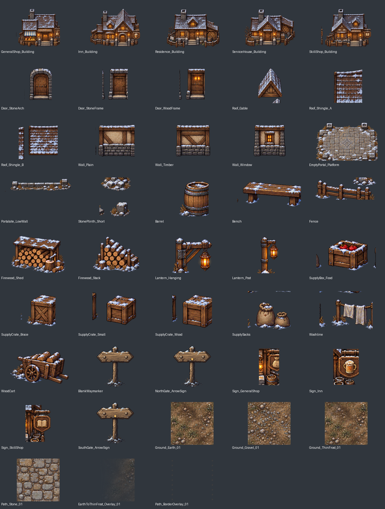
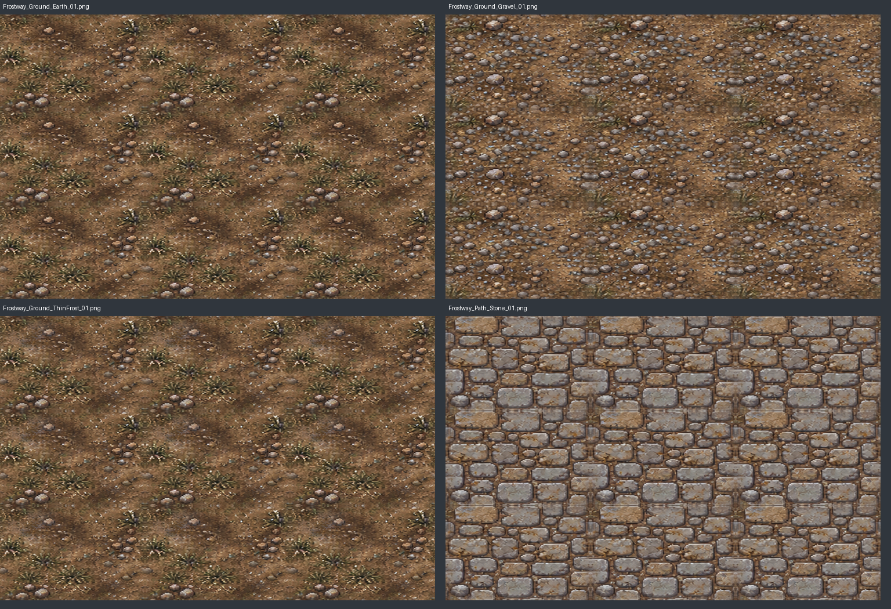
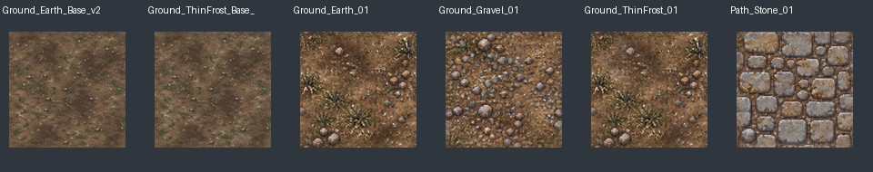
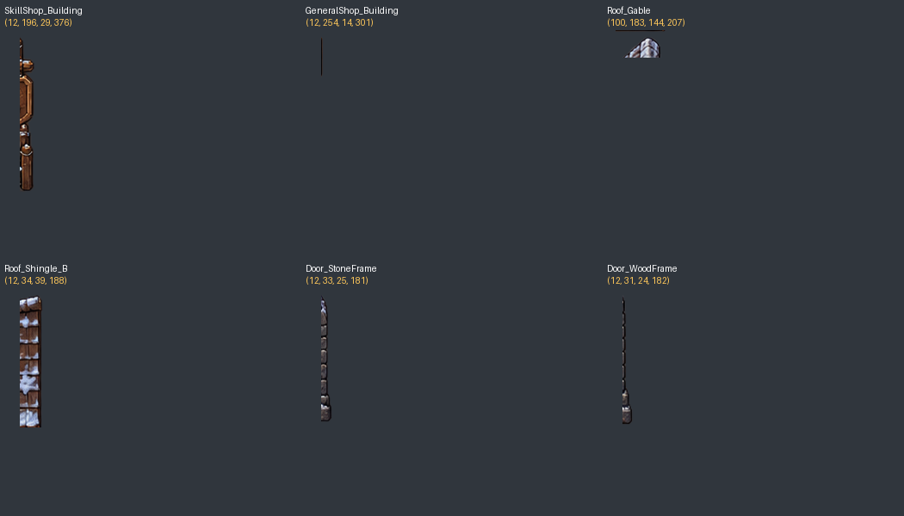
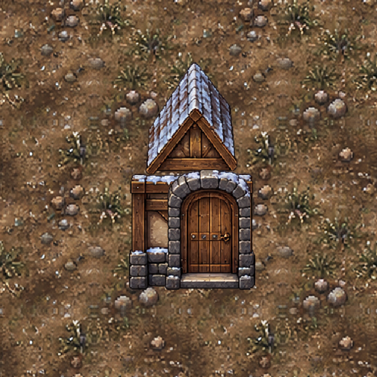
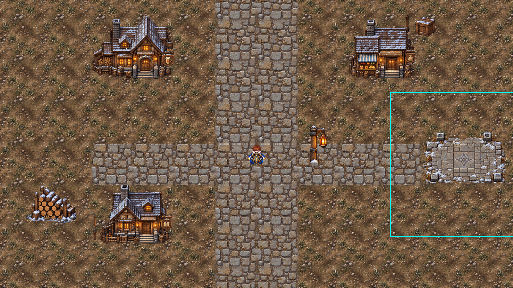
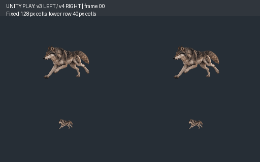
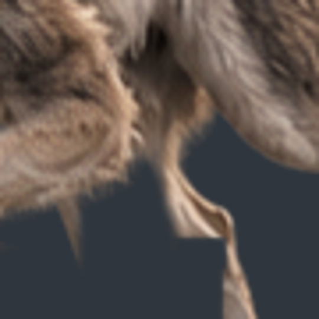

# 서릿길 마을 GameArt v3 / Wolf Run6 v4 합동 Delta QA

2026-10-21 · 브랜치 `codex/qa-frostway-v3-wolf-run6-v4-20261021` · 기준main `e4e9891f6f01ea95cada9e63b1f09946d94d6041`.

**이번 ZIP2개는 예상 SHA와 실제 F: 파일 SHA가 모두 일치합니다.** 입력ZIP은 읽기만 했으며 재압축/이동/변경0입니다. 전송·PNG포맷 정상과 실제 그림의 잘린 윤곽/분해 품질은 별도입니다.

|판정|PART_A 마을v3|PART_B Wolfv4|
|---|---|---|
|ZIP 동일성·CRC·Manifest|PASS|PASS|
|PNG 포맷·해독 기술|43종 PASS|6종/Strip/Atlas PASS|
|미술|**FAIL:일부 개별Sprite에 이웃 원화 조각 잔존**.원화 방향은 유지|**FAIL:05 다리 윤곽의 새 직각 절단**|
|게임 사용 가능성|묶음 FAIL.부분별 PASS/HOLD/FAIL은43종CSV 참조|기존펫 교체 불가,모션 수정 필요|
|격리 Unity|최소거리블록·3화면비·모듈9종 조립·대리Collider 검사 완료|실제Play Mode12FPS·128/40px 비교 완료|
|대표 승인|USER_FINAL_ART_APPROVAL_PENDING|USER_RUN_FINAL_APPROVAL_PENDING|

## 1. 정본·작업 경계

[Issue #45](https://github.com/HappyPaul812/Project-Limitless/issues/45),[#43](https://github.com/HappyPaul812/Project-Limitless/issues/43) 최신댓글과 [합동 계약](https://github.com/HappyPaul812/Project-Limitless/blob/docs/planning/문서/00_프로젝트/20261021_FrostwayGameArt_v3_WolfRun6_v4_JointCodeX_DeltaQA_Contract.md)(blob `9ab1c601ae72f2fc18b4e4ed162cd84115b36594`)을 직접 읽었습니다. [응답 원문·보고SHA](Evidence/JointVillageV3WolfV4_20261021/GitHubSources.json).

기존 Main22 136/F1 64/서리들쥐40 PASS와 Main23 preflight를 재사용했습니다. 전수 재QA0. 본문은 이번 새 파일·배치·모션의 Delta QA이며 Main23 Quest/NPC/상점/Save를 구현하지 않았습니다. 새 QA프로젝트는 `Temp/JointVillageV3WolfV4QA20261021/UnityHarness`,본게임과 연결0입니다. 원본 Editor/기존Wolf/승인아트/GUID/meta 변경0,main 직접commit/Push/PR/병합0.

## 2. PART_A 파일·기술

- `F:/Downloads/Limitless_Chapter3_FrostwayVillage_Environment_GameArt_v3.zip`
- **SHA256 `2a74677d5f62d7e13e64ea85ba62e12175be0be0e0d19864c23233f1bd84e79a`**,예상과일치.17,311,281bytes/59항목/CRC오류0.
- 독립후보PNG **43종**(Tiles4+Transitions2+Buildings5+Modular9+Props14+Signs6+Portal3),Preview/Repeat PNG12,메타4.게임43종 RGBA 해독정상·빈이미지0·외곽3px alpha침범0.추가미리보기까지PNG55개 정상.
- Manifest 각PNG SHA 및 SHA256SUMS 전부일치.기본4tile256×256RGBA/완전불투명/상하좌우반대에지 일치.각종bbox/alpha≥32의16px이상연결군은 독립산출했습니다.**테두리여백PASS가 내부외딴조각 없음의 증거는 아닙니다.**
- 파일별실제SHA·크기·component좌표:[A_Validation.json](Evidence/JointVillageV3WolfV4_20261021/A_Validation.json).43종개별미술/사용판정:[A_PNG43_Review.csv](Evidence/JointVillageV3WolfV4_20261021/A_PNG43_Review.csv).

### 2.1 반복타일·F1 비교

4종모두원본을직접2×2/3×3배열했습니다.경계픽셀은맞지만Earth/ThinFrost의풀무리·작은흰돌이같은대각열로반복되고Gravel의큰돌군집도격자로읽힙니다.돌길은정상적인반복포장형태이나동일돌패턴을장거리에그대로두면모티프반복이남습니다.미세에지정합PASS와반복미술HOLD를분리합니다.추가variation은이무늬가눈에띄는타일에한해제안하며승인F1을다시제작하지않습니다.

전환2종은방향제한overlay로만검토했습니다.EarthToThinFrost는X방향용이며4방향RuleTile구성이라고볼수없습니다.Path_BorderOverlay는길모서리장식이지길폭이나Physics를제공하지않습니다.사방자동타일PASS로승격하지않았습니다.

승인F1의256px/PPU128/2WU와이번256px후보를동일128px표시(64px/WU)로비교했습니다.이번에는이전1254px콘셉트전체를가상2WU로축소한비교와달리기본타일의동일셀비교입니다.새흙/자갈은F1보다풀·돌이더밝고반복밀도가강합니다.ThinFrost는흙우세지만흰알갱이가많아진정도라완전설원회귀는없습니다.최종질감·명도조화는대표승인대상입니다.

### 2.2 분해·조립 결함의 정확한 위치

좌표는원본PNG좌상단기준/right,bottom exclusive입니다.아래는대표위치이고전체확인범위는 [A_DefectRects.json](Evidence/JointVillageV3WolfV4_20261021/A_DefectRects.json)과Validation의연결군에기록했습니다.

|파일(각분류폴더아래)|실제결함좌표·설명|
|---|---|
|Buildings/Frostway_SkillShop_Building.png|x12..29/y196..376,왼쪽이웃건물조각이분리된세로띠로남음|
|Buildings/Frostway_GeneralShop_Building.png|x12..14/y254..301,왼쪽외딴세로잔여|
|Buildings/Modular/Frostway_Roof_Gable.png|x100..144/y183..207,주지붕아래다른지붕조각|
|Buildings/Modular/Frostway_Roof_Shingle_B.png|x12..39/y34..188,왼쪽독립지붕띠|
|Buildings/Modular/Frostway_Door_StoneFrame.png|x12..25/y33..181,문왼쪽이웃벽/문조각|
|Buildings/Modular/Frostway_Door_WoodFrame.png|x12..24/y31..182,문왼쪽이웃조각|
|Buildings/Modular/Frostway_Door_StoneArch.png|x12..13/y137..191,문왼쪽얇은잔여|
|Buildings/Modular/Frostway_Wall_Plain.png|x12..16/y136..187,벽왼쪽잔여|
|Props/Frostway_Fence.png|x270..435/y12..65,울타리위에별도바위/눈더미조각|
|Props/Frostway_SupplyCrate_Small.png|x12..36/y13..129,상자왼쪽긴기둥조각|
|Props/Frostway_SupplyCrate_Wood.png|x12..37/y28..157,같은종류의이웃기둥|
|Props/Frostway_SupplyBox_Food.png|x12..32/y81..136 및x224..235/y55..136,상자양쪽이웃원화잔여|
|Props/Frostway_SupplySacks.png|x12..68/y12..21 및x154..235/y12..18,윗부분다른소품의조각;왼쪽하단도잔여|
|Props/Frostway_Washline.png|x104..228/y12..23,위다른소품조각;왼쪽x12..50/y71..199도남음|
|Portal_Inactive/Frostway_StonePlinth_Short.png|위x21..235/y12..112에별도큰돌더미.작은기단은아래x85..235/y187..293에있어한PNG가분리된복수대상을포함|

Bench/Brace/LowWall의작은잔여도CSV/JSON에남겼습니다.모든분리component가결함이라는자동판정은하지않았으며,실물에서다른물체로읽히는부분만정리대상으로선별했습니다.비어있는투명테두리를늘려도이문제는해결되지않습니다.

모듈9종은원래PPU128·종횡비보존으로3조합(Gable+Timber+StoneArch,ShingleA+Plain+WoodFrame,ShingleB+Window+StoneFrame)을Unity에실제로배치했습니다.주지붕폭/처마와벽폭·문틀기준이일치하지않고,문안에이미벽/지붕일부가포함돼겹침이발생합니다.임의scale/stretch로맞추지않았습니다.**조립origin/접합선/footprint자료가없어이3배치가작가의유일한의도라고단정하지않지만,현패키지의무조정모듈호환PASS는불가**합니다.원화이웃조각은배치문제와독립적인실결함입니다.

[조립B](Evidence/JointVillageV3WolfV4_20261021/A_Modular_Assembly_B.png) · [조립C](Evidence/JointVillageV3WolfV4_20261021/A_Modular_Assembly_C.png).

### 2.3 표식·독립소품·비작동포탈

여관=맥주잔/일반상점=주머니/스킬상점=책으로그림역할은구분됩니다.그러나별도Signs3개도간판만분리되지않고집벽/랜턴/통을사각형으로포함합니다.예: `Signs/Frostway_Sign_SkillShop.png`125×173의왼쪽x12..45/y12..161에집외벽이붙어있습니다.작은서비스표시에는간판본체와기둥/벽연결부의정리·문자라벨병행이필요합니다.실제NPC/UI서비스기능은만들지않았습니다.

North/SouthArrowSign은966×1055로256tile과같은PPU128을일괄적용하면7.55×8.24WU입니다.세부역할별scale/PPU계약이필요하며3WU통로에무변환배치하면안됩니다.작은N/S화살표만으로게임목적지명을보장하지않고문자안내는후속UI계약입니다.이거대한표지판을문검수용장애물로임의고정하지않았습니다.

장작/통/랜턴같은깨끗한단품은바닥기준배치가가능합니다.반면상자·울타리·빨랫줄등은위이웃조각이별도로뜹니다.모든props를같은발기준/Collider로즉시사용가능하다고판정하지않았습니다.

동쪽7×7WU검수공간에EmptyPortal_Platform만장식으로배치,Collider/Trigger/Spawn/Teleport/VFX/NPC/Quest연결0입니다.실제Physics2D.OverlapBox도예약7×7내Collider0.기단의모양은사용후보지만StonePlinth_Short는조각정리가필요합니다.이검수공터는Main23정식좌표가아닙니다.

### 2.4 실제 Unity 최소블록·휠체어·Sorting

Unity6000.6.5f1/Direct3D11/실제Play Mode에서독립거리블록을생성했습니다.그림판합성이아니라실SpriteRenderer·Camera·RenderTexture의 **1600×900(16:9),1200×900(4:3),2100×900(21:9)** 출력입니다.원본Editor의GameView창을열거나캡처한것은아닙니다.

-32×24WU검수바닥/네면경계/북문비개통stop,PPU128/셀2WU.남북길은2셀폭4WU로그리고,기본본체반경0.5WU의CircleCast를중앙/±1WU에서검사해3WU폭을cover했습니다.남북·여관문앞·일반상점문앞·스킬상점문앞·동쪽공터의7개경로query는clear,북문stop연장query는의도대로blocked입니다.
-본게임PlayerPlaceholder의기본반경0.5와같은 **대리Physics2D shape query + 원본휠체어외형1셀**을사용했습니다.실PlayerController·전체애니/수동입력·실제NPC 접근을복제하지않았습니다.따라서본게임휠체어조작/코너정지·회전전수PASS가아닙니다.이샘플의직선segment와문앞도착점만통과했고실문진입Scene은없습니다.
-임시건물footprint BoxCollider를발밑에만배치하고지붕Sprite에는Collider를두지않았습니다.가려진실제문/벽형상을PNG로부터자동추정한Collider가아니므로최종물리계약은후속입니다.
-휠체어표시를건물앞/뒤에두고sortOrder를앞/뒤로설정한캡처확인.임시order에대한렌더검사이며기존게임의자동YSort전체회귀가아닙니다.통건물단일Sprite로roof-fade가완성됐다는뜻도아닙니다.
-3비율의중앙검수시야에맵밖검은영역은없습니다.4:3에서는동쪽예약부지전체가한화면에안들어오므로실제추적카메라검증/이동으로확인해야하며,이번센터캡처가모든끝단카메라를보증하지않습니다.

[실제Unity4:3](Evidence/JointVillageV3WolfV4_20261021/A_Unity_4x3.png) · [실제Unity21:9](Evidence/JointVillageV3WolfV4_20261021/A_Unity_21x9.png) · [앞Sorting](Evidence/JointVillageV3WolfV4_20261021/A_Sorting_Front.png) · [뒤Sorting](Evidence/JointVillageV3WolfV4_20261021/A_Sorting_Behind.png) · [물리query결과](Evidence/JointVillageV3WolfV4_20261021/A_Unity_Village.json).

**A 후속 보완은3묶음:** ①위실제foreign조각을alpha마스크에서정리(원래물체보존),②모듈접합origin/처마·문폭과간판독립층·표지scale를정의,③Earth/ThinFrost 중심의눈에띄는반복모티프만완화.전체마을재그림·승인F1수정·신규Main23구현요청이아닙니다.

## 3. PART_B 파일·Delta

- `F:/Downloads/Limitless_Beast_Wolf_Run6_FromApprovedV5_ArtRework_v4.zip`
- **SHA256 `3ab0b57d2389b55ed33f73c1d3d13862b9b595245e196d1f3a4c98f090b8a412`**,예상과일치.3,024,517bytes/34항목/CRC오류0.
-6PNG512×384RGBA/strip3072×384/atlas1536×768의각6셀RGBA일치.6포즈서로다름/외곽alpha누출0/Manifest SHA모두정상.GIF/APNG도모든프레임디코딩정상,시간정보는Validation에기록.
-비교기준은지난F:수령v3(f7eb4122...ZIP)의실제보존PNG입니다.이전ZIP171b...와다르다는이력은유지합니다.이번00~03은그수령본과도PNG바이트/SHA가정확히같습니다.

|Frame|v3→v4|RGBA 변경px|변경bbox(x0,y0,x1,y1)exclusive|
|---|---|---:|---|
|00/01/02/03|각각PNG SHA동일|각각0|없음|
|04|PNG변경|4,368|(322,164,415,296)|
|05|PNG변경|7,542|(212,198,336,325)|

04꼬리ROI는끝점을제외한 **[346,485)×[88,164)** 에서변경0입니다.문서의‘x346..485/y88..164’를끝점포함으로읽으면y164의x392~396 **5픽셀**이변합니다.이경계해석차이를누락하지않았으며꼬리본체복원손상이라고판정하지않습니다.03꼬리는전체프레임동일로보존됩니다. [정확ROI결과](Evidence/JointVillageV3WolfV4_20261021/B_TailROI.json).

[전체PNG SHA·시간·셀·Delta](Evidence/JointVillageV3WolfV4_20261021/B_Validation.json).

## 4. PART_B 실제12FPS·미술 판정

독립검수기의v3왼쪽/v4오른쪽을고정pivot(.5,.14)/PPU256/동일scale로재생했습니다.Time.realtimeSinceStartupAsDouble×12로실시간프레임전환,엔진frame가실제로진행하는것과연속정상00~05cycle을기록했습니다.안정전환간격은약 **83.263~83.389ms**,검수재생약2.10초입니다.상단셀128×96px,하단40×30px.프레임별이동/resize/발높이자동보정으로결함을숨기지않았습니다.

GIF는실제Unity카메라캡처의정상6프레임을총500ms(80/80/90/80/80/90ms)로묶은움직이는자료입니다.이는오프라인원화GIF가아니지만EditorGameViewUI창녹화도아닙니다.실시간stamp는JSON을따릅니다.

[단독128pxv4](Evidence/JointVillageV3WolfV4_20261021/B_Unity_v4_128px.gif) · [정지연속화면](Evidence/JointVillageV3WolfV4_20261021/B_Unity_Sequence.png) · [시간/frame원본](Evidence/JointVillageV3WolfV4_20261021/B_Unity_Playback.json) · [시간요약](Evidence/JointVillageV3WolfV4_20261021/B_Unity_Summary.json).

04의뒷다리는기존뭉툭한접힌실루엣에서무릎/발이보이는형태로바뀌었고,05의앞다리도들어올린자세로실제변경됐습니다.색/얼굴/털·성견늑대인상은유지됩니다.그러나 **MOTION_ART_FAIL**:05앞다리를지운뒤편다리의윤곽이직각으로절단되어있습니다.

-정확파일 `Assets/Poses/Wolf_Run_05_v4.png`,검토영역 **x315..338/y235..280**.약y252에서수평으로끝난후x334부근에서세로로내려가는alpha단절이보입니다.기존앞다리제거/재합성영역이뒤쪽다리의연속윤곽까지지운것으로보이는위치이며,마스크작업원인은추정이지만직각절단자체는실제PNG에서확인했습니다.
-128px에서는수픽셀범위지만팔다리연속성이손상됩니다.12FPS재생기술PASS나새다리포즈추가만으로고품질달리기PASS가되지않습니다.
-02→03→04의몸통/꼬리자세전환은기존형태가그대로남습니다.공중자세의높이변화나bbox길이만으로오류라고단정하지않지만전체자연스러움은기존HOLD를해제하지않습니다.05→00은새앞발회수→전방뻗기로연결되나새절단결함때문에최종루프승인불가입니다.

[04/05원본고정캔버스전후](Evidence/JointVillageV3WolfV4_20261021/B_Raw04_05_Comparison.png).

**B 후속 보완은2건:** ①05위영역의가려진다리연속윤곽과앞다리접합마스크만복구,②수정후05→00과02→03→04의12FPS전환을동일배율재검토.00~03/복원꼬리/v5키아트는보존하고전체6포즈·다른펫양산으로확대하지않습니다.수정본도바울대표최종모션승인별도입니다.

## 5. 환경오류·보호·완료 경계

최종격리컴파일오류0,VILLAGE_BLOCK_QA_COMPLETE/WOLF_QA_PLAYBACK_COMPLETE 로그존재.단UnityEditor.Search.SearchDatabase기동ArgumentOutOfRangeException1건은재발했습니다.검수기밖stack이며출력완료와구분해남겼습니다.‘Console오류0’으로보고하지않습니다. [최종로그gzip](Evidence/JointVillageV3WolfV4_20261021/Unity_Final.log.txt.gz).

메타/GUID가없는입력PNG는Unity프로젝트밖Input에서Texture2D.LoadImage/Sprite.Create로읽었습니다.본게임Resources/기존Wolf/승인SpriteImport설정/GUID를변경하지않았습니다.PPU128/256·임시Collider/Sort값은검수조건이지정식제품설정승인이아닙니다.원본카메라/Bounds코드는읽기및격리참조복사만수행했습니다.

원본보호전후:[ProtectionResult.json](Evidence/JointVillageV3WolfV4_20261021/ProtectionResult.json).Assets/UserData/Packages/ProjectSettings4,351파일SHA,rootHEAD/status,ZIP2의해시를대조했습니다.초기스냅샷은읽기조사/별도worktree생성후수집했고그전원본파일쓰기는없었습니다.원본Editor포커스/Play/Scene선택/Refresh/Import0.기존Main22/F1/Mouse전체QA실행0.이번변경은보고서·정적검사스크립트·독립검수기소스·파생증거만입니다.

정식게임적용·Main23퀘스트/NPC/Save구현·기존Wolf교체·main직접commit/Push/병합0.최종commit은본보고를포함한브랜치HEAD/완료보고를따릅니다.
