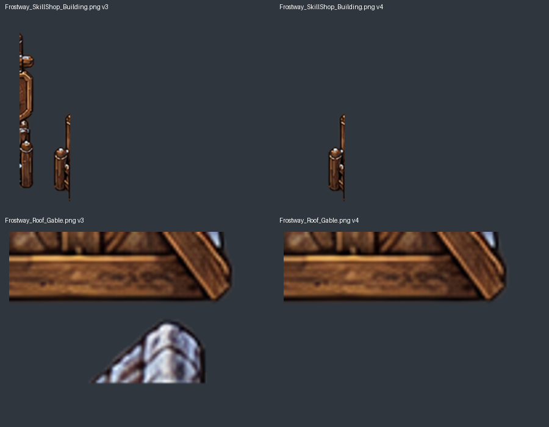
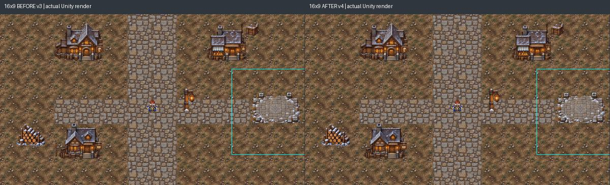
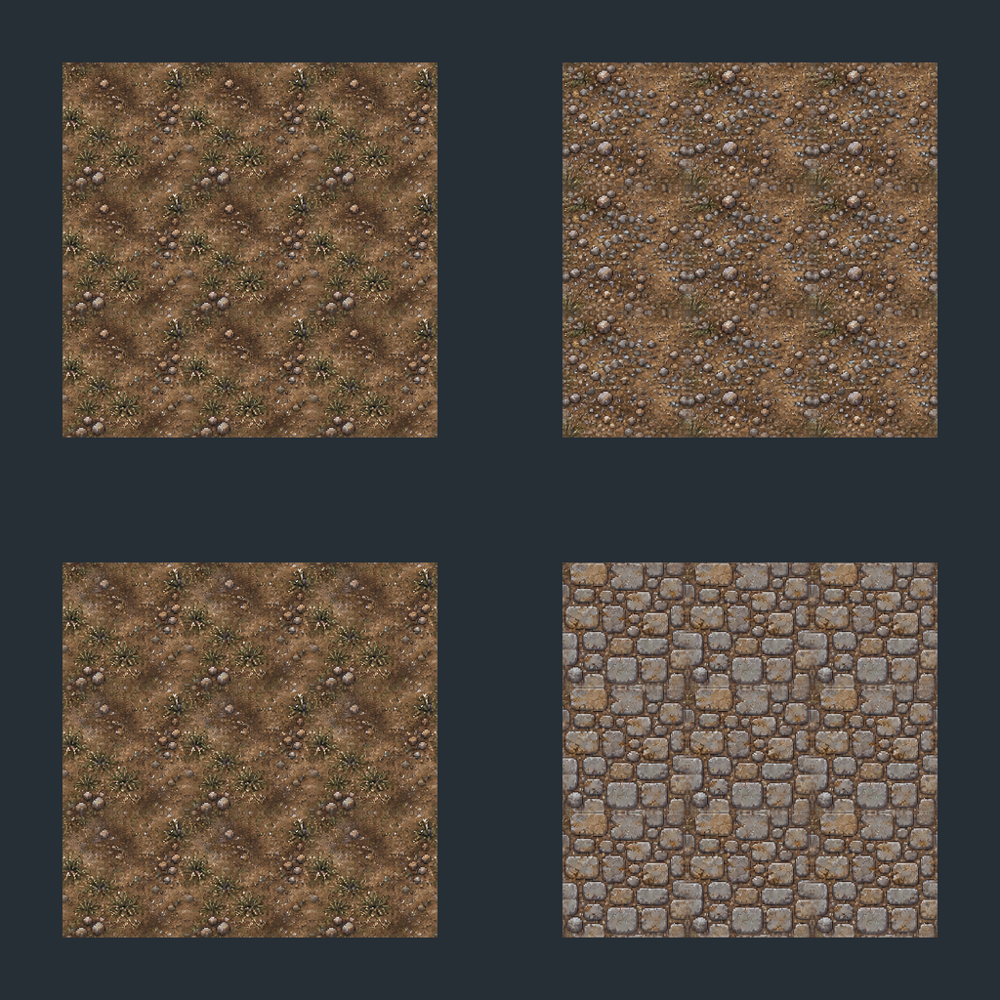
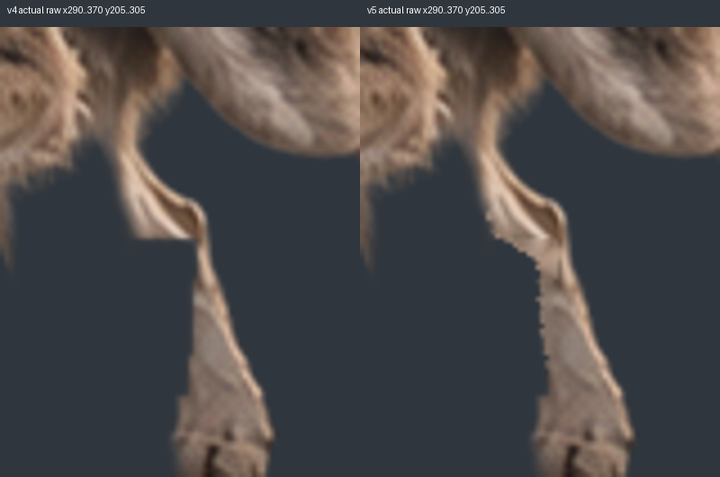
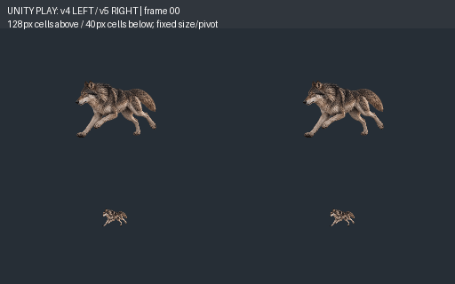

# 서릿길 마을 v4 / Wolf Run6 v5 표적 Delta QA

2026-10-21 · `codex/qa-frostway-v4-wolfrun-v5-20261021` · 기준main `e4e9891f6f01ea95cada9e63b1f09946d94d6041`.

**ZIP2개 실제SHA=납품보고SHA,기술PASS.지정한마을2종·Wolf05의국소FAIL은해결PASS입니다.** 전체마을/전체Run을자동최종승인하지않으며기존OPEN과대표최종승인을분리합니다.

|항목|A 마을v4|B WolfRunv5|
|---|---|---|
|기술|PASS|PASS|
|이번표적미술|**PASS**:이웃원화조각제거·본체보존|**PASS권고**:05직각끊김곡선보완·불필요변경0|
|전체미술승인상태|**HOLD**:타일반복·기존별도OPEN이월|**HOLD**:국소수정PASS와별개로전체Run최종수용대기|
|실제Unity|같은블록16:9/4:3/21:9·조립/문/Sorting비교|실제12FPSv4/v5동시128px·40px비교|
|정식적용|미실행|기존Wolf교체0|

## 정본·범위

[Issue45](https://github.com/HappyPaul812/Project-Limitless/issues/45)·[Issue43](https://github.com/HappyPaul812/Project-Limitless/issues/43)의최신댓글과 [기획계약](https://github.com/HappyPaul812/Project-Limitless/blob/docs/planning/문서/00_프로젝트/20261021_Frostway_v4_WolfRun6_v5_Scoped_Unity_DeltaQA_Contract.md)(blob `c0ebd2fe5bf5eb757ffdb69837315f97d525bc15`)을직접확인했습니다. [원격응답](Evidence/JointVillageV4WolfV5_20261021/GitHubSources.json).

비교기준은앞선실물QA commit `695f6f74e63996bb9d0ba0561dc6518f1e7af049`와그때추출한Villagev3/Wolfv4입니다.이전43종기술전수·Main22 136/F1 64/서리들쥐40 PASS 재시험0.마을의새픽셀검사는2종만,나머지는SHA확인만했습니다.Wolf는요청대로6frame/strip/atlas와05변경마스크를검증했습니다.Main23실제Quest/NPC/Save구현0입니다.

## A. 동일성·수정내용

- `F:/Downloads/Limitless_Chapter3_FrostwayVillage_Environment_GameArt_TargetedFix_v4.zip`
- **실제SHA256 `ee25baef91ec740b85dd3bb62b32583292d703f9261863bd534d0eb8241d1896`**,납품보고와일치.19,767,770bytes/70항목/CRC오류0.
- Manifest에기록된SHA전부정상,SHA256SUMS69/69정상.게임PNG43경로동일,**나머지41PNG의파일SHA전부v3동일**.

|수정파일|실측RGBA변경px|실측변경bbox,좌상단원점/끝exclusive|결과|
|---|---:|---|---|
|Buildings/Frostway_SkillShop_Building.png|2,496|(12,196,29,377)|신규변경부alpha전부0,주본체8연결component변경0|
|Buildings/Modular/Frostway_Roof_Gable.png|712|(100,183,145,207)|동일하게잔여조각만제거,주지붕변경0|

이좌표는납품의끝점포함x12~28/y196~376,x100~144/y183~206과일치합니다.사각형전체를지운것이아니라불필요component픽셀만투명화됐습니다.변경영역밖RGBA전부동일,정상본체훼손/재색칠/크기변경없음.수정후PNG SHA는각각 `ef34b49de4f807debf4a69e1947eb9b8e02a543ee117ca2867fe3aa06a5efb17`, `37ea6a69844b662c40583cea3d457ff0c47344aef7054ff8e32b4d09870dceb0`입니다.

[A_Validation.json](Evidence/JointVillageV4WolfV5_20261021/A_Validation.json)에KEEP41의전후SHA와본체검증을기록했습니다.

### 새PNG를연결한실제Unity3비율

원본Editor가아닌새최소프로젝트`Temp/JointVillageV4WolfV5QA20261021/UnityHarness`를숨김배치로실행했습니다.이전과같은거리블록/PPU/좌표/Collider/Sort조건에v4PNG를연결했습니다.아래는실SpriteRenderer·Camera·RenderTexture출력이며오프라인미술시안이아닙니다.**EditorGameViewUI창캡처는아닙니다.**

|화면|실제렌더전후변경px|변경화면bbox,끝exclusive|
|---|---:|---|
|1600×900 16:9|648|(292,660,301,750)|
|1200×900 4:3|648|(92,660,101,750)|
|2100×900 21:9|710|(531,664,540,757)|

위변경은스킬상점왼쪽잔여띠제거위치에한정됐습니다.나머지화면은픽셀동일이어서정상건물/주변조립의신규렌더회귀없음을확인했습니다.Gable의아래조각은일부조립뷰에서문에가려질수있으므로스크린샷만으로제거를주장하지않고위원본마스크검증을함께사용했습니다.모듈3조합/문/앞뒤Sorting의기존샘플에서도이번수정으로새틈·겹침이발생하지않았습니다.**기존모듈접합규격미확정자체를해결했다는뜻은아닙니다.**

[4:3전후](Evidence/JointVillageV4WolfV5_20261021/A_Unity_BeforeAfter_4x3.jpg) · [21:9전후](Evidence/JointVillageV4WolfV5_20261021/A_Unity_BeforeAfter_21x9.jpg) · [렌더차이JSON](Evidence/JointVillageV4WolfV5_20261021/A_RenderDelta.json).

[모듈A](Evidence/JointVillageV4WolfV5_20261021/A_Modular_Assembly_NativePPU.png) · [모듈B](Evidence/JointVillageV4WolfV5_20261021/A_Modular_Assembly_B.png) · [모듈C](Evidence/JointVillageV4WolfV5_20261021/A_Modular_Assembly_C.png) · [앞Sorting](Evidence/JointVillageV4WolfV5_20261021/A_Sorting_Front.png) · [뒤Sorting](Evidence/JointVillageV4WolfV5_20261021/A_Sorting_Behind.png).

수정인접문앞/남북·공터샘플의기존반경0.5WU대리Physics2D query는통과,북문stop은차단,동쪽7×7WU안Collider0을유지합니다.이것은실PlayerController/실입력/실NPC접근전체QA가아닙니다.상점실서비스/자동YSort/실문Scene전환은구현하지않았습니다.

### 타일4종 — 새그림변경없이표시배율검토

4파일은v3와SHA동일.PPU128/256px=2WU,**64px/WU에서1tile128px**로각3×3을실제Unity렌더했습니다.오버레이는기존방향제한계약을유지하며4방향자동타일로취급하지않았습니다.

|타일|시각권고|정확한반복위치(타일원본좌표)|
|---|---|---|
|Frostway_Ground_Earth_01.png|**HOLD유지/부분개선권고**.흰돌+풀무리의대각열이128px에서도반복해읽힘|x9~94/y120~252|
|Frostway_Ground_ThinFrost_01.png|**HOLD유지/부분개선권고**.같은군집의반복이남음|x9~94/y120~252|
|Frostway_Ground_Gravel_01.png|**HOLD유지**.큰자갈군이주기적으로보이지만대표수용가능성있음.필수전체재그림권고아님|x23~130/y26~120|
|Frostway_Path_Stone_01.png|**PASS권고(반복포장역할에한정)**.반복돌판은보이나돌길의규칙성으로수용가능한표현.대표최종수용전까지기존HOLD를자동승인으로기록하지않음|x60~215/y94~240|

타일을직접수정하지않았습니다.수정필요시Earth/ThinFrost의특정모티프변형부터별도아트작업으로제안합니다.대표가현재반복을수용하면추가제작없이승인할수있고,기술에지PASS가미술승인을대신하지않습니다.

### 이전검수와기획요약의차이 — 재검사없이OPEN이월

기획/납품요약은‘이전FAIL2파일’로요약하지만,실제앞선QA의43종CSV에는잔여원화조각으로FAIL기록된파일이18종이었습니다.이번2종해결후다른 **16종은KEEP41에포함되어바이트불변**입니다.이번요청범위를늘려재검사하거나다시수정하지않았으며기존OPEN으로이월했습니다.예:GeneralShop왼쪽잔여,Roof_Shingle_B옆띠,문frame의이웃조각,상자/울타리/StonePlinth의별도원화조각.그사실을숨기고마을전체미술PASS로승격하지않습니다.

[InheritedOpenFindings.json](Evidence/JointVillageV4WolfV5_20261021/InheritedOpenFindings.json)은이전commit/파일/SHA/판정을그대로참조한인계자료이며**이번16종의새미술검수가아닙니다**.마을2종표적PASS와전체GameReady게이트는별개입니다.기획담당이기존잔여를의도적허용/제외할지아트수정범위로유지할지는후속범위확인이필요합니다.

## B. 동일성·Frame05 변경범위

- `F:/Downloads/Limitless_Beast_Wolf_Run6_FromApprovedV5_ArtRework_v5.zip`
- **실제SHA256 `16ba7923771c98f05b0f041b5c5a63857cdecfcdfd2e1f7768d9f24d1af0e351`**,납품보고와일치.2,663,380bytes/32항목/CRC오류0.
- Manifest SHA모두일치.6PNG512×384RGBA/Strip3072×384/Atlas1536×768의각6셀RGBA일치.GIF/APNG모든frame디코딩및500ms루프확인.
- **00~04 PNG compressed byte/SHA5/5그대로**.05만174RGBA픽셀변경,실측끝exclusive bbox **(318,245,334,281)**.즉납품의끝점포함x318~333/y245~280과일치합니다.이범위밖RGBA변화0,몸통·얼굴·꼬리·발끝의그밖픽셀보존.
-05새SHA `d3d53b94be9084bfd9b2a0bbe6fa492b903138b37c86e7068c9eaefbe8b1194c` 일치.변경좌표CSV174행도실제전후RGBA174점과정확히일치(중복0)합니다.

[B_Validation.json](Evidence/JointVillageV4WolfV5_20261021/B_Validation.json) · [174행독립대조](Evidence/JointVillageV4WolfV5_20261021/B_ChangedCSVCheck.json).

## B. 실제12FPS·미술

Unity6000.6.5f1/Direct3D11의실제Play Mode에서 **v4왼쪽/v5오른쪽**,같은128px셀/고정pivot(.5,.14)/PPU256/동일크기로동시재생했습니다.아래행40px도같은조건입니다.엔진frame1→227,재생2.1024초,안정frame전환간격 **83.283~83.384ms**입니다.정상00~05cycle과04→05→00연결을캡처했습니다.실시간정지frame1스크린샷만으로PASS판정하지않았습니다.

움직이는GIF는실제UnityRT에서캡처한정상cycle을500ms(80/80/90/80/80/90ms)로묶었습니다.파일미리보기GIF와구분하고실제timestamp는JSON을기준으로합니다.원본EditorGameView창영상이라고주장하지않습니다.

[단독v5 128px](Evidence/JointVillageV4WolfV5_20261021/B_Unity_v5_128px.gif) · [실제frame연속정지화면](Evidence/JointVillageV4WolfV5_20261021/B_Unity_Sequence.png) · [시간/frame](Evidence/JointVillageV4WolfV5_20261021/B_Unity_Playback.json) · [시간요약](Evidence/JointVillageV4WolfV5_20261021/B_Unity_Summary.json).

**이번05국소미술은PASS권고**입니다.직각으로잘린가로단면이곡선으로이어지고,128px에서이전의잘린조각처럼읽히는형태가완화됐습니다.04→05→00사이에새사각윤곽·꼬리절단·몸통변형이추가되지않았습니다.기존paw최하단위치와발끝형상은174px수정범위밖이므로같습니다.그사실만으로새접지움직임이나전체Run완성도를과장하지않습니다.

관절·발목의합성흔적이거슬리는지와6프레임전체의보폭/체형전환을포함한 **전체모션미술HOLD는대표최종수용전까지유지**합니다.기존02→03→04의자세/비율유보를174px국소수정만으로자동철회하지않았습니다.이번지정된05의직각결함은해결됐고,이동일국소범위에서추가필수수정좌표는새로발견하지않았습니다.원화를다시그리거나KEEP5프레임을임의재제작하도록요청하지않습니다.

승인정적Wolfv5의회갈털·밝은가슴·긴주둥이·성견스타일은범위밖픽셀보존과실제미리보기에서유지됩니다.정적키아트/공식펫원본/GUID/Resources연결은수정0입니다.**정적Wolfv5승인과Run6v5승인은다른게이트**입니다.

## 환경·보호·마감

컴파일오류0,마을/모션완료로그존재.기존UnityEditor.Search.SearchDatabase기동ArgumentOutOfRangeException1건은재발해환경이슈로분리했습니다.Console오류0이라고보고하지않습니다. [배치로그gzip](Evidence/JointVillageV4WolfV5_20261021/Unity.log.txt.gz).

[ProtectionResult.json](Evidence/JointVillageV4WolfV5_20261021/ProtectionResult.json):원본Assets/UserData/Packages/ProjectSettings4,351파일·rootHEAD/status·입력ZIP2해시전후대조.최초스냅샷은읽기조사/새worktree생성후기록했고그전원본파일쓰기는없었습니다.원본Editor포커스/Play/선택/Refresh/Import0,실제게임적용0,main직접commit/Push/PR/병합0.Main22/F1/Mouse기존전수재검사0.

완료commit은본보고를포함한브랜치HEAD와최종보고를따릅니다.대표최종미술승인요청대상은 **A 타일반복수용여부/잔여OPEN처리범위**, **B 이번v5실모션의최종수용여부**입니다.승인이있어도실게임적용은별도지시후진행합니다.
