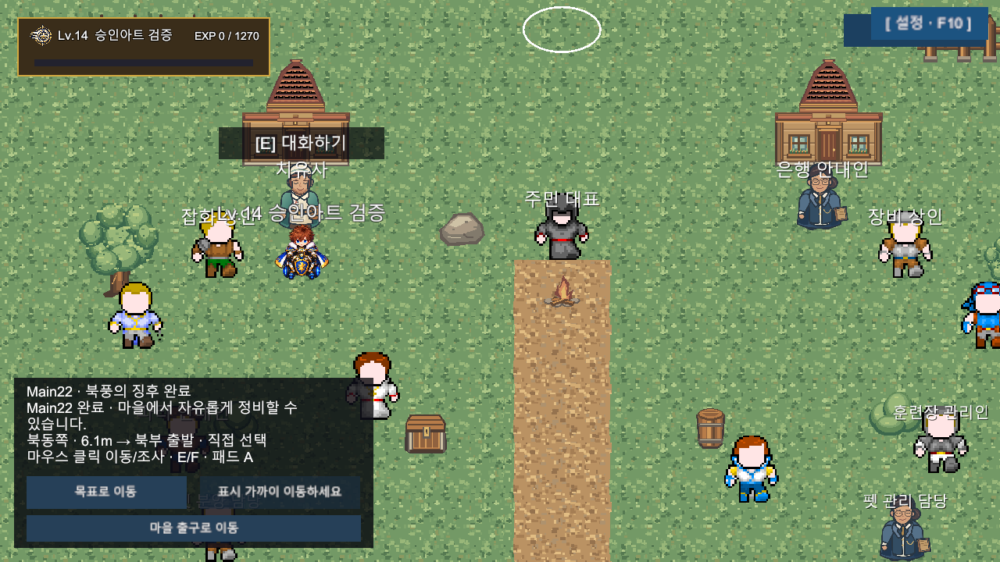
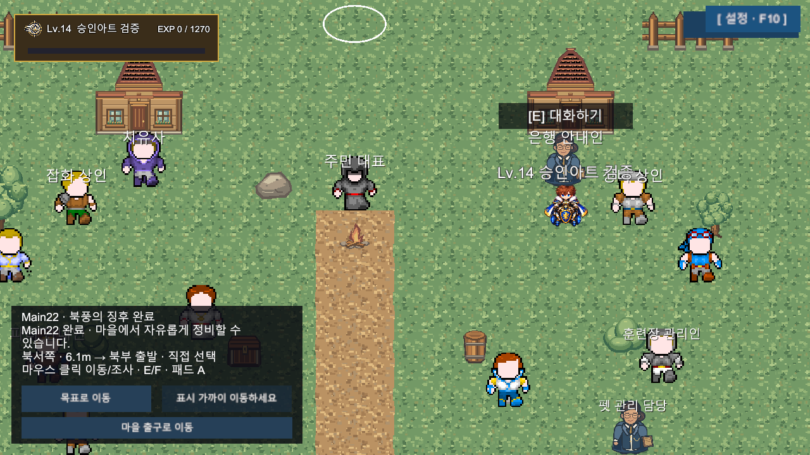
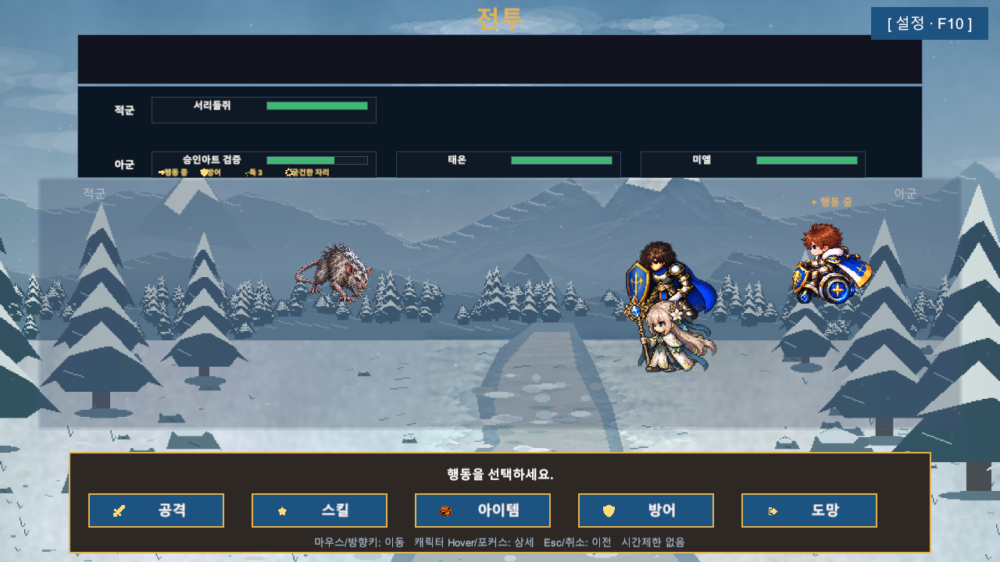
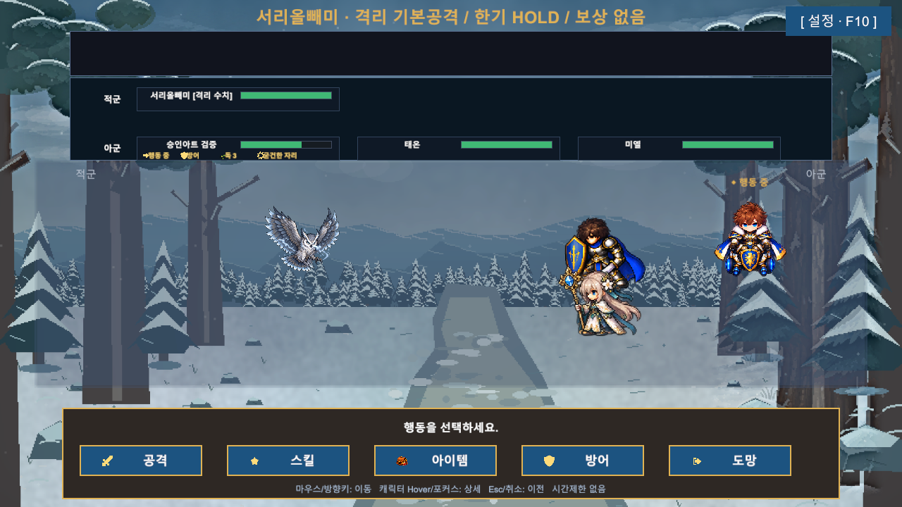

# Issue95·91 승인 아트4종 원본 로컬 적용 — 2026-11-11

**APPROVED_ART_4_LOCAL_ORIGINAL_APPLIED / UNITY_IMPORT_DELTA_QA_PASS / USER_REALPLAY_PENDING / LOCAL_COMMITTED / REMOTE_NOT_PUSHED**

바울 대표의 이번 채팅 “승인 아트4종 원본 게임 적용”을 명시적12파일 배포 승인으로 실행했습니다. 디자인 승인 재질문·새 그림·기능 변경0. 기존107PASS/0FAIL 재사용, 전체 반복0.

## 브랜치·동기화

- 기준 `codex/art95-91-unity-delta-20261111`, 검증 제품 **d40bb17057da555322993c1b1c2fd7944b95bf78** 그대로 사용.
- 적용 브랜치 **codex/art95-91-original-apply-20261111**, 별도 worktree `F:/study/codex/Project-Limitless/Temp/Art95_91Apply20261111/Worktree`.
- 원본 시작main **3a44dd0483759dc4921b22a914853395701789d7** → 제품d40bb170 **FF-only/no-autostash 완료**. 제품 커밋은 main에서 작성하지 않았습니다.
- 이 완료보고·CODEX_LATEST·CURRENT_STATUS·검증증거는 적용 브랜치에서 별도 Docs 커밋 후 동일 방식으로 FF합니다. 최종 전체main SHA는 Issue95/91 완료댓글 및 로컬 `Temp/Art95_91Apply20261111/Final.json` 참조. 문서 커밋 자체의 SHA를 본문에 자기참조하지 않습니다.
- 원격 Push·Merge commit0. 기존 사용자 dirty302/untracked550를 stash/reset/덮어쓰기 하지 않았습니다.

## 정확한 제품 변경12파일

모든 경로는 `Unity/Client/Assets/_Project/` 기준. 제품 d40bb170과 내용 동일, 추가 제품 변경0.

| 경로 | 유형 |
|---|---|
| Resources/VillageNpcSprites/Eldiran/OGA06_Healer_Original_Approved.png + .meta | 신규2 |
| Resources/VillageNpcSprites/Eldiran/OGA16_Bank_Original_Approved.png + .meta | 신규2 |
| Scripts/NPC/VillageNpcAppearanceCatalog.cs | 기존5 StableID의 외형 경로만 수정1 |
| Art/Battle/Backgrounds/Chapter3_Snowroad_v2_Approved.png + .meta | 신규2 |
| Art/Battle/Backgrounds/Chapter3_Forest_F2_v2_Approved.png + .meta | 신규2 |
| Resources/BattleBackgrounds/Chapter3.asset + .meta | 신규2 |
| Scripts/Battle/BattleSceneController.cs | 독립 Chapter3 조회·기존 fallback 유지1 |

신규10+수정2=12. **Scene0·Prefab0·Collider0·기존GUID교체0·기존meta수정0·Save코드0·B352제품변경0**. Ch1/2 Catalog/class/PNG·기존 NPC PNG/meta·사용자 승인 타아트·Packages/ProjectSettings 불변. 별도 문서·검사기·증거는 제품12파일 외 보고 자료입니다.

## 승인 SHA·Import 설정

| PNG | SHA256 | 설정 / GUID |
|---|---|---|
| OGA06 | `67aef89677e9b9f174f30b2c2a9e854eaee4e61814774402bd94a18691bd401f` | PPU329 / Pivot pixel(261.5,42) / GUID `67ebb47b457740ce9b201583ccdb6ea2` |
| OGA16 | `1199c57d3c279b51af83452c8b580814d6456417ea8e3f3b83ea9fdc6c5f8dcd` | PPU320.25 / Pivot pixel(269,43) / GUID `95de97663f18471386646a2c705d98b5` |
| Snowroad v2 | `339beeb80d313c589cf50842fc9f6964049b0752e783d83ac8a7097c768205ab` | GUID `1b9d15bf83a74ec48af655f07ad9f069` |
| Forest F2 v2 | `4d57949a1a9d2ae5600d4ba1b95989153fed6a0d8f47f8fc52e6f670a013535a` | GUID `b3cd30df380741d48d698ebc20a452c8` |

NPC512 원본의 보이는 높이1.142857WU·발끝 위치·Point/FullRect 유지. 체형 변형 없이 PPU를 적용했습니다. 배경1672×941·PPU100·중앙Pivot·Bilinear·비압축·preserveAspect 유지. Chapter3 Catalog GUID `6e3abdaee0ec199408355d5e407ab659`, 키 World_NorthF1/World_NorthF2_CANDIDATE.

실제 납품: NPC `F:/Downloads/LIMITLESS_Issue95_OGA06_OGA16_FinalReview_20261111.zip`의 Originals_BYTE_KEEP, 배경 `F:/Downloads/Limitless_Sprites/ch3_bg_v2_easy.zip`. #91 FinalReview 검토판 미사용.

## 검증 결과·한계

1. **기존 격리107PASS/0FAIL 재사용**: NPC 실제 치유/은행 안내 E 상호작용·StableID5/Collider/이름표·재사용처·실3인/적·후열HP/독/방어·960/1280/1680·Ch1/2 실제 전환. 이번 전체 재실행0. 원 보고 `Temp/Art95_91Unity20261111/Worktree/문서/00_프로젝트/Issue95_91_ApprovedArt_UnityDelta_20261111.md`, 보고commit52490cf4c5d4ca508ac6e6f5c117bdd460e93d1b.
2. **신규 격리 최소 Import7PASS**: 검증 복제본 `Temp/Art95_91Unity20261111/QA/Client`에서12파일 동일성 확인 뒤 숨김 Unity6000.6.5f1 Batch/EditMode로만 검사. OGA06/16 PPU/Pivot·StableID5 연결·Ch3 키/배경·Ch1/2 참조·B352 타입·컴파일/PlayOFF. 실행 Exit0. 기존107 검사 진입점은 호출하지 않았습니다.
3. **원본 Import·컴파일9PASS + Console 오류0**: FF 후 원본 Editor Application.dataPath가 `F:/study/codex/Project-Limitless/Unity/Client/Assets`임을 확인하고 Refresh/컴파일 완료. 새Sprite2 PPU/Pivot·StableID5·Ch3 두 배경·Ch1/2·B352 타입·Unity버전·기존 Editor상태·컴파일idle 실제 로드 확인. 원본 Scene 열기/Save/Play/선택/포커스 변경0. 최종 Console error0.
4. 원본에서 새 Runtime 왕복/전투/개인Save를 다시 실행하지 않았습니다. 기존107을 재사용하고 새 원본 Import·compiled type/Resources 연결만 Delta로 확인했습니다. 따라서 원본 실플레이 수용 확인은 **USER_REALPLAY_PENDING**입니다.
5. 격리의 기존 MCP assembly-reference EndOfStream 환경 로그는 남아 있습니다. 신규 게임/C# 오류와 분리하며 환경 문제까지 해결했다고 주장하지 않습니다. 이번 원본 Console은0입니다. 기존 근접 이름 중첩·1680 preserveAspect 여백·F2 전투 후보 한기HOLD 표기도 유지했습니다.

## 원본 보호 증명

원본 보호 **8294파일 / 1,216,830,802bytes** SHA baseline 기록. 제품FF/Import 뒤 허용 코드2파일만 변경, 나머지8292 SHA동일. 승인 PNG4 SHA·신규GUID/meta 제품참조 동일. 이후 보고FF에는 CURRENT_STATUS/CODEX_LATEST2파일만 추가로 허용합니다. Save/UserData·dirty302/untracked550 status byte-exact 동일. 전체 개인 경로명·Save 내용은 업로드하지 않았습니다.

원본 Editor 기존 외부 worktree Bootstrap(Temp/Main22FirstPlayable20261021/Worktree/.../Bootstrap.unity) 유지, dirtyfalse·PlayOFF·selectionnull·비포커스. 검증용 in-memory 코드에서 obsolete Selection.activeInstanceID 조회가 거절되어 activeObject null 확인으로 바로 수정한 준비 오류는 게임 컴파일 오류로 세지 않았습니다. 제품 C# 변경은 검증된2파일뿐입니다.

## 적용 화면 — 기존107PASS 실제 GameView 재사용

아래는 기존 실제 격리 RenderView 캡처를 **byte-exact 재사용**한 적용 외형 참고입니다. 이번 원본 Editor 신규 Play 캡처라고 주장하지 않습니다. 원본은 동일한12파일/PPU/Pivot/Resources 연결을 Import 확인했습니다. 960/1680 및 재사용처 추가 캡처는 위107PASS 증거 폴더에 남아 있습니다.

## 바울 대표 실플레이 확인 방법

- 현재 작업을 저장하신 뒤 원본 Unity6000.6.5f1에서 새 Play를 시작합니다. 개인 Save를 덮어쓸 필요 없이 기존 슬롯의 이어하기로 외형을 확인할 수 있습니다.
- 시작 마을: 치유사(-4.4,2) 및 은행 안내인(4.4,2) 접근→E, 새 외형/기존 대사 확인. 실제 치료 확인은 기존 게임 규칙대로 저장을 수반하므로 필요할 때만 선택합니다.
- Field03 안전지대 치유사(-2.05,-4.55), Arbel 치유사(2,-2)/펫관리(7,-3)의 재사용 외형 확인. Stable ID와 업무는 기존대로입니다.
- Chapter3 서릿길/World_NorthF1 전투는 Snowroad v2, 첫눈의 숲/World_NorthF2_CANDIDATE 기존 선택 조우는 Forest F2 v2. 후열 휠체어/HP/상태와 기존 전투UI를 확인합니다. F2 B352 굽은 눈길은 그대로입니다.
- 이번 배포 추가 승인 대기는 없습니다. 바울 대표 실플레이의 수용 확인만 남습니다. 원격 배포는 하지 않았습니다.
