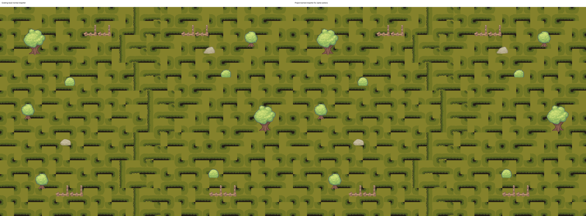

# PR7 Importer 수정 검증 및 안전한 로컬 반영 — 2026-10-13

**동일 결과물 YES / 검증 범위의 신규 회귀 NO.** 후보 `d57ff6668754a8dadb7e8c787ec402f99e837ce3`를 PR7 대상 로컬 브랜치 `codex/integrate-abc-planning-20261013`에 충돌 없이 보존 병합했습니다. 실제 검증한 코드 병합 SHA는 `2fbe9577b212ee46f4525a597c3bcd4d7833f055`이며, 이후 커밋은 이 보고서·증거·상태·인계만 추가합니다.

## 새로운 실행 근거

- 기존 정상 로컬 Importer와 후보를 같은 카메라·Scene·환경 Renderer로 각각 새 배치 실행: **2,016,000 RGBA 픽셀 차이0**, 363 Sprite 누락0. 배우/NPC/UI 등 동적 Renderer는 이 비교에서만 숨겼습니다. 실제 배우·NPC가 있는 기능 화면은 별도 회귀 실행 이미지입니다.
- Sprite fileID/Rect/Pivot/PPU/Scale/좌표/Sorting 및 환경 Collider snapshot 동일. 7 PNG SHA 동일, Scene 새 GUID를 역치환하면 원래 PR Scene 전체 텍스트와 동일. ThirdParty 원본, 다른 Scene, 코드, Save 규격 변경0.
- 새 통합 결과와 QA 복사본의 생산 코드·Scene·Prefab·PNG·WAV 1253파일 대조 PASS(텍스트 CRLF/LF 정규화, PNG/WAV 바이트 대조). Editor QA helper/자동 업그레이드 metadata는 대조에서 제외했습니다.
- Field04 새 Runtime 회귀 **228 PASS / 0 FAIL**: Main12→13, 세린·Story/일반 전투 UI, 이동/Camera/출구·Spawn, 몬스터 재등장, 저장·Continue. 기존 B/C 개별 결과를 새 실행으로 계산하지 않았습니다. 해당 코드의 변경0도 확인했습니다.
- 실제 테스트 Unity **6000.6.5f1**. 정본 **6000.5.7f1**, 실물 키보드/패드 장기 플레이, 전체 다른 Scene 재플레이는 **NOT_VERIFIED**. 기존 UnityEditor.Search 예외는 별도로 기록되어 Console 종합은 PARTIAL입니다.
- 기존 서쪽 Spawn/나무 겹침, 북쪽 경계 틈은 **OPEN**. 새 결함으로 계산하거나 해결했다고 보고하지 않습니다. v2 미술·30/42 동서 후보 적용0, 정식 남북 Road30 유지.

## 반영과 보호

- 통합 **로컬 브랜치 반영 완료**, 자동 Push0. 원격 PR7은 이 명령이 실행되기 전까지 기존 HEAD이며 Draft를 유지합니다. 바울 대표가 기존에 지정한 직접 Push 절차를 유지합니다.
- 별도 실사용 로컬 worktree `Temp/PR7Apply20261013/local-working`, 브랜치 `codex/local-pr7-importer-20261013`에 최종 통합 결과를 반영합니다. 이곳은 QA 복사본과 다릅니다. 원본 main에 있는 미커밋 자료는 이관·덮어쓰기하지 않았으며 해당 자료를 포함한 원본 실행본 자체는 변경하지 않습니다. 새 worktree에서는 원본 Save/설정을 연결하거나 덮어쓰지 않습니다.
- 원본 main HEAD/337 상태항목/822 확장파일 및 보호대상 4317파일 SHA 불변. Save·설정·사용자 Scene·TTS/BGM·아트 원본 보존. 원본 Editor/화면 포커스 조작0.
- 생산 변경: `_Project/Art/Environment/LegacySpriteRegistration20261013` 기존 PNG7개+meta7개+폴더meta1개, 정식 Field04 GUID 참조362개. 나머지는 검증 문서·증거·CURRENT_STATUS·CODEX_LATEST입니다.

## 후속 판정

Importer 차단 사유는 해소되어 이번 수정은 **APPLIED_TO_INTEGRATION_AND_LOCAL (로컬 두 worktree 기준)**입니다. 원격 반영은 바울 대표의 일반 Push가 남아 있습니다. Push 후 PR7의 HEAD와 CI를 확인하면 Draft 해제 검토가 가능합니다. 실제 Draft 해제·main 병합은 수행하지 않았습니다. 영속 스킬 저장 계약은 기존 미승인 상태를 유지하고 Chapter3 상점은 설계만 존재합니다.

검증 상세는 [summary](Evidence/PR7_Importer_Apply_20261013/summary.json), [새 Runtime 검사](Evidence/PR7_Importer_Apply_20261013/Regression/checks.txt)를 참고하십시오. 검증범위 밖의 잠재 회귀까지 부재를 단정하지 않습니다.
