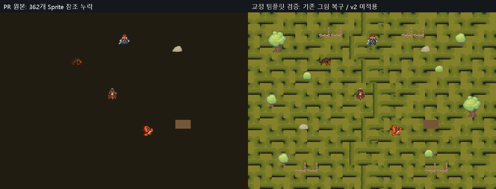

# PR #7 정식 Field04 Sprite 등록 교정안

**PROJECT_OWNED_FIX_CANDIDATE / 원본·PR 적용0 / PR #7 BLOCKED.** 브랜치 `codex/pr7-importer-fix-proposal-20261013`, 기준 통합 SHA `3aca58a468e88457026a0bb5e0ea1e5d3e51ec42`. 원본 main·사용자 미커밋·현재 PR와 canonical ThirdParty 파일은 바꾸지 않았습니다. 별도 수정 worktree에만 기존 PNG7개와 새meta를 _Project에 복사하고 Field04의362 Sprite GUID 참조를 교정한 실제 수정 후보를 준비했습니다.

## 문제와 입력 계약

새 통합 checkout에서 정식 Field04의363 Renderer 중362 Sprite가 null이어서 바닥·나무·수풀·울타리가 보이지 않습니다. Sprite GUID만 존재하는 것으로 검증을 끝내면 안 됩니다. Scene의 **GUID+local fileID**와 실제 importer의 Single/Multiple/slice ID/PPU를 맞춰야 합니다.

| 대상 기존Texture | 영향 Renderer | 교정 내용 |
|---|---:|---|
| tiles/tiles_grass.png |345(Grass315+Road30)|기존 Scene의5slice ID/명칭/Rect 등록, PPU128 |
| assets/tree_medium.png |3|기존21300000 Single/PPU128/Center |
| assets/tree_big.png |2|기존21300000 Single/PPU128/Center |
| assets/bush_01.png |2|기존21300000 Single/PPU128 |
| assets/bush_02.png |1|기존21300000 Single/PPU128 |
| assets/rock_01.png |1|기존21300000 Single/PPU128 |
| tiles/fence_tiles.png |8|기존1892116053 slice 등록/PPU128 |

공통 경로는 `Unity/Client/Assets/ThirdParty/Schwarnhild/BasicHandDrawn/`입니다. RockNorth/rock_02의1개 참조는 기존에도 유효하여 교정 대상에서 제외했습니다. 해당7 PNG와 meta는 main/통합 Git blob이 동일하고, 현재 정상 로컬 PNG도 같은 SHA입니다. 새 B/C 생산 코드가 PNG·Scene을 변경하여 만든 문제와 구분됩니다.

[7개 입력PNG/meta SHA·GUID·기존 참조 ID 목록](Evidence/PR7_Importer_Proposal_20261013/proposal_manifest.json). 각 `.meta.txt`는 사용자의 기존 정상 로컬 Importer를 읽어 만든 검토 템플릿이며, userData/키/음성 생성 정보를 담는 실행 파일이 아닙니다. GUID를 유지하고 새 그림을 만들지 않았습니다.

## 실제 격리 검증

- before:362 missing / after:0 missing, Renderer363개 그대로. [전](Evidence/PR7_Importer_Proposal_20261013/before/renderer_references.tsv), [후](Evidence/PR7_Importer_Proposal_20261013/after/renderer_references.tsv).
- 기존Road30은 남북 배열 그대로, SpriteRenderer Scale1, 환경Collider snapshot byte 동일, PNG/정식Scene 변경0. v2 PNG/동서30·42 후보 배치0.
- `Temp/IntegratedQA20261013/Client` 복사본에만7 meta를 시험하고 결과를 기록한 후 PR의 원래 설정으로 복원했습니다. 원본·수정안 worktree ThirdParty 파일 직접 변경0. 격리 actualUnity6000.6.5f1이며 정본6000.5.7f1 직접검증은 NOT_VERIFIED입니다.
- 기존 서쪽 Spawn 겹침·북쪽 경계틈은 해결하지 않았습니다. 이번 이미지는 기존 아트 등록 복구이며 v2 미술 승인 자료와 구분됩니다.

## 정식 교정 전에 필요한 선택

AGENTS §4의 **“ThirdParty 외부 에셋의 원본 파일은 직접 수정하지 않는다”**와 프로젝트용 수정본은 `_Project`에 복사하라는 규칙을 준수하여 canonical ThirdParty meta는 덮어쓰지 않았습니다.

1. **등록 metadata의 프로젝트 관리 예외를 명시 승인하는 방법:** 승인된7 meta 등록 계약만 별도 구현 브랜치에서 적용하고 PNG/GUID/Scene 좌표·Collider를 보존합니다. 해당GUID를 쓰는 Arbel/Field05/07~10 및 다른Prefab/Resources의 참조를 추가 검사해야 합니다.
2. **이번에 실제 준비한 수정 후보:** `Assets/_Project/Art/Environment/LegacySpriteRegistration20261013`에 기존 PNG7개를 byte-identical로 복사하고 새GUID/meta를 등록했습니다. Field04 Scene에서 기존7 GUID의362 참조만 새GUID로 바꿨으며 local fileID·좌표·Scale·Collider·Quest·Spawn·스크립트는 그대로입니다. [새 등록 manifest](Evidence/PR7_Importer_Proposal_20261013/project_owned_fix_manifest.json). v2 아트를 사용하거나 Scene 전체를 재생성하지 않았습니다. 이 후보도 현재 PR/main/사용자 원본에는 적용하지 않았습니다. 다른Scene에 대한 전역 이관은 하지 않았고, 그 영향은 후속 범위입니다.

사용자 검토 후 이 수정 후보를 별도PR로 통합 브랜치에 반영하고, 새 통합HEAD로 Compile·전체참조·영향Scene/Quest/Battle/Save를 재검증해야 합니다. 현재 PR #7을 Draft에서 해제하거나 main에 병합하지 않았습니다. 자동Push0입니다.

프로젝트용 실제 수정 후보도 새 격리 실행에서 누락0/363을 확인했고, Main12→13·실제Story/일반2 UI전투·몬스터35초·Continue2·물리경로·Camera·출구 회귀228검사 PASS/FAIL0였습니다. 기존Search예외로 Console종합PARTIAL이며 정본6000.5.7f1·다른Scene 전역이관·수동입력은 미검증입니다. [실제 수정 검증](Evidence/PR7_Importer_Proposal_20261013/project_owned_validation.json), [228회귀](Evidence/PR7_Importer_Proposal_20261013/ProjectOwned_Regression/checks.txt), [복구된 실제화면](Evidence/PR7_Importer_Proposal_20261013/ProjectOwned/native_field04.png). SourceScene의 GUID를 역치환하면 기존Scene 텍스트와 정확히 같음도 확인했습니다.
