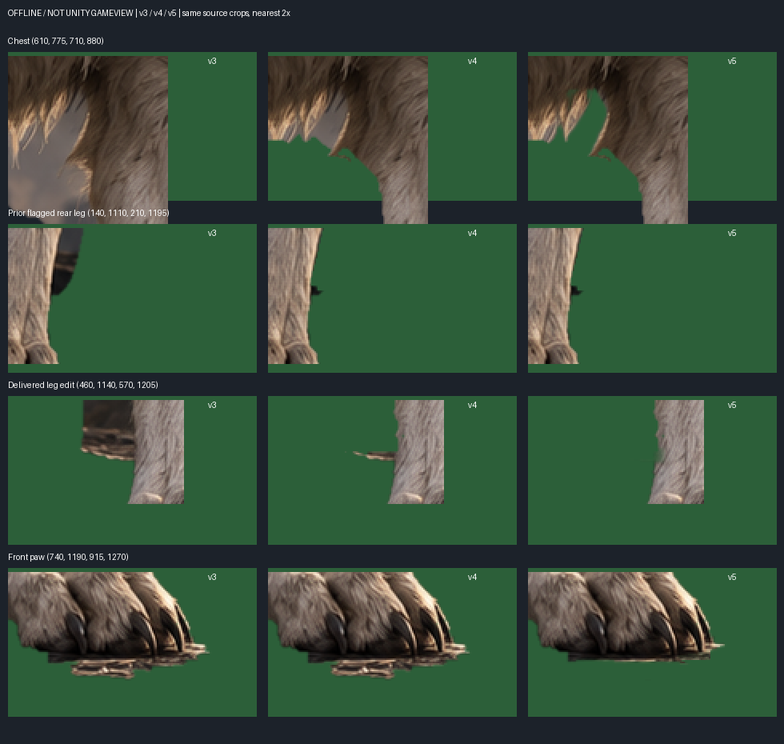
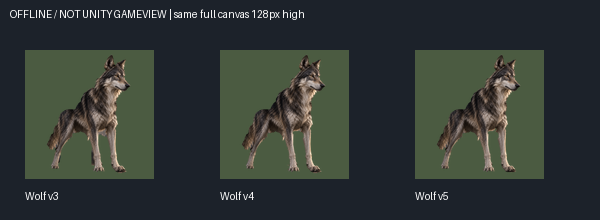
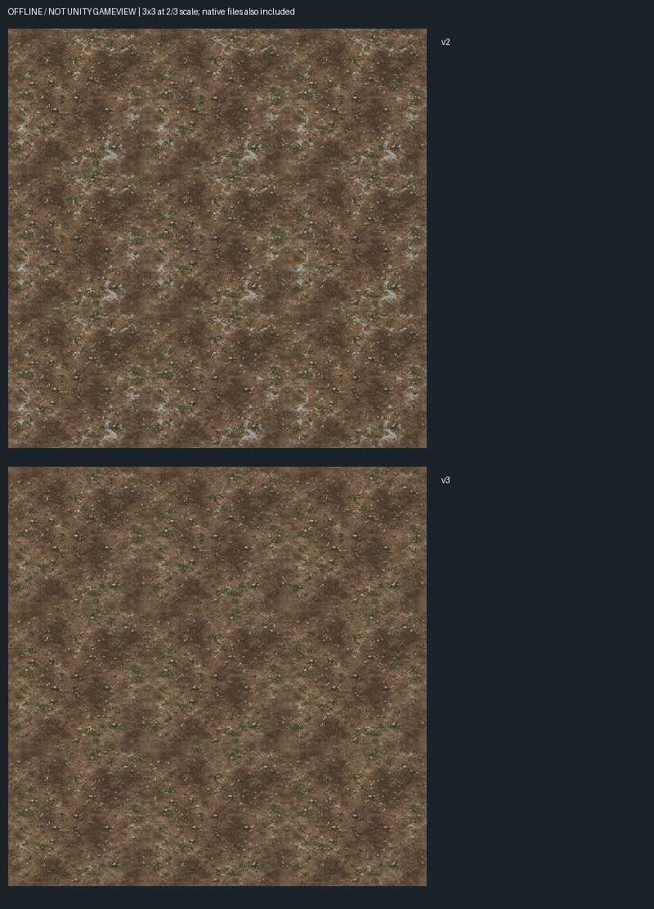
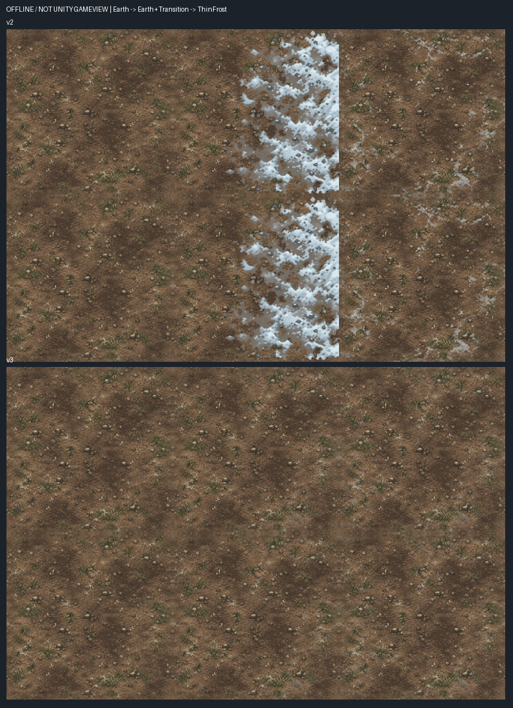
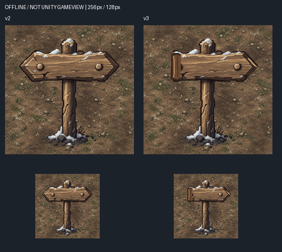

# Wolf v5 / NorthF1 v3 변경분 Delta QA — 2026-10-21

바울 대표 요청에 따른 새 납품 변경분 검수입니다. 기존 전체 QA는 재실행하지 않았습니다.

- 브랜치: `codex/art-review-wolfv5-northf1v3-delta-20261021`
- 기준 검수 commit: `2471b1f2e98413dfaf0a703fc63cfdd7c8688fb5`
- **Wolf: 기술 PASS / 미술 HOLD. F1: 기술 PASS / 6종 미술 PASS / 전체 묶음 PASS(오프라인 미술 권고).**
- 최종 사용자 미술 승인은 별도입니다. 승인 뒤에도 자동 적용하지 않습니다.
- 모든 비교는 **오프라인 합성 / Unity GameView 아님**. 실제 PPU·TileGrid·Collider·휠체어 통행·Main22 런타임은 이번 범위 밖입니다.

## 근거

[Issue #43 v5 납품](https://github.com/HappyPaul812/Project-Limitless/issues/43#issuecomment-6307233464), [Issue #30 v3 납품](https://github.com/HappyPaul812/Project-Limitless/issues/30#issuecomment-6307227680), 기획 `docs/planning/문서/00_프로젝트/20261021_Wolfv4_F1v2_QA_TargetedFix_Orders.md`, art-renewal v5 실제 납품 및 art-new v3 QA 정본을 확인했습니다.

기획 정본에 적힌 이전 검수 commit 중 `...a705...`는 실제 로컬 기준 `...a703...`와 다릅니다. 실제 브랜치/이전 보고서 commit을 기준으로 사용했습니다. 또한 납품서의 다리 수정 좌표와 기존 지적 좌표가 달라 아래에 분리 기록했습니다.

## ZIP 기술 결과

| 패키지 | SHA256 | 파일 수 | CRC / PNG decode |
|---|---|---:|---|
| Limitless_Wolf_KeyArt_v3_TargetedAlphaFix_v5.zip | `920459eb2ef4e160461b2b6425a9b183da633cd14411655a4d5affdbaf3d8bc7` | 13 | PASS / 9 PNG PASS |
| Limitless_Chapter3_NorthF1_Environment_6_TargetedFix_v3.zip | `488a65c051d1d017787771e0169124e47437b472911caa9949fdd59e55079054` | 20 | PASS / 17 PNG PASS |

Wolf 신규 아트는 1 PNG, 나머지는 비교 자료/Manifest/CSV입니다. F1은 Art 6 PNG, 비교/QA 11 PNG 등 총20파일이며 SHA256SUMS 19개 기록이 모두 일치합니다. Wolf Manifest의 v3/v4/v5 SHA도 실제 파일과 일치합니다. 비교 PNG는 게임용 자산 수에 포함하지 않았습니다.

## Wolf v5

- PNG: `Wolf_KeyArt_v3_AlphaFix_v5.png`, **952×1306 RGBA**, SHA256 `b770c73c36b9035a2bb0e70b8c126090b5fa248d27db542af077094d12ee2ea1`.
- v3 SHA `30b2d464fe2c456c0fa7d82f1fad51f64065b6e8379ea174548deec7d1b91b4e`, v4 SHA `62f72e97525f0266cbb6132da8b21571594f7c0deb3b1e1749cce749c9bf1c0a` 보존.
- v4→v5 RGB 변경 **0**, 알파 변경 **2,174픽셀 전부 감소**, 증가0. 제공 CSV 2,174행이 실제 모든 변경 좌표·전후 알파와 정확히 일치합니다. 과도한 재드로잉이 아닌 표적 보정입니다.
- 가슴 위 900픽셀: 큰 회색 삼각 배경 제거 확인. 털·발톱·자세·비율·색상과 128px 전체 인상은 유지됩니다. RGB 보존만으로 윤곽 보존을 단정하지 않고 실제 확대 비교도 확인했습니다.
- 납품자가 정리한 다리 영역 237픽셀은 **x475..549/y1158..1187**입니다. 이 수평 배경 조각은 제거됐습니다.
- 하지만 직전 검수에서 지적한 **뒷다리 옆 x150..194/y1125..1174의 검은 돌기**는 v4와 **전 픽셀 동일**하며 여전히 보입니다. 이 영역과 납품자의 다리 수정 영역은 다릅니다. 따라서 잔여3곳 모두 해결로 통과시킬 수 없습니다.
- 앞발 밑 1,037픽셀: 넓게 돌출된 바닥 조각은 제거됐습니다. 발톱 끝 주변 가는 테두리는 확대 자료에 남아 있으나 이번 HOLD의 명확한 원인은 위 뒷다리 검은 돌기입니다.
- **기술 PASS / 미술 HOLD. 최소 수정: 해당 뒷다리 검은 돌기의 배경 알파만 정리하고 실제 털/발 윤곽은 보존.** 다른 부분 재제작 불필요.

## NorthF1 v3

| 항목 / 실제 PNG | 기술 | 미술 | 변경분 근거 |
|---|---|---|---|
| 흙 / NorthF1_Ground_Earth_Base_v2.png | PASS | PASS 유지 | v2와 동일 SHA/바이트, 픽셀 변경0 |
| 흙길 / NorthF1_Path_WornTrail_Overlay_v2.png | PASS | PASS 유지 | 동일 SHA/바이트, 변경0; 시각 판정만 계승 |
| 관목 / NorthF1_Prop_FrostShrub_01_v2.png | PASS | PASS 유지 | 동일 SHA/바이트, 변경0 |
| 얇은 서리 / NorthF1_Ground_ThinFrost_Base_v3.png | PASS | PASS | 14,807픽셀 변경. 밝은 고리/대각 무늬의 반복 시선 집중 감소, 흙 우세 유지, 2×2/3×3에서 에지 끊김 없음 |
| 전환부 / NorthF1_EarthToFrost_Transition_Overlay_v3.png | PASS | PASS | 흙→흙+전환→얇은 서리 연결에서 v2의 흰 띠 절단 해소. 1방향 경사 유지, 검은 덧판 없음 |
| 표지판 / NorthF1_Prop_Waymarker_01_v3.png | PASS | PASS | 2,016픽셀 변경. 왼쪽 평평한 꼬리와 오른쪽 화살촉 구분이256/128px에서 명확, 목적지/텍스트 추가 없음 |

**F1 전체 묶음: PASS(오프라인 미술 검수). 남은 HOLD/FAIL PNG 없음.** 기본 오른쪽 방향은 그림 방향이며 Main22 목적지나 월드 이동 방향 확정이 아닙니다. 기존 흙길의 실제 휠체어 통행폭은 검증하지 않았습니다.

6종 모두256×256 RGBA 디코딩 PASS. KEEP 3종은 기존 PASS 결과와 동일성만 확인했습니다. 전환부는 투명 픽셀의 RGB까지 포함해65,536픽셀이 변경됐지만 수정 대상 PNG 안의 변경이며 KEEP 범위 침범은 없습니다.

얇은 서리 v3 좌우/상하 RGBA 에지 최대차0. 흙→합성전환 / 합성전환→서리 인접 에지 최대차는 v2 `0 / 186`, v3 **`0 / 0`**입니다. 이는 지정된1방향 조합에 한정합니다. 단일 타일을 복제한 지형 고유 반복은 남지만 이전의 밝은 서리 모티프가 두드러지는 문제는 완화됐습니다. 별도 다방향/코너 타일 요구를 추가하지 않았습니다.

서리 RGB 색차>28 참고 지표는 독립 계산에서 v2 **4,360** → v3 **1,569**픽셀입니다. 납품 기록4,358과2픽셀 차이가 있어 수치를 그대로 복사하지 않았습니다(계산 형변환/임계 처리 차이는 미확정). 이는 적설 비율이나 미술 승인 자체를 뜻하지 않습니다.

원본 해상도 [v2 2×2](Evidence/WolfV5F1V3Delta_20261021/ThinFrost_v2_2x2.png), [v3 2×2](Evidence/WolfV5F1V3Delta_20261021/ThinFrost_v3_2x2.png), [v2 3×3](Evidence/WolfV5F1V3Delta_20261021/ThinFrost_v2_3x3.png), [v3 3×3](Evidence/WolfV5F1V3Delta_20261021/ThinFrost_v3_3x3.png).

### Art PNG 전체 SHA256

| PNG | SHA256 |
|---|---|
| NorthF1_EarthToFrost_Transition_Overlay_v3.png | `93126dd1cda0f3b97823ae4756344600ed7f6af619eb42013d1ec45a4933c4d1` |
| NorthF1_Ground_Earth_Base_v2.png | `ccf2c22e90bee292ecf2d0d030dad53e0032457272ebb94fccdf6491fabcf8b9` |
| NorthF1_Ground_ThinFrost_Base_v3.png | `12fe03d156944e1b72aec4e807770ee8016c61fe1de5804366819e716b97c30c` |
| NorthF1_Path_WornTrail_Overlay_v2.png | `e78b41d48707dfce6a79dd4e826f864c5c2608b45a0f457af414ee9768a20175` |
| NorthF1_Prop_FrostShrub_01_v2.png | `6c83c88881e7f89245ed580d50424b2671629ad9491da93f247aab99bfe4746e` |
| NorthF1_Prop_Waymarker_01_v3.png | `6e55b64dbc2e906a50cf8b7310849bb156a90bc40436f28a86832e59e232b589` |

## 원본 보호 / 검증 경계

- 원본 Assets/UserData/ProjectSettings/Packages 총4,351파일의 SHA 목록 전후 동일. root git status와 HEAD 전후 동일. Save/UserData 및 사용자 수동 아트 보존.
- v3/v4 Wolf, 이전 F1 v2, 전달 ZIP 무수정. 자료는 별도 Temp에 추출했고 검수 worktree에는 문서·파생 비교 이미지·수치만 기록했습니다.
- 원본 Editor는 Bootstrap, Play OFF, 포커스 없음, 컴파일 중 아님. MCP 읽기 전용 상태 조회만 사용했고 창/Scene 선택·Import·Play·Refresh를 실행하지 않았습니다.
- Wolf Run/Bear/Fox, 신규 아트 제작, Unity 정식 적용, Main22/Scene/Quest 변경 **미실행**.
- **main 직접 커밋 / Push / 병합 모두 미실행.** 검수 브랜치 로컬 커밋만 수행합니다.
- 추가 최소 수정은 Wolf 뒷다리 검은 돌기 알파 한 곳입니다. F1은 추가 제작 요청 없이 바울 대표 최종 미술 승인 대기입니다.

독립 수치: [Validation.json](Evidence/WolfV5F1V3Delta_20261021/Validation.json), [보호 결과](Evidence/WolfV5F1V3Delta_20261021/Protection.json), [좌표 CSV](Evidence/WolfV5F1V3Delta_20261021/Delivered_Alpha_Changes.csv). 최종 commit SHA는 완료 보고 및 인계에 기록합니다.
